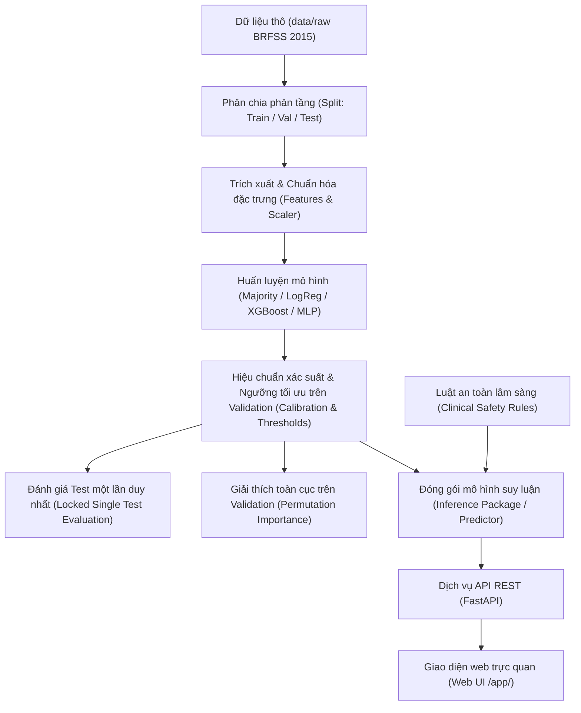

# Kiến trúc hệ thống Diabetes AI Lab

> **Miễn trừ trách nhiệm:** Hệ thống này được xây dựng **chỉ để học tập, nghiên cứu và thử nghiệm công nghệ; không phải chẩn đoán y khoa**. Kết quả do mô hình cung cấp không thể thay thế cho ý kiến chuyên môn của bác sĩ hoặc các xét nghiệm y tế xác nhận chính thức.

---

## 1. Sơ đồ luồng dữ liệu và thực thi

Hệ thống tuân thủ chặt chẽ nguyên tắc chia tách dữ liệu, hiệu chuẩn độc lập và khóa kiểm thử một lần duy nhất.

---

## 2. Bảng phân công module và trách nhiệm

### 2.1. Mã nguồn lõi (`src/diabetes_ai`)

| Module | Đường dẫn | Trách nhiệm chính |
|---|---|---|
| **Data** | `src/diabetes_ai/data` | Nạp dữ liệu BRFSS, kiểm tra checksum SHA-256, chuẩn hóa schema, xử lý biến đổi nhị phân, phân chia train/val/test phân tầng (`stratified_split`), lọc trùng lặp (`dedup`). |
| **Features** | `src/diabetes_ai/features` | Danh mục 21 đặc trưng lâm sàng và nhân khẩu học, chuẩn hóa số học `StandardScaler`, mã hóa dữ liệu đầu vào. |
| **Models** | `src/diabetes_ai/models` | Khởi tạo và huấn luyện 4 họ mô hình: Baseline tần suất đa số (`Majority`), Hồi quy Logistic (`LogisticRegression`), Cây quyết định tăng cường (`XGBoost`), và Mạng nơ-ron đa tầng PyTorch (`MLP` 3 lớp với Dropout/BatchNorm). |
| **Evaluation** | `src/diabetes_ai/evaluation` | Tính toán chỉ số đánh giá (ROC-AUC, PR-AUC, Macro-F1, Brier Score, ECE), tính khoảng tin cậy Bootstrap 95%, hiệu chuẩn nhiệt độ và hồi quy đẳng trương, phân tích công bằng theo nhóm, vẽ biểu đồ và khóa kiểm thử `test_lock`. |
| **Explain** | `src/diabetes_ai/explain` | Tính toán độ quan trọng đặc trưng bằng phương pháp hoán vị (Permutation Feature Importance) trên tập validation, trích xuất top đặc trưng ảnh hưởng lớn nhất. |
| **Safety** | `src/diabetes_ai/safety` | Hệ thống luật an toàn lâm sàng chốt chặn (cờ đỏ triệu chứng, BMI cực đoan >= 45 kết hợp tăng huyết áp/cholesterol); ưu tiên ghi đè mô hình khi phát hiện rủi ro nghiêm trọng. |
| **Inference** | `src/diabetes_ai/inference` | Đóng gói bộ dự đoán suy luận `Predictor`: kết hợp nạp trọng số mô hình, tiền xử lý dữ liệu, hiệu chuẩn xác suất, áp dụng luật an toàn và xuất mức cảnh báo nguy cơ. |
| **Serving** | `src/diabetes_ai/serving` | Dịch vụ web FastAPI (`app.py`, `routes.py`, `deps.py`), cung cấp REST API endpoint `/predict`, `/explain/global`, `/health`, và phục vụ giao diện tĩnh `/app/`. |

### 2.2. Kịch bản thực thi (`scripts/`)

| Kịch bản | Trách nhiệm |
|---|---|
| `prepare_data.py` | Kiểm tra tính toàn vẹn dữ liệu gốc, tiền xử lý, tạo các tập phân chia và lưu trữ `indices.npz`. |
| `train.py` | Huấn luyện mô hình theo tệp cấu hình YAML (hỗ trợ đa lớp, nhị phân, khử trùng lặp). |
| `calibrate_and_threshold.py` | Tìm ngưỡng tối ưu Macro-F1 và thực hiện hiệu chuẩn xác suất trên tập validation (out-of-fold). |
| `evaluate.py` | Đánh giá toàn diện trên validation hoặc kiểm thử test (áp dụng cơ chế khóa kiểm thử một lần duy nhất). |
| `explain_global.py` | Tính toán mức độ quan trọng đặc trưng toàn cục trên tập validation và xuất biểu đồ tương quan. |
| `export_model.py` | Đóng gói mô hình phục vụ tốt nhất kèm trọng số, scaler, ngưỡng hậu xử lý và mã băm SHA-256. |
| `make_reports.py` | Tự động đọc số liệu thực nghiệm điền vào các mẫu báo cáo chuẩn (`model_card.md`, `fairness_report.md`, `final_report.md`). |
| `run_all.sh` | Kịch bản tự động hóa toàn bộ quy trình từ chuẩn bị dữ liệu đến đánh giá và xuất báo cáo. |

---

## 3. Quy ước đặt tên thực nghiệm (Run Naming Convention)

Mỗi lần huấn luyện và đánh giá được định danh duy nhất theo cú pháp:
$$\text{run\_name} = \langle\text{model}\rangle\_\langle\text{task}\rangle\_\langle\text{dataset}\rangle$$

1. **Thành phần `<model>`:**
   - `majority`: Mô hình baseline đoán lớp phổ biến nhất.
   - `logreg`: Mô hình Hồi quy Logistic chuẩn hóa L2.
   - `xgb`: Mô hình Gradient Boosted Trees (XGBoost).
   - `mlp`: Mô hình Mạng nơ-ron đa tầng PyTorch (Multi-Layer Perceptron).
2. **Thành phần `<task>`:**
   - `multiclass`: Bài toán phân loại 3 lớp (0: Không mắc bệnh, 1: Tiền tiểu đường, 2: Đái tháo đường).
   - `binary`: Bài toán phân loại 2 lớp (0: Không mắc / Tiền tiểu đường, 1: Đái tháo đường).
3. **Thành phần `<dataset>`:**
   - `full`: Toàn bộ tập dữ liệu BRFSS 2015 (253.680 bản ghi).
   - `dedup`: Tập dữ liệu đã khử bỏ 24.206 dòng trùng lặp hoàn toàn (còn lại 229.474 bản ghi).

**Danh sách các run tiêu chuẩn:**
- Bộ phân loại đa lớp đầy đủ: `majority_multiclass_full`, `logreg_multiclass_full`, `xgb_multiclass_full`, `mlp_multiclass_full`.
- Bộ phân loại nhị phân đối chứng: `majority_binary_full`, `logreg_binary_full`, `xgb_binary_full`, `mlp_binary_full`.
- Bộ phân loại đa lớp khử trùng lặp: `majority_multiclass_dedup`, `logreg_multiclass_dedup`, `xgb_multiclass_dedup`, `mlp_multiclass_dedup`.

---

## 4. Quy ước khóa kiểm thử tập Test (Test Set Lock Protocol)

Để ngăn chặn tuyệt đối hiện tượng rò rỉ thông tin và tối ưu hóa quá mức trên tập kiểm thử (overfitting / p-hacking), hệ thống áp dụng cơ chế khóa tự động:

1. **Tệp lưu trữ trạng thái khóa:** `reports/metrics/test_lock.json`.
2. **Quy tắc kích hoạt một lần duy nhất:**
   - Mọi siêu tham số, epoch dừng sớm, phương pháp hiệu chuẩn và ngưỡng quyết định phân lớp bắt buộc phải hoàn thành và chốt trên tập **validation**.
   - Khi chạy lệnh `python scripts/evaluate.py --split test`, hàm `acquire_test_lock` sẽ kiểm tra tệp khóa:
     - Nếu chưa từng chạy test: Thực hiện tính toán mã băm SHA-256 của toàn bộ tệp trọng số mô hình (`model.*`), bộ chuẩn hóa (`scaler.json`), và cấu hình hậu xử lý (`postproc_*.json`). Sau khi ghi nhận kết quả thành công, một bản ghi nhật ký kiểm thử (`evaluations`) được lưu lại.
     - Nếu đã từng được đánh giá: Lệnh bị từ chối ngay lập tức, hiển thị thông báo bằng tiếng Việt và thoát với mã lỗi `sys.exit(2)`.
3. **Ngoại lệ phát lại tái lập (Replay Reproducibility):**
   - Chỉ khi thực hiện kiểm tra độ tái lập toàn diện qua `scripts/run_all.sh --clean --replay-test`, cờ `--force-reeval --reason "run_all replay"` mới được phép sử dụng.
   - Lần chạy cưỡng bức này sẽ được lưu rõ ràng vào `test_lock.json` với thuộc tính `"forced": true` và lý do thực hiện cụ thể.
