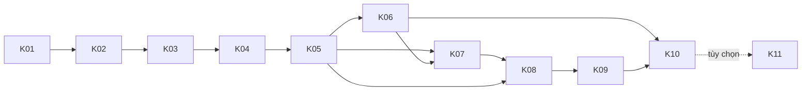

# Kế hoạch triển khai — Diabetes AI Lab (`docs/plan.md`)

> Tài liệu giao việc cho agent thực thi (Google Antigravity). Mỗi khối tự đủ thông tin; agent không cần nhớ cuộc trò chuyện nào khác. Dự án chỉ phục vụ học tập, không phải công cụ chẩn đoán y khoa.

## 1. Tóm tắt dự án và nguyên tắc chung

- **Mục tiêu:** huấn luyện, đánh giá nghiêm ngặt và đóng gói AI sàng lọc **nguy cơ** đái tháo đường từ 21 chỉ số khảo sát BRFSS 2015 (Logistic Regression, XGBoost, MLP PyTorch), kèm hiệu chuẩn xác suất, kiểm tra công bằng, giải thích, luật an toàn, API và demo web.
- **Hiện trạng:** repo dựng bằng `setup_repo.sh` (phần lớn là stub chỉ có docstring); đã xong A.1–A.3 (cấu trúc, cài môi trường, CSV nằm ở `data/raw/brfss2015/`); `pytest` hiện đạt 2 test. **Bắt đầu từ K01.**
- **Phạm vi:** 10 khối bắt buộc K01–K10 + 1 khối tùy chọn K11 (chỉ làm sau khi K10 đạt).
- **Khởi động mỗi phiên (Git Bash).** Đường dẫn có dấu tiếng Việt và khoảng trắng nên luôn đặt trong dấu nháy:
```bash
cd "/f/PT các HTTM/AITRAINING/diabetes-ai-lab" && source .venv/Scripts/activate
export PYTHONUTF8=1 PYTHONIOENCODING=utf-8
```
- **Quy ước mã:** `pathlib`, mở file luôn `encoding="utf-8"`, `json.dump(..., ensure_ascii=False, indent=2)`, type hint đầy đủ, thông báo lỗi bằng tiếng Việt nêu rõ cột/giá trị gây lỗi, matplotlib dùng backend `Agg`.
- **Quy ước cấu hình:** siêu tham số chỉ đọc từ `configs/*.yaml`; seed mặc định 42 qua `seed.py`; không viết cứng số trong code.
- **Tên run:** `<tên-mô-hình>_<task>_<variant>` (ví dụ `xgb_multiclass_full`); thư mục `models/<run>/` (git bỏ qua); số liệu `reports/metrics/*.json` (được commit).
- **Giao thức đánh giá:** chọn epoch, ngưỡng, phương pháp hiệu chuẩn và mô hình chỉ dựa trên **validation**; test chỉ được nạp bởi `scripts/evaluate.py` (có khóa `test_lock.json`); accuracy luôn đi kèm accuracy của baseline "luôn đoán không".
- **Commit:** Conventional Commits (`feat|fix|test|docs|chore(<scope>): ...`); mỗi bước con một commit trung gian, mỗi khối một commit tổng kết.
- **Bước con xong khi:** lệnh kiểm chứng của bước đó cho đúng kết quả mong đợi **và** đã commit. **Khối xong khi:** mọi tiêu chí định lượng của khối đạt, `python -m pytest -q` đúng số test nêu, `git status --short` rỗng.
- **Khi một bước thất bại:** dừng, báo lỗi và số liệu đo được; **không** tự sửa dữ liệu, tiêu chí hay dùng test để chỉnh tham số.
- **Trung thực số liệu:** mọi con số kết quả do máy đo; số lấy từ `234.pdf` chỉ là mốc sanity (±0,02 AUC), không phải mục tiêu.
- **An toàn:** mọi kết quả hiển thị cho người dùng (API, web, báo cáo) phải kèm miễn trừ trách nhiệm và khuyên xét nghiệm xác nhận; có test tự động kiểm tra ở K08, K09, K10.

## 2. Kết quả kiểm tra đầu vào

Số liệu dưới đây do người lập kế hoạch **chạy pandas/scikit-learn trên đúng file CSV được cung cấp**. Môi trường của người dùng (phiên bản Python, `torch`, `xgboost`, `shap`) **chưa kiểm chứng**; việc kiểm chứng là bước đầu tiên của K01.

### 2.1 Dữ liệu `diabetes_012_health_indicators_BRFSS2015.csv`

| Hạng mục | Giá trị đo được |
|---|---|
| Kích thước file / sha256 | 22.738.151 byte; `a971809d0786d2d7d7f6070f83dfe8af9d860ea33a79e0e2701c8a49f78f9861` |
| Số dòng dữ liệu / số cột | 253.680 / 22 (1 nhãn `Diabetes_012` + 21 đặc trưng); thứ tự cột **trùng** `FEATURES` trong `schema.py` |
| Kiểu dữ liệu | cả 22 cột là `float64`, mọi giá trị đều là số nguyên |
| Ô thiếu | 0 |
| Dòng trùng lặp (bản sao thừa) | 23.899 (9,42%); còn 229.781 dòng duy nhất |
| Bản sao thừa theo nhãn | lớp 0: 23.648; lớp 1: 2; lớp 2: 249 |
| Nhãn (gốc) | 0: 213.703 (84,241%); 1: 4.631 (1,826%); 2: 35.346 (13,933%) |
| Nhãn sau khử trùng | 0: 190.055 (82,71%); 1: 4.629 (2,01%); 2: 35.097 (15,27%) |
| Vector 21 đặc trưng khác nhau | 227.908; 12.228 vector xuất hiện nhiều hơn một lần (nhiều nhất 59 lần) |
| Vector đặc trưng trùng nhưng **khác nhãn** | 1.834 vector, gồm 6.120 dòng (nhiễu nhãn nội tại; không xóa) |
| 14 cột nhị phân | chỉ có {0,1}: HighBP, HighChol, CholCheck, Smoker, Stroke, HeartDiseaseorAttack, PhysActivity, Fruits, Veggies, HvyAlcoholConsump, AnyHealthcare, NoDocbcCost, DiffWalk, Sex |
| BMI | 12–98 (84 giá trị); p1=18, trung vị=27, p99=50; >50: 2.175 dòng; >60: 805; >70: 584; >80: 279; <15: 68 |
| MentHlth, PhysHlth | 0–30 (31 giá trị mỗi cột) |
| GenHlth / Age / Education / Income | 1–5 / 1–13 / 1–6 / 1–8; `Education=1` chỉ có 174 dòng |
| Sex | 0: 141.974; 1: 111.706 |
| Bộ nhớ khi nạp bằng pandas | khoảng 44,6 MB |

### 2.2 Kích thước các tập sẽ chia (seed 42, phân tầng theo nhãn 3 lớp)

Công thức: `test = ceil(0,20 × N)`; phần còn lại chia tiếp `val = ceil(0,15 × phần còn lại)`; còn lại là train. Với bản đầy đủ, kết quả **khớp** `234.pdf` (50.736 test; 30.442 validation).

| Biến thể | Tổng | Train | Validation | Test | Lớp 0 / 1 / 2 ở train | Tỉ lệ lớp 2 (train / val / test) |
|---|---|---|---|---|---|---|
| `full` (giữ trùng, **chính**) | 253.680 | 172.502 | 30.442 | 50.736 | 145.317 / 3.149 / 24.036 | 13,934% / 13,931% / 13,933% |
| `dedup` (đối chứng) | 229.781 | 156.250 | 27.574 | 45.957 | 129.236 / 3.148 / 23.866 | 15,274% / 15,275% / 15,273% |

Chi tiết khác của biến thể `full`: validation lớp 0/1/2 = 25.645 / 556 / 4.241; test = 42.741 / 926 / 7.069. Bài toán nhị phân (tiền tiểu đường + tiểu đường = 1): 27.185 / 4.797 / 7.995 mẫu dương (15,76%) ở train / val / test. Baseline "luôn đoán không": accuracy 0,84242 trên cả validation lẫn test. Trọng số lớp (mũ 0,75, công thức `(N/(K·n_c))^0,75`) trên train `full`: `[0,4989; 8,8333; 1,9236]`.

**Rò rỉ do trùng lặp (biến thể `full`)**: 3.856 dòng validation (12,67%) và 6.469 dòng test (12,75%) có vector 21 đặc trưng **giống hệt** một dòng ở train (test: 6.102 lớp 0, 48 lớp 1, 319 lớp 2).

Cỡ nhóm công bằng trên test `full` (số mẫu tiền tiểu đường / tiểu đường): tuổi 18–34: 32 / 101; 35–44: 57 / 339; 45–54: 154 / 963; 55–64: 242 / 1.993; 65–74: 257 / 2.370; 75+: 184 / 1.303. Thu nhập <25k: 308 / 2.619; 25–50k: 268 / 1.915; ≥50k: 350 / 2.535. Giới nữ: 521 / 3.668; nam: 405 / 3.401.

### 2.3 Khảo sát sơ bộ khi lập kế hoạch (KHÔNG phải kết quả báo cáo)

Chạy trên validation `full` với scikit-learn 1.9.1, xgboost 3.4.1 (máy của người lập kế hoạch); chỉ dùng để đặt dải chấp nhận hợp lý. Agent thực thi phải tự đo lại.

| Mô hình | AUC OvR macro (val) | AUC từng lớp 0 / 1 / 2 | Ghi chú |
|---|---|---|---|
| Logistic Regression (`balanced`) | 0,7722 | 0,8133 / 0,6857 / 0,8175 | macro-F1 (argmax) 0,4237 |
| XGBoost (400 cây, depth 5, lr 0,05, trọng số mũ 0,75, chưa early stopping) | 0,7750 | 0,8226 / 0,6760 / 0,8265 | macro-F1 (argmax) 0,4539; train 20,1 giây; ECE lớp tiểu đường (10 bin, chưa hiệu chuẩn) 0,1063 |
| Nhị phân: LR / XGBoost | 0,8144 / 0,8233 | — | AUC của lớp dương |

### 2.4 Điểm cần thận trọng rút ra từ `234.pdf`

1. Accuracy 75,2% **thấp hơn** baseline luôn đoán "không" (84,2%): không dùng accuracy làm thước đo chính; luôn in kèm baseline.
2. Nhóm tiền tiểu đường gần như không phân biệt được (recall 17%, precision 4,0%, AUC từng lớp 0,697): báo cáo trung thực, thêm biến thể nhị phân, không hứa hẹn nhãn lớp 1.
3. MLP chỉ hơn Logistic Regression khoảng 0,009 AUC: không coi MLP là tốt nhất theo mặc định; chọn mô hình bằng quy tắc có biên đơn giản (K05).
4. Xác suất hiển thị là xác suất gốc của mô hình đã huấn luyện bằng trọng số lớp nên bị thổi phồng (Hình 30 của PDF nêu ECE khoảng 14,3% ở biểu đồ nhóm tiền tiểu đường): kế hoạch thêm bước **hiệu chuẩn** và hiển thị xác suất đã hiệu chuẩn (K05).
5. Cảnh báo "nguy cơ cao" (chỉ số ≥ 0,25) báo 54,4% người, chỉ 23,7% trong số đó thật sự tiểu đường, 47,5% người không bệnh bị báo nhầm: kế hoạch đo lại tỉ lệ cảnh báo, PPV, lift trên xác suất đã hiệu chuẩn (K06).
6. Chênh lệch recall tiểu đường theo nhóm tuổi 49,2 điểm %, thu nhập 24,9, giới 3,5: kế hoạch đo lại kèm khoảng Wilson 95%, tỉ lệ nền của từng nhóm và cờ "mẫu nhỏ" (K06).
7. PDF không nói gì về 9,42% dòng trùng lặp: kế hoạch đo rò rỉ (12,75% test có "bản sinh đôi" ở train), giữ `full` làm chính để so sánh được với PDF và thêm đối chứng `dedup` cùng chỉ số trên tập test "không có bản sinh đôi".
8. Mô hình không nhận đường huyết làm đầu vào nên bỏ sót người có đường huyết cao: luật an toàn chỉ chạy khi có dữ liệu tương ứng; critic ở K11 (tùy chọn).
9. Trọng số cộng điểm Graph-RAG được chọn trên chính bộ 16 câu; RAG, RL và Qwen **ngoài phạm vi** bắt buộc của kế hoạch này.
10. Mọi giải thích (tác động yếu tố, what-if) chỉ là tương quan từ khảo sát Hoa Kỳ 2015, không phải nhân quả.

### 2.5 Điểm cần chú ý trong `setup_repo.sh`

- `tests/test_api_health.py` yêu cầu `/health` trả **đúng** `{"status": "ok"}`: không thêm trường mới vào `/health` (trạng thái mô hình đặt ở `/model-info`).
- `.gitignore` bỏ qua `*.npz`, `*.joblib`, `*.pt`, `models/*`, `data/raw|interim|processed|external/**`: chỉ số chia lưu bằng `indices.npz` (tự bị bỏ qua), còn `manifest.json` (có sha256) được commit.
- `Makefile` cần `make`, thường **không có** trong Git Bash: đường chạy chính là `bash scripts/run_all.sh`.
- `pyproject.toml` chưa có `pythonpath = ["src"]` (đang dựa vào `pip install -e .`): K01 thêm làm phương án dự phòng.
- `.gitattributes` có `* text=auto` nên file `.sh` có thể thành CRLF khi checkout trên Windows: K10 thêm `*.sh text eol=lf`.
- `Dockerfile`, `docker-compose.yml`, `.github/*`, `.pre-commit-config.yaml`: ngoài phạm vi, không sửa (xem Phụ lục A).

## 3. Các giả định

1. **A1.** Python của người dùng có thể là 3.14; K01 kiểm tra thật và áp dụng nhánh quyết định (cài wheel CPU → `py -3.12 -m venv` → phương án dự phòng).
2. **A2.** `val_size = 0,15` hiểu là 15% của phần còn lại sau khi tách test (30.442 dòng), đúng như `234.pdf`; `test_size = 0,2`; `seed = 42`; luôn phân tầng theo nhãn 3 lớp (cả bài toán nhị phân dùng chung các dòng này để so sánh trực tiếp).
3. **A3.** Biến thể `full` (giữ dòng trùng) là **chính** vì các dòng trùng là những người trả lời khác nhau có hồ sơ giống nhau (khử trùng làm lệch tỉ lệ bệnh nền 13,9% → 15,3% và làm xác suất hiệu chuẩn sai); biến thể `dedup` (xóa bản sao thừa của cả hàng gồm nhãn, giữ lần xuất hiện đầu tiên) là **đối chứng**.
4. **A4.** Không cắt BMI, không xóa outlier (805 dòng BMI > 60 giữ nguyên); mọi mô hình nhận 21 cột đã chuẩn hóa z-score fit trên train.
5. **A5.** Xử lý mất cân bằng bằng trọng số lớp mũ 0,75 (XGBoost, MLP); Logistic Regression dùng `class_weight="balanced"` như cấu hình có sẵn và như PDF.
6. **A6.** Chọn mô hình bằng AUC OvR macro trên validation (xác suất gốc); nếu mô hình phức tạp hơn không vượt Logistic Regression ít nhất 0,003 thì chọn Logistic Regression; thứ tự ưu tiên khi hòa: `logreg` → `xgb` → `mlp`.
7. **A7.** Xác suất hiển thị là xác suất **đã hiệu chuẩn** (fit trên validation); hệ số điều chỉnh ngưỡng chỉ ảnh hưởng nhãn dự đoán; chỉ số nguy cơ = P(tiểu đường) + 0,5·P(tiền tiểu đường), ngưỡng 0,10 / 0,25 lấy từ `configs/serve.yaml` (không đổi).
8. **A8.** Nhóm công bằng: tuổi gộp 6 nhóm (mã 1–3, 4–5, 6–7, 8–9, 10–11, 12–13), thu nhập gộp 3 nhóm (1–4, 5–6, 7–8), giới 2 nhóm; nhóm có ít hơn 30 mẫu dương bị gắn cờ "mẫu nhỏ" và không tính vào chênh lệch tối đa.
9. **A9.** Bootstrap n = 1000, seed 42, phân tầng theo lớp; khoảng Wilson 95% cho các tỉ lệ theo nhóm.
10. **A10.** Test được đánh giá **một lần** qua `scripts/evaluate.py` (cho cả ba bộ run `multiclass_full`, `binary_full`, `multiclass_dedup`); gỡ lỗi script bằng `--split val`; chạy lại test chỉ khi dùng `--force-reeval --reason "..."` (ghi vào khóa); lần phát lại sạch ở K10 là ngoại lệ có ghi rõ.
11. **A11.** SHAP là tùy chọn (có thể không cài được); mặc định giải thích bằng "thay giá trị bằng trung bình dân số" như PDF.
12. **A12.** Không thêm thư viện mới: không dùng LightGBM/Optuna; nếu `xgboost` không cài được thì dùng `HistGradientBoostingClassifier` của scikit-learn (ghi `backend` vào metadata).
13. **A13.** Chỉ CPU; `num_workers=0` cho DataLoader (tránh lỗi đa tiến trình trên Windows); mỗi lần huấn luyện ≤ 10 phút; gỡ lỗi bằng `--max-train-rows`.
14. **A14.** Số test tích lũy nêu trong kế hoạch giả định `torch` đã cài và CSV có sẵn (các test dùng dữ liệu thật chạy, không bị bỏ qua).
15. **A15.** Mã hóa Age/Income/Education/GenHlth/Sex theo mô tả của bộ dữ liệu Kaggle "Diabetes Health Indicators"; **chưa đối chiếu** với codebook CDC gốc (ghi vào `docs/data_dictionary.md`).
16. **A16.** NHANES và Pima không dùng; notebook 00, 02–07 và các file hạ tầng Docker/CI bỏ qua (xem Phụ lục A).
17. **A17.** Ngày giờ trong nhật ký lấy từ máy chạy (định dạng `YYYY-MM-DD`).

## 4. Bảng tổng quan các khối

| ID | Tên | Cỡ | Số file | Bắt buộc / Tùy chọn | Phụ thuộc | Tiêu chí hoàn thành ngắn |
|---|---|---|---|---|---|---|
| K01 | Môi trường, đọc/kiểm tra dữ liệu, tiền xử lý, chia tập, test chống rò rỉ | L | 15 | Bắt buộc | — | `pytest` 18 passed; chia 172.502/30.442/50.736 và 156.250/27.574/45.957, giao nhau = 0 |
| K02 | EDA, đặc trưng/scaler, bộ đo chất lượng, từ điển dữ liệu | M | 10 | Bắt buộc | K01 | `pytest` 33 passed; notebook chạy hết; ≥ 6 hình EDA |
| K03 | Baseline (majority, Logistic Regression) và XGBoost | L | 12 | Bắt buộc | K02 | `pytest` 40 passed; AUC val LR trong [0,753; 0,793], XGB trong [0,762; 0,802] |
| K04 | MLP PyTorch (dataset, loss, callbacks, trainer) | L | 11 | Bắt buộc | K03 | `pytest` 48 passed; AUC val MLP trong [0,762; 0,802]; tái lập ≤ 1e-4 |
| K05 | Chọn ngưỡng, hiệu chuẩn, khoảng tin cậy, chọn mô hình | M | 9 | Bắt buộc | K03, K04 | `pytest` 60 passed; ECE macro (out-of-fold) ≤ 0,03 và thấp hơn trước hiệu chuẩn |
| K06 | Công bằng, đánh giá test một lần, biểu đồ, báo cáo số liệu | M | 9 | Bắt buộc | K05 | `pytest` 69 passed; `test_lock.json` có 1 lần; lần chạy thứ hai thoát mã 2 |
| K07 | Giải thích: hoán vị, SHAP (tùy chọn), what-if | M | 8 | Bắt buộc | K05 | `pytest` 77 passed; 21 mục độ quan trọng; what-if có kịch bản giảm nguy cơ |
| K08 | Luật an toàn, mức nguy cơ, suy luận, xuất mô hình | L | 11 | Bắt buộc | K05, K07 | `pytest` 95 passed; `models/best_model.joblib` tạo được |
| K09 | API FastAPI và demo web | M | 9 | Bắt buộc | K08 | `pytest` 106 passed; smoke test API/web đạt |
| K10 | Tài liệu, báo cáo tự sinh, `run_all.sh`, chạy lại toàn pipeline | L | 13 | Bắt buộc | K01–K09 | `pytest` 110 passed; `run_all.sh --clean --replay-test` exit 0 |
| K11 | Critic, CV, tuning, knowledge, agents | L | 15 | **Tùy chọn** | K10 | `pytest` 125 passed; không làm thay đổi kết quả K01–K10 |

## 5. Sơ đồ phụ thuộc



- **Đường găng:** K01 → K02 → K03 → K04 → K05 → K06 → K07 → K08 → K09 → K10 (xếp tuần tự, không chạy song song).
- K07 chỉ thật sự cần artifact của K05 (run đã hiệu chuẩn, `model_selection.json`) nhưng được xếp sau K06 để mọi khối dùng bảng chỉ số đã chốt.
- K11 không chặn đường găng; chỉ làm khi K10 đã đạt toàn bộ tiêu chí.

## 6. Chi tiết từng khối

> Quy ước chung cho mọi khối: lệnh viết cho Git Bash đã khởi động như mục 1; "stub" là file chỉ có docstring do `setup_repo.sh` tạo (ghi **SỬA**, nghĩa là thay bằng mã thật); mọi file mới trong `src/` đều giữ docstring tiếng Việt đầu file. Ước lượng dòng code tính cả test, không tính dòng trống/docstring/JSON notebook.

---

### K01 — Môi trường, đọc/kiểm tra dữ liệu, tiền xử lý, chia tập  [Cỡ: L, 15 file]  [Bắt buộc]

**Mục tiêu:** kiểm chứng môi trường thật (A.0), đọc và kiểm tra CSV (A.4), tiền xử lý và chia train/val/test phân tầng có đo rò rỉ do dòng trùng (A.5), viết test chống rò rỉ (A.6).
**Phụ thuộc:** không (khối đầu). Cần sẵn `.venv`, CSV ở `data/raw/brfss2015/`.
**Đọc trước khi làm:** `setup_repo.sh` (mục 3, 5, 11), `configs/data.yaml`, `configs/features.yaml`, `src/diabetes_ai/data/schema.py`, `pyproject.toml`, `tests/conftest.py`, `tests/test_schema.py`, `tests/test_api_health.py`, `docs/plan.md` mục 2–3.
**Ước lượng:** ~720 dòng code mới. **Số lệnh kiểm chứng:** 7.

**Tổng hợp file của khối:**

| STT | Đường dẫn | TẠO MỚI/SỬA | Bước con | Vai trò |
|---|---|---|---|---|
| 1 | `scripts/check_env.py` | TẠO MỚI | a | Kiểm tra môi trường, ghi `reports/metrics/env_check.json` (thay notebook 00) |
| 2 | `pyproject.toml` | SỬA | a | Thêm `pythonpath = ["src"]`, marker `real_data` |
| 3 | `src/diabetes_ai/paths.py` | SỬA | b | Hằng số đường dẫn |
| 4 | `src/diabetes_ai/config.py` | SỬA | b | Nạp YAML và `.env` |
| 5 | `src/diabetes_ai/seed.py` | SỬA | b | Đặt seed tái lập |
| 6 | `src/diabetes_ai/data/schema.py` | SỬA | b | Thêm miền giá trị, nhóm đặc trưng |
| 7 | `configs/data.yaml` | SỬA | b | Thêm khóa `dedup`, `splits_dir` |
| 8 | `src/diabetes_ai/data/load.py` | SỬA | c | Đọc CSV, ép kiểu, kiểm cột |
| 9 | `src/diabetes_ai/data/validate.py` | SỬA | c | Báo cáo thiếu/trùng/ngoài miền/nhãn |
| 10 | `tests/conftest.py` | SỬA | c | Fixture dữ liệu giả lập và đường dẫn CSV thật |
| 11 | `src/diabetes_ai/data/preprocess.py` | SỬA | d | Mã hóa nhãn, mặt nạ dòng trùng |
| 12 | `src/diabetes_ai/data/split.py` | SỬA | d | Chia phân tầng, manifest, đo bản sinh đôi |
| 13 | `scripts/prepare_data.py` | SỬA | d | Chạy validate + chia cả hai biến thể |
| 14 | `tests/test_preprocess.py` | SỬA | d | 8 test load/validate/preprocess |
| 15 | `tests/test_split_no_leakage.py` | SỬA | d | 8 test chống rò rỉ |

#### Bước con K01a — Kiểm tra môi trường thật (A.0)
**File:** `scripts/check_env.py`, `pyproject.toml`.
**Đặc tả code chi tiết:**
- `scripts/check_env.py` (chỉ dùng thư viện chuẩn + import thử; chạy được cả khi `diabetes_ai` chưa import được):
  - `_ver(pkg: str) -> str | None` dùng `importlib.metadata.version`; `_try_import(mod: str) -> tuple[bool, str]` trả (ok, thông điệp lỗi).
  - Danh sách lõi `CORE = [numpy, pandas, scikit-learn(sklearn), pyyaml(yaml), joblib, matplotlib, fastapi, pydantic, uvicorn, pytest, httpx]`; nặng `HEAVY = [torch, xgboost, shap]`.
  - Ghi nhận: `sys.version_info`, `platform.platform()`, có đang trong venv không (`sys.prefix != sys.base_prefix`), cảnh báo nếu Python ≥ 3.14, đường dẫn có khoảng trắng/ký tự không ASCII (chỉ thông tin).
  - Thử `import diabetes_ai` và in `diabetes_ai.__file__` (phải nằm dưới `src/`).
  - Smoke test: `torch` (`torch.__version__`, `torch.cuda.is_available()`, một phép `@` nhỏ); `xgboost` (fit 5 cây trên 200 dòng ngẫu nhiên); `shap` (chỉ import).
  - CSV: tìm `data/raw/brfss2015/diabetes_012_health_indicators_BRFSS2015.csv` từ `Path(__file__).resolve().parents[1]`; ghi kích thước, sha256 (đọc từng khối 1 MiB), số dòng dữ liệu (`sum(1 for _ in f) - 1`).
  - Ghi `reports/metrics/env_check.json` với khóa: `python, platform, in_venv, core_ok, torch_ok, xgboost_ok, shap_ok, cuda, csv{exists, bytes, sha256, n_rows}, recommended_actions[]`. Mã thoát 0 khi `core_ok` và `csv.exists`, ngược lại 1. **Không tự cài gói.**
- `pyproject.toml`: trong `[tool.pytest.ini_options]` thêm `pythonpath = ["src"]` và `markers = ["real_data: cần CSV thật trong data/raw/"]`; giữ nguyên `testpaths`, `addopts`.
**Nhánh quyết định sau khi chạy `check_env.py` (agent tự thực hiện, ghi kết quả vào commit):**
1. `core_ok=false` → `pip install -r requirements-dev.txt && pip install -e .`, chạy lại.
2. `torch_ok=false` → thử `pip install torch --index-url https://download.pytorch.org/whl/cpu`. Nếu vẫn lỗi (thường do Python 3.14 chưa có wheel) → chuyển sang Python 3.12:
```bash
deactivate 2>/dev/null; mv .venv ../diabetes-ai-lab-venv-cu   # để ngoài repo, tránh git add nhầm
py -3.12 -m venv .venv                                         # chưa có: winget install -e --id Python.Python.3.12
source .venv/Scripts/activate && python -m pip install -U pip
pip install -r requirements-dev.txt && pip install -e .
```
3. `xgboost_ok=false` → `pip install xgboost`; nếu vẫn lỗi, **tiếp tục** (K03 dùng `HistGradientBoostingClassifier`, ghi `backend`).
4. `shap_ok=false` → tiếp tục (SHAP tùy chọn).
5. Nếu `torch_ok=false` sau mọi cách: dừng báo cáo người dùng trước K04 (xem rủi ro K04).
**Cấu hình liên quan:** không.
**Kiểm chứng bước con:** `python scripts/check_env.py; echo "exit=$?"; python -m pytest -q`
→ in bảng phiên bản, dòng cuối `exit=0`; `env_check.json` có `"core_ok": true`, `csv.n_rows` = 253680, `csv.sha256` = `a971809d…f9861`; pytest `2 passed`.
**Commit trung gian:** `chore(env): kiểm tra môi trường thật và thêm pythonpath cho pytest`.

#### Bước con K01b — Hạ tầng, lược đồ, cấu hình
**File:** `paths.py`, `config.py`, `seed.py`, `data/schema.py`, `configs/data.yaml`.
**Đặc tả code chi tiết:**
- `paths.py`: `ROOT: Path = Path(os.environ.get("DIABETES_AI_ROOT") or Path(__file__).resolve().parents[2])`; `CONFIGS_DIR, DATA_DIR, RAW_DIR (= data/raw/brfss2015), SPLITS_DIR, MODELS_DIR, REPORTS_DIR, FIGURES_DIR, METRICS_DIR, DOCS_DIR`; `ensure_dirs() -> None` (mkdir parents, exist_ok); `rel(p: Path) -> str` trả đường dẫn tương đối dạng POSIX để ghi vào JSON/log.
- `config.py`: `load_yaml(path: str | Path) -> dict` (`yaml.safe_load`, utf-8; thiếu file → `FileNotFoundError("Không tìm thấy file cấu hình: ...")`); `load_config(name: str) -> dict` (đọc `configs/<name>.yaml`); `deep_update(base: dict, override: dict) -> dict` (không sửa đối tượng gốc); `get_env(key: str, default: str | None = None) -> str | None` (gọi `dotenv.load_dotenv(ROOT / ".env")` đúng một lần).
- `seed.py`: `set_seed(seed: int = 42) -> None` đặt `PYTHONHASHSEED`, `random.seed`, `np.random.seed`; nếu import được `torch` thì `torch.manual_seed(seed)` và `torch.use_deterministic_algorithms(True, warn_only=True)`; `make_rng(seed: int = 42) -> np.random.Generator`.
- `schema.py` (giữ nguyên `TARGET`, `CLASSES`, `FEATURES`; `tests/test_schema.py` vẫn phải qua), thêm:
  - `BINARY_FEATURES` (14 cột theo `configs/features.yaml`), `ORDINAL_FEATURES = ["GenHlth","Age","Education","Income"]`, `COUNT_FEATURES = ["MentHlth","PhysHlth"]`.
  - `FEATURE_RANGES: dict[str, tuple[float, float]]`: nhị phân (0,1); `BMI` (10,100) (dữ liệu quan sát 12–98, chừa biên); `MentHlth`,`PhysHlth` (0,30); `GenHlth` (1,5); `Age` (1,13); `Education` (1,6); `Income` (1,8).
  - `BINARY_CLASS_NAMES = ["không", "tiền tiểu đường hoặc tiểu đường"]`; `class_names(task: str) -> list[str]` (`multiclass` → `CLASSES`, `binary` → `BINARY_CLASS_NAMES`, khác → `ValueError`).
- `configs/data.yaml`: giữ mọi khóa hiện có; thêm `dedup: false` và `splits_dir: data/splits`.
**Cấu hình liên quan:** `configs/data.yaml` (`dedup`, `splits_dir`, `split.*`).
**Kiểm chứng bước con:** `python -c "from diabetes_ai.paths import ROOT; from diabetes_ai.config import load_config; from diabetes_ai.data.schema import FEATURE_RANGES; c=load_config('data'); print(ROOT.name, c['split']['val_size'], c['dedup'], len(FEATURE_RANGES))" && python -m pytest -q tests/test_schema.py`
→ `diabetes-ai-lab 0.15 False 21` rồi `1 passed`.
**Commit trung gian:** `feat(core): paths, config, seed và lược đồ có miền giá trị`.

#### Bước con K01c — Đọc và kiểm tra dữ liệu (A.4)
**File:** `data/load.py`, `data/validate.py`, `tests/conftest.py`.
**Đặc tả code chi tiết:**
- `load.py`: `load_raw(path: str | Path | None = None, config: dict | None = None) -> pd.DataFrame`.
  1. `path` mặc định `ROOT / config["raw_path"]` (config mặc định `load_config("data")`).
  2. Thiếu file → `FileNotFoundError(f"Không tìm thấy dữ liệu tại '{path}'. Đặt CSV vào data/raw/brfss2015/ (xem data/README.md).")`.
  3. `pd.read_csv(path, encoding="utf-8")`; thiếu cột → `ValueError(f"Thiếu cột: {sorted(missing)}")`; cột lạ → `ValueError` nêu tên cột lạ.
  4. Sắp cột theo `[TARGET] + FEATURES`; kiểm tra mọi giá trị là số nguyên:
  ```python
  bad = (df[col] % 1 != 0).sum()
  if bad: raise ValueError(f"Cột {col} có {bad} giá trị không nguyên")
  ```
  5. Ép `TARGET` → `int64`, đặc trưng → `float32`; `reset_index(drop=True)` (RangeIndex là yêu cầu của `split.py`).
- `validate.py`: dataclass `ValidationReport` (`n_rows, n_cols, missing: dict[str,int], n_duplicates, n_unique_rows, out_of_range: dict[str,int], label_counts: dict[str,int], label_pct: dict[str,float], feature_stats: dict[str,dict(min,max,nunique)], warnings: list[str]`) với thuộc tính `ok` (không thiếu, không ngoài miền, nhãn ⊆ {0,1,2}), `to_dict()`, `raise_if_invalid()` (nêu cột, số dòng, khoảng cho phép). `validate_dataframe(df: pd.DataFrame) -> ValidationReport` dùng `FEATURE_RANGES`; `df.duplicated().sum()` tính trên cả 22 cột. Cảnh báo (không phải lỗi): có dòng trùng (kèm %), `Education=1` dưới 200 dòng, BMI > 60, tỉ lệ lớp hiếm nhất < 2%. `write_report(report: ValidationReport, path: Path | None = None) -> Path` ghi `reports/metrics/data_validation.json`.
- `tests/conftest.py` (giữ fixture `sample_profile`): thêm hàm `make_synthetic_df(n: int = 4000, seed: int = 0, dup_frac: float = 0.08) -> pd.DataFrame` (đủ 22 cột đúng miền; nhị phân Bernoulli, BMI nguyên ~ N(28,6) cắt [12,98], Age/Education/Income/GenHlth đều rời rạc, MentHlth/PhysHlth phần lớn 0; nhãn sinh từ logistic của HighBP, BMI, Age, GenHlth để AUC học được > 0,7, tỉ lệ khoảng 84/2/14; thêm `dup_frac` bản sao dòng ngẫu nhiên); fixture `synthetic_df` (scope session) gọi hàm đó; fixture `real_csv_path` trả đường dẫn CSV thật hoặc `pytest.skip("Không có CSV thật")`.
**Cấu hình liên quan:** `configs/data.yaml` (`raw_path`).
**Kiểm chứng bước con:** `python -c "from diabetes_ai.data.load import load_raw; from diabetes_ai.data.validate import validate_dataframe, write_report; r=validate_dataframe(load_raw()); write_report(r); print(r.n_rows, r.n_duplicates, r.ok)"`
→ `253680 23899 True`; file `reports/metrics/data_validation.json` tồn tại.
**Commit trung gian:** `feat(data): đọc và kiểm tra dữ liệu BRFSS`.

#### Bước con K01d — Tiền xử lý, chia tập, test chống rò rỉ (A.5, A.6)
**File:** `data/preprocess.py`, `data/split.py`, `scripts/prepare_data.py`, `tests/test_preprocess.py`, `tests/test_split_no_leakage.py`.
**Đặc tả code chi tiết:**
- `preprocess.py`:
  - `encode_target(y: np.ndarray | pd.Series, task: str = "multiclass") -> np.ndarray` (`multiclass` giữ 0/1/2 dạng `int64`; `binary` trả `(y > 0).astype("int64")`; task lạ → `ValueError("task phải là 'multiclass' hoặc 'binary'")`).
  - `duplicate_mask(df: pd.DataFrame) -> np.ndarray` (bool; True cho bản sao thứ hai trở đi trên cả 22 cột: `df.duplicated(keep="first").to_numpy()`).
  - `drop_exact_duplicates(df: pd.DataFrame) -> pd.DataFrame` (giữ chỉ số gốc, không reset).
- `split.py`:
  - `@dataclass(frozen=True) SplitIndices(train, val, test: np.ndarray; variant: str; seed: int)` + `sizes() -> dict[str,int]`.
  - `variant_name(dedup: bool) -> str` (`"dedup"` / `"full"`).
  - `make_split(df, test_size: float = 0.2, val_size: float = 0.15, seed: int = 42, dedup: bool = False) -> SplitIndices`; chỉ số là **số hàng của DataFrame gốc** (kể cả khi `dedup`, tập hợp chỉ chứa các hàng được giữ). Mẫu cốt lõi:
  ```python
  ids = df.index.to_numpy()
  if dedup:
      ids = ids[~duplicate_mask(df)]
  y = df.loc[ids, TARGET].to_numpy()
  trainval, test = train_test_split(ids, test_size=test_size, stratify=y, random_state=seed)
  y_tv = df.loc[trainval, TARGET].to_numpy()
  train, val = train_test_split(trainval, test_size=val_size, stratify=y_tv, random_state=seed)
  ```
  Trả mảng đã `np.sort`, kiểu `int64`. Trước khi trả, kiểm tra ba tập rời nhau và hợp lại đúng bằng `ids`, nếu không `ValueError("Rò rỉ chỉ số giữa các tập ...")`. Yêu cầu `df.index` là `RangeIndex` (nếu không → `ValueError`).
  - `twin_mask(df, train_idx: np.ndarray, query_idx: np.ndarray) -> np.ndarray`: True nếu vector 21 đặc trưng của dòng truy vấn giống hệt một dòng train. Dùng băm: `h = pd.util.hash_pandas_object(df[FEATURES].astype("int64"), index=False).to_numpy(); return np.isin(h[query_idx], h[train_idx])`.
  - `build_manifest(df, split, test_size, val_size) -> dict`: `variant, seed, test_size, val_size, stratify, dedup, n_rows_raw, n_rows_used, sizes, class_counts, class_pct, sha256{train,val,test}` (băm `arr.astype("int64").tobytes()`), `twins{val{n,pct}, test{n,pct}}`.
  - `save_split(split, manifest, splits_dir: Path | None = None) -> Path` ghi `data/splits/<variant>_seed<seed>/indices.npz` (`np.savez_compressed`) và `manifest.json`; `load_split(variant: str = "full", seed: int = 42, splits_dir: Path | None = None) -> SplitIndices` (thiếu → `FileNotFoundError("Chưa có split ... Hãy chạy: python scripts/prepare_data.py")`).
- `scripts/prepare_data.py`: tham số `--only {full,dedup}`; nạp CSV → `validate_dataframe` (`raise_if_invalid`) → `write_report` → với mỗi biến thể: `make_split`, `build_manifest`, `save_split`; in đúng định dạng `[full] train=172502 val=30442 test=50736 total=253680`, `[full] val_twins=3856 (12.67%) test_twins=6469 (12.75%)`; thoát 0.
- `tests/test_preprocess.py` (8 test): `test_load_raw_returns_expected_columns_and_dtypes` (ghi CSV giả vào `tmp_path`), `test_load_raw_missing_file_message`, `test_load_raw_missing_column_raises`, `test_validate_flags_out_of_range_and_missing`, `test_validate_counts_duplicates`, `test_encode_target_binary_merges_classes`, `test_drop_exact_duplicates_keeps_first_and_index`, `test_real_csv_validation_numbers` (`@pytest.mark.real_data`: 253680 dòng, 23899 trùng, 0 thiếu, nhãn 213703/4631/35346).
- `tests/test_split_no_leakage.py` (8 test): `test_split_disjoint_and_cover`, `test_split_is_stratified` (tỉ lệ từng lớp lệch ≤ 0,5 điểm % giữa các tập), `test_split_deterministic_for_same_seed`, `test_split_dedup_has_no_exact_duplicates`, `test_twin_mask_counts` (dựng sẵn df có số bản sinh đôi biết trước; so với cách chính xác bằng `set` các tuple), `test_save_load_roundtrip_and_hash_in_manifest`, `test_real_split_sizes_and_class_share` (172502/30442/50736; tỉ lệ lớp 2 trong 13,933 ± 0,3 điểm % ở cả ba tập), `test_real_split_deterministic_hashes` (hai lần gọi cho sha256 giống nhau).
**Cấu hình liên quan:** `configs/data.yaml` (`split.test_size`, `split.val_size`, `split.seed`, `dedup`, `task`).
**Kiểm chứng bước con:** `python scripts/prepare_data.py && python -m pytest -q tests/test_preprocess.py tests/test_split_no_leakage.py`
→ in 2 cụm `[full]` và `[dedup]` đúng số (dedup: `train=156250 val=27574 test=45957 total=229781`), rồi `16 passed`; tồn tại `data/splits/full_seed42/manifest.json` và `data/splits/dedup_seed42/manifest.json`.
**Commit trung gian:** `feat(data): tiền xử lý, chia phân tầng và đo bản sinh đôi`.

#### Kiểm thử và tiêu chí hoàn thành của cả khối
**Test tự động cần viết:** như đã liệt kê ở K01d (16 test mới).
**Tiêu chí hoàn thành (định lượng, kiểm chứng được):**
- `python -m pytest -q` → `18 passed` (2 cũ + 16 mới), 0 skipped.
- `reports/metrics/data_validation.json`: `n_rows=253680`, `n_duplicates=23899`, tổng ô thiếu = 0, tổng ngoài miền = 0.
- `full`: train+val+test = 253.680, giao nhau = 0; kích thước 172.502 / 30.442 / 50.736.
- `dedup`: tổng 229.781; kích thước 156.250 / 27.574 / 45.957; không còn hàng trùng hoàn toàn trong ba tập.
- `manifest.json` của `full` có `twins.test.n` = 6469 và `twins.val.n` = 3856.
- `env_check.json` có `core_ok=true`.
**Artifact tạo ra:** `reports/metrics/env_check.json`, `reports/metrics/data_validation.json`, `data/splits/{full,dedup}_seed42/{indices.npz,manifest.json}`; hàm `load_raw`, `validate_dataframe`, `make_split`, `load_split`, `twin_mask`, `encode_target`, `set_seed`, `load_config`.
**Ghi nhật ký:** chưa có số mô hình; ghi vào thân commit tổng kết: phiên bản Python/torch/xgboost từ `env_check.json`.
**Commit tổng kết:** `feat(data): hoàn tất K01 — dữ liệu, chia phân tầng và test chống rò rỉ`.
**Rủi ro & cách xử lý:**
1. Python 3.14 thiếu wheel `torch`/`xgboost`/`shap` → nhánh quyết định ở K01a; không chặn K01–K03.
2. `UnicodeEncodeError` khi in tiếng Việt → đã `export PYTHONUTF8=1`; mọi `open()` có `encoding="utf-8"`.
3. `twin_mask` chậm hoặc tốn RAM → dùng băm uint64 (không dùng `MultiIndex.isin`); nếu vẫn chậm, chạy trên `int32`.
4. `torch.use_deterministic_algorithms` báo lỗi với một số phép toán → đã dùng `warn_only=True`.
5. Số đo khác bảng mục 2 (lệch phiên bản scikit-learn) → dừng, báo cáo số lệch; không sửa tiêu chí.
**Lệnh giao cho agent thực thi:**
> Đọc `docs/plan.md` mục 1–3 và khối K01. Khởi động phiên theo mục 1. Làm lần lượt các bước con K01a, K01b, K01c, K01d. Sau mỗi bước con chạy đúng lệnh kiểm chứng của bước đó, so với kết quả mong đợi rồi commit với thông điệp đã nêu. Ở K01a hãy thực hiện nhánh quyết định môi trường và ghi rõ phương án đã chọn. Nếu bước nào thất bại thì dừng và báo lỗi, không tự sửa dữ liệu hay tiêu chí. Cuối khối chạy `python -m pytest -q` (phải `18 passed`), kiểm tra `git status --short` rỗng rồi tạo commit tổng kết.

---

### K02 — EDA, đặc trưng/scaler, bộ đo chất lượng, từ điển dữ liệu  [Cỡ: M, 10 file]  [Bắt buộc]

**Mục tiêu:** phân tích khám phá chỉ dựa trên train cho phần liên quan nhãn (B); xây ma trận đặc trưng, scaler fit trên train, trọng số lớp và bộ chỉ số đánh giá (C.1); ghi lại quyết định dữ liệu vào từ điển.
**Phụ thuộc:** K01 (`load_raw`, `load_split`, `data/splits/full_seed42/`).
**Đọc trước khi làm:** `src/diabetes_ai/data/{schema,load,validate,preprocess,split}.py`, `configs/features.yaml`, `configs/evaluate.yaml`, `reports/metrics/data_validation.json`, `data/splits/full_seed42/manifest.json`, `docs/data_dictionary.md` (stub), `notebooks/01_eda_brfss.ipynb` (stub).
**Ước lượng:** ~650 dòng code (không tính JSON notebook). **Số lệnh kiểm chứng:** 5.

**Tổng hợp file của khối:**

| STT | Đường dẫn | TẠO MỚI/SỬA | Bước con | Vai trò |
|---|---|---|---|---|
| 1 | `src/diabetes_ai/logging_utils.py` | SỬA | a | Logger chung |
| 2 | `src/diabetes_ai/features/feature_names.py` | SỬA | a | Tên tiếng Việt và nhãn mức |
| 3 | `src/diabetes_ai/features/scalers.py` | SỬA | a | Scaler z-score lưu JSON |
| 4 | `src/diabetes_ai/training/imbalance.py` | SỬA | a | Trọng số lớp, lấy mẫu con có phân tầng |
| 5 | `src/diabetes_ai/features/build_features.py` | SỬA | b | `ExperimentData`, nạp X/y theo split |
| 6 | `src/diabetes_ai/evaluation/metrics.py` | SỬA | b | Bộ chỉ số đánh giá |
| 7 | `tests/test_metrics.py` | SỬA | b | 9 test chỉ số |
| 8 | `tests/test_features.py` | TẠO MỚI | b | 6 test scaler/trọng số/ma trận đặc trưng |
| 9 | `notebooks/01_eda_brfss.ipynb` | SỬA | c | EDA, lưu hình vào `reports/figures/` |
| 10 | `docs/data_dictionary.md` | SỬA | c | Từ điển dữ liệu và quyết định về dòng trùng |

#### Bước con K02a — Tiện ích đặc trưng
**File:** `logging_utils.py`, `feature_names.py`, `scalers.py`, `imbalance.py`.
**Đặc tả code chi tiết:**
- `logging_utils.py`: `get_logger(name: str = "diabetes_ai", level: str | None = None, log_file: Path | None = None) -> logging.Logger`; định dạng `%(asctime)s | %(levelname)s | %(name)s | %(message)s`; không thêm handler trùng; nếu có `sys.stdout.reconfigure` thì đặt `encoding="utf-8"`.
- `feature_names.py`: `VI_FEATURE: dict[str, str]` đủ 21 khóa theo `FEATURES` (ví dụ `HighBP`→"Huyết áp cao", `BMI`→"Chỉ số BMI", `GenHlth`→"Tự đánh giá sức khỏe (1 tốt – 5 kém)", `Age`→"Nhóm tuổi (13 nhóm)"); `AGE_LABELS` (1:"18–24", 2:"25–29", …, 12:"75–79", 13:"80+"), `INCOME_LABELS` (1:"<10k USD", 2:"10–15k", 3:"15–20k", 4:"20–25k", 5:"25–35k", 6:"35–50k", 7:"50–75k", 8:"≥75k"), `EDUCATION_LABELS` (6 mức), `GENHLTH_LABELS` (1 "Rất tốt" … 5 "Kém"), `SEX_LABELS = {0: "Nữ", 1: "Nam"}`; `vi(name: str) -> str` (không có khóa thì trả lại `name`).
- `scalers.py`: `class StandardScalerNP` với `__init__(feature_names: list[str] | None = None)`, `fit(X: np.ndarray) -> StandardScalerNP` (`mean_` và `std_` kiểu float64, `ddof=0`; `std_ < 1e-8` thì đặt 1,0), `transform(X) -> np.ndarray` (float32), `inverse_transform`, `to_dict()/from_dict()`, `save_json(path)/load_json(path)`. Chưa fit → `RuntimeError("Scaler chưa được fit")`; sai số cột → `ValueError(f"Cần {d} cột, nhận {X.shape[1]}")`.
- `imbalance.py`:
  ```python
  def class_weights(y: np.ndarray, n_classes: int | None = None, power: float = 0.75) -> np.ndarray:
      k = n_classes or int(y.max()) + 1
      counts = np.bincount(y, minlength=k).astype("float64")
      if (counts == 0).any():
          raise ValueError(f"Lớp {int(np.argmin(counts))} không có mẫu trong tập huấn luyện")
      return (len(y) / (k * counts)) ** power
  ```
  Thêm `sample_weights(y, weights) -> np.ndarray` (`weights[y]`) và `subsample_stratified(y: np.ndarray, n: int, seed: int = 42) -> np.ndarray` (trả chỉ số đã sắp xếp; giữ tỉ lệ lớp, mỗi lớp ≥ 1 mẫu).
**Cấu hình liên quan:** `configs/features.yaml` (đọc để đối chiếu danh sách cột).
**Kiểm chứng bước con:** `python -c "import numpy as np; from diabetes_ai.training.imbalance import class_weights; print(class_weights(np.repeat([0,1,2],[145317,3149,24036]), power=0.75).round(4))"`
→ `[0.4989 8.8333 1.9236]`.
**Commit trung gian:** `feat(features): tên tiếng Việt, scaler, trọng số lớp và logger`.

#### Bước con K02b — Ma trận đặc trưng, chỉ số, test
**File:** `build_features.py`, `metrics.py`, `tests/test_metrics.py`, `tests/test_features.py`.
**Đặc tả code chi tiết:**
- `build_features.py`:
  - `to_xy(df: pd.DataFrame, idx: np.ndarray, task: str = "multiclass") -> tuple[np.ndarray, np.ndarray]` (X `float32` shape `(n, 21)` đúng thứ tự `FEATURES`; y `int64` qua `encode_target`).
  - `@dataclass ExperimentData`: `X_train, y_train, X_val, y_val: np.ndarray`, `X_test, y_test: np.ndarray | None`, `scaler: StandardScalerNP`, `X_train_raw`/`pop_mean_raw: np.ndarray` (trung bình đặc trưng gốc trên train, dùng cho what-if), `idx_train, idx_val, idx_test`, `task: str`, `variant: str`, `class_names: list[str]`; thuộc tính `n_classes`.
  - `build_experiment_data_from_frame(df, split: SplitIndices, task: str = "multiclass", include_test: bool = False, max_train_rows: int | None = None, seed: int = 42) -> ExperimentData`: scaler **chỉ fit trên train** (sau lấy mẫu con nếu có); val/test chỉ `transform`; khi `include_test=False` thì `X_test=y_test=None` và không đọc chỉ số test.
  - `load_experiment_data(task: str | None = None, variant: str | None = None, include_test: bool = False, max_train_rows: int | None = None) -> ExperimentData`: đọc `configs/data.yaml` (CLI ghi đè), `load_raw`, `load_split(variant)`, gọi hàm trên; khi nạp test phải `logger.warning("ĐANG NẠP TẬP TEST")`.
- `metrics.py` (mọi hàm nhận `y_true: np.ndarray` số nguyên và `proba: np.ndarray (n, K)`):
  - `roc_auc_per_class(y_true, proba) -> np.ndarray` (OvR từng cột; lớp không có mẫu dương → `nan`); `roc_auc_ovr(y_true, proba) -> float` (trung bình macro bỏ `nan`; khi `K=2` bằng AUC của cột 1).
  - `pr_auc_per_class`, `pr_auc_ovr` (`average_precision_score`).
  - `recall_precision_f1_per_class(y_true, y_pred, n_classes) -> dict` (`recall`, `precision`, `f1`; chia 0 → 0,0); `macro_f1(y_true, y_pred, n_classes)`.
  - `brier_multiclass(y_true, proba) -> float` = trung bình theo mẫu của `Σ_k (p_ik − 1[y_i=k])²`; `brier_per_class(y_true, proba) -> np.ndarray` (Brier nhị phân OvR từng lớp).
  - `ece_binary(y_bin, p, n_bins: int = 10) -> float` (bin đều `np.linspace(0,1,n_bins+1)`, gán bằng `np.digitize(p, edges[1:-1])`, ECE = Σ (n_b/N)·|mean(y_b) − mean(p_b)|); `ece_ovr(y_true, proba, n_bins=10) -> dict(per_class=[…], macro=float)`.
  - `majority_baseline_accuracy(y_true) -> float`.
  - `compute_all(y_true, proba, y_pred=None, class_names=None, n_bins: int = 10) -> dict` với khóa: `n, accuracy, accuracy_majority_baseline, roc_auc_ovr_macro, roc_auc_per_class, pr_auc_macro, pr_auc_per_class, macro_f1, recall_per_class, precision_per_class, f1_per_class, brier_multiclass, brier_per_class, ece_per_class, ece_macro, confusion_matrix` (`y_pred=None` → argmax; giá trị đều là kiểu Python/list để ghi JSON).
- `tests/test_metrics.py` (9 test): `test_auc_perfect_and_random` (hoàn hảo = 1,0; ngẫu nhiên có seed trong 0,5 ± 0,03), `test_auc_binary_matches_sklearn`, `test_macro_f1_known`, `test_recall_precision_per_class_known`, `test_brier_multiclass_known` (hoàn hảo = 0; đều 1/3 với K=3 = 2/3), `test_ece_zero_when_calibrated`, `test_ece_large_when_overconfident` (p=0,9 nhưng ~50% dương → ≈ 0,4), `test_majority_baseline_accuracy`, `test_compute_all_keys_and_baseline`.
- `tests/test_features.py` (6 test): `test_scaler_fit_uses_only_train_stats` (mean khớp train, khác mean toàn bộ), `test_scaler_std_zero_guard`, `test_scaler_json_roundtrip`, `test_class_weights_match_formula` (số `[0,4989; 8,8333; 1,9236]` ± 1e-3), `test_build_experiment_data_shapes_and_test_hidden` (dùng `synthetic_df` + `make_split`; `X_test is None` khi `include_test=False`; thứ tự cột đúng `FEATURES`), `test_binary_task_labels`.
**Cấu hình liên quan:** `configs/data.yaml` (`task`, `split`), `configs/evaluate.yaml` (`metrics` — chỉ để đối chiếu tên chỉ số).
**Kiểm chứng bước con:** `python -m pytest -q tests/test_metrics.py tests/test_features.py` → `15 passed`.
**Commit trung gian:** `feat(eval): ma trận đặc trưng, scaler và bộ chỉ số đánh giá`.

#### Bước con K02c — EDA và từ điển dữ liệu (B)
**File:** `notebooks/01_eda_brfss.ipynb`, `docs/data_dictionary.md`.
**Đặc tả code chi tiết:**
- Notebook: tạo bằng `nbformat` trong một lệnh Python tạm (không lưu file phụ), rồi chạy `jupyter nbconvert --to notebook --execute --inplace`. **Mọi thống kê liên quan nhãn (tỉ lệ bệnh theo nhóm, tương quan) chỉ tính trên train** (`load_split("full").train`); phần chất lượng dữ liệu (thiếu, trùng, ngoài miền) dùng toàn bộ. Cấu trúc ≥ 14 ô: (1) tiêu đề và quy ước; (2) import, `savefig(name)` lưu vào `reports/figures/`; (3) nạp + kiểm tra; (4) trùng lặp theo nhãn và các vector trùng khác nhãn → `eda_02_duplicates_by_label.png`; (5) phân bố nhãn → `eda_01_label_distribution.png`; (6) BMI theo lớp + bảng outlier (>50, >60, >70, >80) → `eda_03_bmi_distribution.png`; (7) MentHlth/PhysHlth (lệch về 0); (8) tỉ lệ lớp 2 và lớp 1 theo 13 mức tuổi kèm Wilson 95% → `eda_04_prevalence_by_age.png`; (9) theo Income và GenHlth → `eda_05_prevalence_by_income_genhlth.png`; (10) 14 yếu tố nhị phân: chênh lệch tỉ lệ và nguy cơ tương đối → `eda_06_binary_risk_factors.png`; (11) tương quan Spearman với nhãn → `eda_07_correlation_with_target.png`; (12) số bản sinh đôi val/test từ `manifest.json`; (13) kết luận 6–8 gạch đầu dòng, **chỉ dùng số đọc từ kết quả các ô trên**.
- `docs/data_dictionary.md` (tiếng Việt, số có dấu chấm ngăn nghìn): (1) nguồn, ngày tải (lấy từ `stat` của CSV), kích thước và sha256; (2) bảng 21 cột (tên, tiếng Việt, kiểu, miền, mã hóa) + lưu ý A15 chưa đối chiếu codebook CDC; (3) nhãn 3 lớp và nhị phân; (4) chất lượng dữ liệu từ `data_validation.json`; (5) **Quyết định về dòng trùng lặp**: đo 23.899 dòng (9,42%); giữ `full` làm chính (lý do ở A3), `dedup` làm đối chứng, 12,75% test có bản sinh đôi ở train, 1.834 vector đặc trưng có nhãn mâu thuẫn; (6) quy tắc chia và kích thước (253.680 → 50.736 test / 202.944 → 30.442 val / 172.502 train); (7) cách gộp nhóm công bằng (A8); (8) giới hạn dữ liệu (khảo sát tự khai, Hoa Kỳ 2015, tương quan).
**Cấu hình liên quan:** `configs/data.yaml`, `configs/features.yaml`.
**Kiểm chứng bước con:** `jupyter nbconvert --to notebook --execute --inplace notebooks/01_eda_brfss.ipynb && python -c "import glob,json; n=len(glob.glob('reports/figures/eda_*.png')); c=len(json.load(open('notebooks/01_eda_brfss.ipynb',encoding='utf-8'))['cells']); print(n,c)" && grep -c "23.899" docs/data_dictionary.md`
→ lệnh chạy xong không lỗi; in `n ≥ 6` và `c ≥ 14`; `grep` ≥ 1.
**Commit trung gian:** `docs(eda): notebook EDA và từ điển dữ liệu`.

#### Kiểm thử và tiêu chí hoàn thành của cả khối
**Test tự động cần viết:** 9 test ở `tests/test_metrics.py`, 6 test ở `tests/test_features.py` (đã liệt kê).
**Tiêu chí hoàn thành (định lượng):**
- `python -m pytest -q` → `33 passed`.
- `class_weights` trên đếm train `full` cho `[0,4989; 8,8333; 1,9236]` (± 1e-3).
- Notebook chạy `--execute` thoát 0; `grep -c "Traceback" notebooks/01_eda_brfss.ipynb` = 0; ≥ 6 file `reports/figures/eda_*.png`.
- `docs/data_dictionary.md` chứa các số 253.680, 23.899, 172.502, 30.442, 50.736.
- Không có dòng nào trong notebook nạp tập test (`grep -c "include_test" notebooks/01_eda_brfss.ipynb` = 0).
**Artifact tạo ra:** `ExperimentData`, `load_experiment_data`, `build_experiment_data_from_frame`, `StandardScalerNP`, `class_weights`, `compute_all`, `ece_ovr`, `get_logger`, `VI_FEATURE`, 7 hình EDA.
**Ghi nhật ký:** chưa có số mô hình; không thêm dòng vào `docs/experiment_log.md`.
**Commit tổng kết:** `feat(eda): hoàn tất K02 — EDA, đặc trưng và bộ chỉ số`.
**Rủi ro & cách xử lý:**
1. `nbconvert` không tìm thấy kernel → `python -m ipykernel install --user --name python3`, chạy lại.
2. Notebook thực thi quá lâu hoặc nặng (hình nhúng) → dùng `dpi=100`, không vẽ scatter toàn bộ 253k điểm (lấy mẫu 20.000 điểm khi cần).
3. ECE/AUC test sai do nhãn dạng float → mọi `y` ép `int64` trước khi truyền vào `metrics`.
4. Thống kê EDA vô tình dùng toàn bộ dữ liệu → mọi bảng liên quan nhãn phải lọc bằng `split.train`; rà lại ô (7)–(11) trước khi commit.
**Lệnh giao cho agent thực thi:**
> Đọc `docs/plan.md` mục 1–3 và khối K02; K01 đã xong (có `data/splits/full_seed42/`). Làm lần lượt K02a, K02b, K02c. Sau mỗi bước con chạy lệnh kiểm chứng, so kết quả mong đợi rồi commit. Ở K02c, mọi con số trong kết luận EDA và từ điển dữ liệu phải lấy từ kết quả chạy thật, không viết tay; thống kê liên quan nhãn chỉ trên tập train. Nếu bước nào thất bại thì dừng và báo lỗi, không tự sửa dữ liệu hay tiêu chí. Cuối khối chạy `python -m pytest -q` (phải `33 passed`) và commit tổng kết.

---

### K03 — Baseline (majority, Logistic Regression) và XGBoost  [Cỡ: L, 12 file]  [Bắt buộc]

**Mục tiêu:** dựng giao diện mô hình chung, pipeline huấn luyện đọc cấu hình, đo ba mốc đối chứng (majority, Logistic Regression) và XGBoost trên **validation** với cùng giao thức; ghi nhật ký thí nghiệm (C.2, C.3).
**Phụ thuộc:** K02 (`load_experiment_data`, `class_weights`, `compute_all`, `StandardScalerNP`).
**Đọc trước khi làm:** `configs/train_logreg.yaml`, `configs/train_xgb.yaml`, `src/diabetes_ai/features/build_features.py`, `src/diabetes_ai/training/imbalance.py`, `src/diabetes_ai/evaluation/metrics.py`, `docs/experiment_log.md`, `reports/metrics/env_check.json` (xem `xgboost_ok`).
**Ước lượng:** ~700 dòng code. **Số lệnh kiểm chứng:** 5.

**Tổng hợp file của khối:**

| STT | Đường dẫn | TẠO MỚI/SỬA | Bước con | Vai trò |
|---|---|---|---|---|
| 1 | `src/diabetes_ai/models/base.py` | SỬA | a | Giao diện `BaseModel`, `ensure_proba` |
| 2 | `src/diabetes_ai/models/baselines.py` | SỬA | a | `MajorityClassifier`, `LogisticRegressionModel` |
| 3 | `src/diabetes_ai/models/xgboost_model.py` | SỬA | a | `XGBoostModel` (dự phòng HistGradientBoosting) |
| 4 | `tests/test_probabilities_sum_to_one.py` | SỬA | a | 4 test tổng xác suất = 1 |
| 5 | `src/diabetes_ai/models/registry.py` | SỬA | b | Đăng ký mô hình, `LoadedRun`, `load_run` |
| 6 | `src/diabetes_ai/training/train.py` | SỬA | b | `run_training`, ghi artifact, nhật ký |
| 7 | `scripts/train.py` | SỬA | b | CLI huấn luyện |
| 8 | `tests/test_train_pipeline.py` | TẠO MỚI | b | 3 test pipeline |
| 9 | `configs/train_majority.yaml` | TẠO MỚI | c | Cấu hình baseline majority |
| 10 | `configs/train_logreg.yaml` | SỬA | c | Thêm `name` |
| 11 | `configs/train_xgb.yaml` | SỬA | c | Thêm `name`, early stopping, backend |
| 12 | `docs/experiment_log.md` | SỬA | c | Ghi dòng thí nghiệm đầu tiên |

#### Bước con K03a — Giao diện và mô hình
**File:** `models/base.py`, `models/baselines.py`, `models/xgboost_model.py`, `tests/test_probabilities_sum_to_one.py`.
**Đặc tả code chi tiết:**
- `base.py`: `class BaseModel(ABC)` với `name: ClassVar[str]`, `__init__(self, params: dict | None = None, n_classes: int = 3, seed: int = 42)`, thuộc tính `fit_info: dict` (rỗng; mô hình điền `best_iteration`, `history`, `best_epoch`...). Phương thức trừu tượng: `fit(self, X_train, y_train, X_val=None, y_val=None, sample_weight=None) -> BaseModel`, `predict_proba(self, X) -> np.ndarray` (float64, `(n, n_classes)`, mỗi hàng tổng 1 ± 1e-6), `save(self, run_dir: Path) -> None`, `@classmethod load(cls, run_dir: Path) -> BaseModel`; `predict(self, X)` = argmax. Hàm `ensure_proba(p: np.ndarray, n_classes: int) -> np.ndarray`: sai shape → `ValueError`, cắt `p ≥ 0`, chuẩn hóa lại hàng.
- `baselines.py`:
  - `MajorityClassifier` (`name="majority"`): `fit` lưu tần suất lớp train làm `prior_`; `predict_proba` trả hàng `prior_` lặp lại; `save/load` bằng `model.json`.
  - `LogisticRegressionModel` (`name="logreg"`): bọc `sklearn.linear_model.LogisticRegression(**params, random_state=seed)` (đừng truyền `multi_class`; để mặc định đa lớp softmax). Bỏ qua `sample_weight` nếu `params` đã có `class_weight` (tránh nhân đôi); lưu `n_iter_` vào `fit_info`; ghi cảnh báo nếu `n_iter_ >= max_iter`. `save/load` bằng `joblib` (`model.joblib`).
- `xgboost_model.py`: `XGBoostModel` (`name="xgboost"`), tham số `backend: "auto" | "xgboost" | "hgb"` (mặc định `auto`: dùng `xgboost` nếu import được **và** phiên bản ≥ 2.0, ngược lại `HistGradientBoostingClassifier` và `logger.warning`).
  - Nhánh xgboost: `xgb.XGBClassifier(**params, objective="multi:softprob" nếu K>2 else "binary:logistic", eval_metric="auc", early_stopping_rounds=<es nếu có val>, tree_method="hist", n_jobs=-1, random_state=seed)`; `fit(..., sample_weight=sw, eval_set=[(X_val, y_val)], verbose=False)`; `fit_info["best_iteration"] = int(model.best_iteration)`.
  - Nhánh hgb: `HistGradientBoostingClassifier(max_iter=n_estimators, max_depth=max_depth, learning_rate=learning_rate, early_stopping=False, random_state=seed)` (bỏ qua `subsample`, `colsample_bytree`; ghi vào `fit_info["ignored_params"]`).
  - `fit_info["backend"]` luôn được ghi; `save/load` bằng `joblib`.
- `tests/test_probabilities_sum_to_one.py` (4 test, dùng `synthetic_df` + `build_experiment_data_from_frame` với `make_split`): `test_majority_proba_sums_to_one`, `test_logreg_proba_sums_to_one`, `test_xgb_or_hgb_proba_sums_to_one`, `test_binary_logreg_has_two_columns_and_sums_to_one`; mỗi test kiểm tra `abs(p.sum(1) - 1).max() < 1e-6`, shape `(n, K)` và mọi phần tử trong [0,1].
**Cấu hình liên quan:** không (tham số truyền trực tiếp trong test).
**Kiểm chứng bước con:** `python -m pytest -q tests/test_probabilities_sum_to_one.py` → `4 passed`.
**Commit trung gian:** `feat(models): giao diện chung, baseline và XGBoost`.

#### Bước con K03b — Pipeline huấn luyện
**File:** `models/registry.py`, `training/train.py`, `scripts/train.py`, `tests/test_train_pipeline.py`.
**Đặc tả code chi tiết:**
- `registry.py`:
  - `MODEL_REGISTRY: dict[str, type[BaseModel]]` = `{"majority", "logreg", "xgboost"}` (K04 thêm `"mlp"`, import trễ để không bắt buộc `torch` khi chỉ chạy LR/XGB).
  - `build_model(model_key: str, params: dict, n_classes: int, seed: int = 42) -> BaseModel` (khóa lạ → `ValueError(f"Mô hình '{k}' không có. Hợp lệ: {sorted(MODEL_REGISTRY)}")`).
  - `@dataclass LoadedRun`: `run_name, run_dir, model, scaler, meta: dict, calibrator | None, postproc: dict | None`; phương thức `predict_proba_scaled(self, Xs, calibrated: bool = True) -> np.ndarray` (model → nếu `calibrated` và có calibrator thì `calibrator.predict`), `predict_proba(self, X_raw, calibrated: bool = True)` (scaler → trên), `scale_factors` (từ `postproc`), `predict_labels(self, proba) -> np.ndarray` (có hệ số/ngưỡng thì áp dụng, không thì argmax).
  - `load_run(run_name: str, models_dir: Path | None = None) -> LoadedRun`: đọc `models/<run>/meta.json`, `scaler.json`, mô hình theo `meta["model_key"]`; nếu có `calibrator.joblib` thì nạp (import trễ `diabetes_ai.evaluation.calibration`); nếu có `reports/metrics/postproc_<run>.json` thì nạp. Thiếu thư mục → `FileNotFoundError("Chưa có run ... Hãy chạy scripts/train.py")`.
- `training/train.py`:
  - `run_training(model_config: dict | Path, task: str | None = None, dedup: bool | None = None, seed: int | None = None, max_train_rows: int | None = None, run_suffix: str = "", data: ExperimentData | None = None, models_dir: Path | None = None, metrics_dir: Path | None = None, log_to_experiment_log: bool = True) -> dict`.
  - Các bước: (1) nạp cấu hình (`task`, `dedup` mặc định từ `configs/data.yaml`); (2) `set_seed`; (3) `data = data or load_experiment_data(task, variant, include_test=False, max_train_rows=max_train_rows)`; (4) trọng số lớp từ **y_train** nếu `imbalance.strategy == "class_weight"` (`power` từ cấu hình) → `sample_weight`; (5) `build_model` → `fit(X_train, y_train, X_val, y_val, sample_weight)` đo giây; (6) `proba_val = model.predict_proba(X_val)` → `compute_all(y_val, proba_val, class_names=...)`; (7) lưu `models/<run>/{model.*, scaler.json, meta.json}`; (8) ghi `reports/metrics/train_<run>.json` (`meta` + `val` + `fit_info`); (9) nếu bật thì `append_experiment_log`.
  - `run_name = f"{cfg['name']}_{task}_{variant}{run_suffix}"`.
  - `meta.json`: `run_name, model_key, params, task, variant, seed, n_classes, class_names, feature_order, train_rows, val_rows, imbalance, class_weights, backend, versions{python,numpy,sklearn,xgboost,torch}, train_seconds, fit_info`.
  - `append_experiment_log(date: str, model: str, config: str, auc: float, macro_f1: float, note: str, path: Path | None = None) -> None`: thêm một dòng bảng Markdown vào `docs/experiment_log.md` (thay `|` trong ghi chú bằng `/`); cột AUC/F1 ghi dạng `0.772 (val)`.
- `scripts/train.py`: tham số `--config` (bắt buộc), `--task {multiclass,binary}`, `--dedup`, `--seed`, `--max-train-rows`, `--run-suffix`, `--no-log`; cuối cùng in **một dòng JSON** tóm tắt (`run, val_auc, val_macro_f1, train_seconds`); mã thoát 0.
- `tests/test_train_pipeline.py` (3 test, dữ liệu giả lập, `tmp_path`, cấu hình LR viết thẳng trong test): `test_run_training_writes_artifacts` (có `model.joblib`, `scaler.json`, `meta.json`, `train_<run>.json`), `test_run_training_reproducible` (hai lần cùng seed cho AUC val chênh ≤ 1e-6), `test_run_training_never_loads_test` (`data.X_test is None`; `load_experiment_data` được gọi với `include_test=False` — kiểm tra bằng `monkeypatch`).
**Cấu hình liên quan:** `configs/train_*.yaml` (`name`, `model`, `params`, `imbalance`).
**Kiểm chứng bước con:** `python -m pytest -q tests/test_train_pipeline.py` → `3 passed`.
**Commit trung gian:** `feat(training): pipeline huấn luyện đọc cấu hình và ghi artifact`.

#### Bước con K03c — Cấu hình, huấn luyện thật, nhật ký
**File:** `configs/train_majority.yaml`, `configs/train_logreg.yaml`, `configs/train_xgb.yaml`, `docs/experiment_log.md`.
**Đặc tả code chi tiết:**
- `train_majority.yaml`: `name: majority`, `model: majority`, `params: {}`.
- `train_logreg.yaml`: giữ `model`, `params`; thêm `name: logreg` và chú thích "không dùng khóa `imbalance` vì đã có `class_weight: balanced`".
- `train_xgb.yaml`: giữ khóa hiện có; thêm `name: xgb`, `backend: auto`, `early_stopping_rounds: 30` (chỉ dùng validation), `params.n_estimators` giữ 400 (số cây tối đa).
- Chạy huấn luyện thật bản `multiclass`/`full` và ghi nhật ký (mỗi dòng có `val` trong cột AUC, `seed=42` trong ghi chú; XGBoost ghi thêm `best_iteration` và `backend`).
**Cấu hình liên quan:** `configs/train_majority.yaml`, `train_logreg.yaml`, `train_xgb.yaml`.
**Kiểm chứng bước con:** `for c in majority logreg xgb; do python scripts/train.py --config configs/train_$c.yaml; done && python -c "import json; [print(r, round(json.load(open(f'reports/metrics/train_{r}_multiclass_full.json',encoding='utf-8'))['val']['roc_auc_ovr_macro'],4)) for r in ('majority','logreg','xgb')]"`
→ 3 dòng JSON tóm tắt rồi `majority 0.5`, `logreg` và `xgb` có AUC trong dải ở tiêu chí; mỗi mô hình ≤ 600 giây.
**Commit trung gian:** `feat(training): baseline và XGBoost trên validation, nhật ký thí nghiệm`.

#### Kiểm thử và tiêu chí hoàn thành của cả khối
**Test tự động cần viết:** 4 test ở `test_probabilities_sum_to_one.py`, 3 test ở `test_train_pipeline.py`.
**Tiêu chí hoàn thành (định lượng):**
- `python -m pytest -q` → `40 passed`.
- Majority (val): `roc_auc_ovr_macro` = 0,5 (± 1e-9); `accuracy` = 0,8424 (± 0,0005) và bằng `accuracy_majority_baseline`.
- Logistic Regression (val): AUC OvR macro trong [0,753; 0,793] (mốc PDF 0,773 ± 0,02; đo sơ bộ 0,772); AUC lớp 1 trong [0,65; 0,73]; `n_iter_ < max_iter`.
- XGBoost (val): AUC OvR macro trong [0,762; 0,802] và ≥ AUC LR − 0,005; AUC lớp 1 trong [0,65; 0,73].
- Nếu AUC < 0,70 hoặc > 0,85: coi là bất thường → kiểm tra rò rỉ (cột nhãn lọt vào đặc trưng), lỗi scaler, thứ tự nhãn; **không** tiếp tục sang K04 khi chưa giải thích được.
- Có `models/{majority,logreg,xgb}_multiclass_full/meta.json`; `docs/experiment_log.md` có ≥ 3 dòng mới.
**Artifact tạo ra:** `models/{majority,logreg,xgb}_multiclass_full/`, `reports/metrics/train_*_multiclass_full.json`, `build_model`, `load_run`, `LoadedRun`, `run_training`.
**Ghi nhật ký:** 3 dòng (majority, logreg, xgb) với AUC/macro-F1 trên val và ghi chú `seed=42; val` (+ `backend` của XGBoost).
**Commit tổng kết:** `feat(models): hoàn tất K03 — baseline và XGBoost`.
**Rủi ro & cách xử lý:**
1. `xgboost` không cài được hoặc < 2.0 → nhánh `hgb`; ghi `backend` trong log; tiêu chí AUC giữ nguyên.
2. `ConvergenceWarning` của Logistic Regression → tăng `max_iter` lên 3000 trong cấu hình (chỉ đổi cấu hình, không đổi dữ liệu) và ghi vào nhật ký.
3. Thiếu RAM / chạy lâu → dùng `--max-train-rows 30000` để gỡ lỗi; chạy thật phải dùng toàn bộ train; ép `float32` đã có sẵn.
4. Early stopping của XGBoost dừng quá sớm (best_iteration < 20) → ghi nhận, không đổi `eval_metric`; báo cáo trong nhật ký.
**Lệnh giao cho agent thực thi:**
> Đọc `docs/plan.md` mục 1–3 và khối K03; K01–K02 đã xong. Làm lần lượt K03a, K03b, K03c. Sau mỗi bước con chạy lệnh kiểm chứng, so kết quả mong đợi rồi commit. Mọi chỉ số huấn luyện chỉ tính trên validation; tuyệt đối không nạp tập test. Nếu AUC nằm ngoài dải sanity thì dừng và báo cáo số đo cùng nghi vấn (rò rỉ, scaler, thứ tự nhãn), không tự sửa tiêu chí. Cuối khối chạy `python -m pytest -q` (phải `40 passed`) và commit tổng kết.

---

### K04 — MLP PyTorch (dataset, loss, callbacks, trainer)  [Cỡ: L, 11 file]  [Bắt buộc]

**Mục tiêu:** hiện thực MLP 21→128→64→32→C, huấn luyện trên CPU với cross-entropy có trọng số lớp (mũ 0,75), chọn epoch theo AUC validation, đo trên cùng giao thức với baseline (C.4).
**Phụ thuộc:** K03 (`BaseModel`, `registry`, `run_training`, `class_weights`).
**Đọc trước khi làm:** `configs/train_mlp.yaml`, `src/diabetes_ai/models/{base,registry}.py`, `src/diabetes_ai/training/{train,imbalance}.py`, `src/diabetes_ai/evaluation/metrics.py`, `tests/test_probabilities_sum_to_one.py`, `reports/metrics/env_check.json` (cần `torch_ok=true`).
**Ước lượng:** ~600 dòng code. **Số lệnh kiểm chứng:** 6.

**Tổng hợp file của khối:**

| STT | Đường dẫn | TẠO MỚI/SỬA | Bước con | Vai trò |
|---|---|---|---|---|
| 1 | `src/diabetes_ai/data/dataset.py` | SỬA | a | `TabularDataset`, `make_loader` |
| 2 | `src/diabetes_ai/training/losses.py` | SỬA | a | Cross-entropy có trọng số, focal (tùy chọn) |
| 3 | `src/diabetes_ai/training/callbacks.py` | SỬA | a | Theo dõi epoch tốt nhất, early stopping |
| 4 | `src/diabetes_ai/models/mlp.py` | SỬA | b | `MLPNet`, `MLPModel` |
| 5 | `src/diabetes_ai/training/trainer.py` | SỬA | b | Vòng lặp huấn luyện |
| 6 | `tests/test_mlp.py` | TẠO MỚI | b | 4 test mô hình |
| 7 | `src/diabetes_ai/models/registry.py` | SỬA | c | Đăng ký `mlp` (import trễ) |
| 8 | `configs/train_mlp.yaml` | SỬA | c | Thêm `name`, `patience`, `device`, `loss` |
| 9 | `tests/test_trainer.py` | TẠO MỚI | c | 3 test trainer/callbacks |
| 10 | `tests/test_probabilities_sum_to_one.py` | SỬA | d | Thêm test MLP |
| 11 | `docs/experiment_log.md` | SỬA | d | Dòng MLP |

#### Bước con K04a — Dataset, loss, callbacks
**File:** `data/dataset.py`, `training/losses.py`, `training/callbacks.py`.
**Đặc tả code chi tiết:**
- `dataset.py`: `class TabularDataset(Dataset)` (`__init__(X: np.ndarray, y: np.ndarray)` lưu tensor `float32`/`int64`); `make_loader(X, y, batch_size: int = 1024, shuffle: bool = True, seed: int = 42, num_workers: int = 0) -> DataLoader` với `generator=torch.Generator().manual_seed(seed)`, `drop_last=False`.
- `losses.py`: `build_loss(kind: str = "weighted_ce", class_weights: np.ndarray | None = None, gamma: float = 2.0, device: str = "cpu") -> nn.Module` (`weighted_ce` → `nn.CrossEntropyLoss(weight=tensor(float32))`; `focal` → lớp `FocalLoss(weight, gamma)`; kind lạ → `ValueError`).
- `callbacks.py`: `BestEpochTracker(mode: str = "max")` với `update(epoch: int, value: float, model: nn.Module) -> bool` (cải thiện thì `copy.deepcopy(model.state_dict())` về CPU), thuộc tính `best_epoch, best_value, best_state`; `EarlyStopping(patience: int | None)` với `step(improved: bool) -> bool` (`patience=None` không bao giờ dừng); `save_checkpoint(path: Path, state: dict, meta: dict) -> None` (`torch.save`).
**Cấu hình liên quan:** `configs/train_mlp.yaml` (`train.batch_size`, `loss`).
**Kiểm chứng bước con:** `python -c "import numpy as np; from diabetes_ai.training.losses import build_loss; from diabetes_ai.training.callbacks import BestEpochTracker, EarlyStopping; print(type(build_loss('weighted_ce', np.array([1.0,2.0,3.0]))).__name__, BestEpochTracker().best_epoch, EarlyStopping(None).step(False))"`
→ `CrossEntropyLoss None False` (`BestEpochTracker` khởi tạo `best_epoch=None`, `best_value=None`).
**Commit trung gian:** `feat(training): dataset, loss có trọng số và callbacks`.

#### Bước con K04b — MLP và trainer
**File:** `models/mlp.py`, `training/trainer.py`, `tests/test_mlp.py`.
**Đặc tả code chi tiết:**
- `mlp.py`: `MLPNet(n_in: int = 21, hidden: Sequence[int] = (128, 64, 32), n_out: int = 3, dropout: Sequence[float] = (0.15, 0.1), activation: str = "relu")` (chỉ hỗ trợ `relu`; dropout áp dụng sau hai lớp ẩn đầu, lớp ẩn thứ ba không dropout):
  ```python
  layers, d_in = [], n_in
  pads = list(dropout) + [0.0] * (len(hidden) - len(dropout))
  for h, p in zip(hidden, pads):
      layers += [nn.Linear(d_in, h), nn.ReLU()] + ([nn.Dropout(p)] if p > 0 else [])
      d_in = h
  layers.append(nn.Linear(d_in, n_out))
  self.net = nn.Sequential(*layers)
  ```
  `MLPModel(BaseModel)` (`name="mlp"`): `fit` gọi `Trainer`, lưu `fit_info = {"history": [...], "best_epoch": int, "best_value": float}`; `predict_proba` chạy `eval()` + `torch.no_grad()` theo lô 8192, `softmax`, float64; `save` ghi `model.pt` (`{"state_dict", "arch", "n_in", "n_out"}`); `load` dựng lại mạng; `export_numpy() -> dict` trả danh sách `W`, `b` từng lớp Linear (dùng ở K08).
- `trainer.py`: `Trainer(model, loss_fn, lr: float, weight_decay: float, batch_size: int, epochs: int, seed: int, device: str = "cpu", patience: int | None = None)`; `fit(X_train, y_train, X_val, y_val) -> dict(history, best_epoch, best_value)`. Mỗi epoch: `model.train()` lặp qua loader (`opt.zero_grad(set_to_none=True)` → loss → `backward` → `opt.step()`), rồi
  ```python
  model.eval()
  with torch.no_grad():
      pv = torch.softmax(model(Xv), dim=1).numpy().astype("float64")
  auc = roc_auc_ovr(y_val, pv)
  ```
  ghi `history` mỗi epoch: `epoch, train_loss, val_loss` (CE không trọng số), `val_auc_ovr, val_macro_f1` (argmax), `seconds`. `BestEpochTracker` theo `val_auc_ovr`; cuối cùng **khôi phục trọng số tốt nhất** (`load_state_dict(best_state)`). Validation chỉ dùng để theo dõi/chọn epoch, không cập nhật trọng số. Tối ưu `torch.optim.Adam(lr, weight_decay)`.
- `tests/test_mlp.py` (4 test, mạng nhỏ, dữ liệu giả lập): `test_forward_shape_and_sum` (đầu ra `(n,3)`, softmax tổng 1), `test_eval_mode_deterministic` (hai lần gọi ở `eval()` bằng nhau tuyệt đối), `test_save_load_roundtrip` (xác suất sau `load` giống trước ≤ 1e-9), `test_overfits_tiny_batch` (64 mẫu, 300 bước, loss giảm > 50%).
**Cấu hình liên quan:** `configs/train_mlp.yaml` (`arch.hidden`, `arch.dropout`, `train.*`).
**Kiểm chứng bước con:** `python -m pytest -q tests/test_mlp.py` → `4 passed`.
**Commit trung gian:** `feat(models): MLP PyTorch và trainer chọn epoch theo AUC validation`.

#### Bước con K04c — Đăng ký, cấu hình, test trainer
**File:** `models/registry.py`, `configs/train_mlp.yaml`, `tests/test_trainer.py`.
**Đặc tả code chi tiết:**
- `registry.py`: trong `build_model` thêm nhánh `"mlp"` với `from diabetes_ai.models.mlp import MLPModel` đặt **bên trong hàm**; `load_run` cũng import trễ khi `meta["model_key"] == "mlp"`. `MODEL_REGISTRY` được dựng lười để `import registry` không cần `torch`.
- `configs/train_mlp.yaml`: giữ khóa hiện có; thêm `name: mlp`, `train.patience: null` (chạy đủ 14 epoch như PDF, vẫn lưu epoch tốt nhất), `train.device: cpu`, `loss: weighted_ce`.
- `tests/test_trainer.py` (3 test): `test_best_epoch_tracker_max` (chuỗi giá trị 0,6; 0,7; 0,65 → `best_epoch == 2`), `test_early_stopping_patience` (`patience=2` dừng sau đúng hai lần không cải thiện), `test_trainer_fit_restores_best` (3 epoch trên dữ liệu giả lập: `len(history) == 3`; `history[best_epoch-1]["val_auc_ovr"] == max` các epoch; trọng số sau `fit` cho đúng AUC đó ≤ 1e-9).
**Cấu hình liên quan:** `configs/train_mlp.yaml`.
**Kiểm chứng bước con:** `python -m pytest -q tests/test_trainer.py && python -c "from diabetes_ai.models.registry import build_model; m=build_model('mlp', {'arch':{'hidden':[128,64,32],'dropout':[0.15,0.1]},'train':{'epochs':1,'batch_size':1024,'lr':0.001,'weight_decay':0.00001}}, 3, 42); print(m.name)"`
→ `3 passed` rồi `mlp`.
**Commit trung gian:** `feat(training): đăng ký mlp, cấu hình và test trainer`.

#### Bước con K04d — Huấn luyện thật và nhật ký
**File:** `tests/test_probabilities_sum_to_one.py`, `docs/experiment_log.md`.
**Đặc tả code chi tiết:**
- `test_probabilities_sum_to_one.py`: thêm `test_mlp_proba_sums_to_one` (1 epoch trên dữ liệu giả lập).
- Chạy thật: `python scripts/train.py --config configs/train_mlp.yaml`; chạy lại một lần với `--run-suffix _repeat --no-log` để kiểm tra tái lập, so AUC val hai lần, sau đó **xóa** `models/mlp_multiclass_full_repeat/` và `reports/metrics/train_mlp_multiclass_full_repeat.json`.
- Ghi dòng MLP vào `docs/experiment_log.md` (ghi chú: `seed=42; val; best_epoch=N`).
**Cấu hình liên quan:** `configs/train_mlp.yaml`.
**Kiểm chứng bước con (hai lệnh):**
1. `python -m pytest -q tests/test_probabilities_sum_to_one.py` → `5 passed`.
2. `python scripts/train.py --config configs/train_mlp.yaml && python scripts/train.py --config configs/train_mlp.yaml --run-suffix _repeat --no-log && python -c "import json; a=json.load(open('reports/metrics/train_mlp_multiclass_full.json',encoding='utf-8')); b=json.load(open('reports/metrics/train_mlp_multiclass_full_repeat.json',encoding='utf-8')); print(a['val']['roc_auc_ovr_macro'], abs(a['val']['roc_auc_ovr_macro']-b['val']['roc_auc_ovr_macro']), a['fit_info']['best_epoch'])"`
→ AUC val trong [0,762; 0,802]; chênh lệch hai lần ≤ 1e-4; `best_epoch` ∈ [1, 14] (PDF tham chiếu: 4).
**Commit trung gian:** `feat(models): huấn luyện MLP thật, kiểm tra tái lập`.

#### Kiểm thử và tiêu chí hoàn thành của cả khối
**Test tự động cần viết:** 4 (`test_mlp.py`) + 3 (`test_trainer.py`) + 1 (thêm vào `test_probabilities_sum_to_one.py`).
**Tiêu chí hoàn thành (định lượng):**
- `python -m pytest -q` → `48 passed`.
- MLP val: AUC OvR macro trong [0,762; 0,802] và ≥ AUC LR − 0,005; AUC lớp 1 trong [0,65; 0,73]; thời gian huấn luyện ≤ 600 giây.
- Hai lần chạy cùng seed: chênh AUC val ≤ 1e-4.
- `meta.json` của run có `fit_info.history` đúng 14 mục (vì `patience: null`).
- Thư mục `*_repeat` đã bị xóa; `git status --short` rỗng.
**Artifact tạo ra:** `models/mlp_multiclass_full/model.pt`, `reports/metrics/train_mlp_multiclass_full.json` (có `history` để vẽ đường học ở K06).
**Ghi nhật ký:** 1 dòng MLP (AUC val, macro-F1 val argmax, `best_epoch`).
**Commit tổng kết:** `feat(mlp): hoàn tất K04 — MLP PyTorch có trọng số lớp`.
**Rủi ro & cách xử lý:**
1. `torch` không cài được trên Python 3.14 → chuyển sang Python 3.12 (K01a). Nếu vẫn không có `torch`: **dừng**, báo người dùng; phương án cuối (chỉ khi người dùng chấp thuận) là `sklearn.neural_network.MLPClassifier(hidden_layer_sizes=(128,64,32))` với oversampling lớp hiếm trên train, ghi rõ khác biệt so với PDF.
2. `OSError: [WinError 126]` khi `import torch` → cài lại bản CPU (`--index-url https://download.pytorch.org/whl/cpu`), cài Microsoft Visual C++ Redistributable.
3. DataLoader treo trên Windows → giữ `num_workers=0`.
4. AUC dao động giữa hai lần chạy > 1e-4 → bật `torch.use_deterministic_algorithms(True)` thật sự, đặt `torch.set_num_threads(1)` rồi chạy lại; ghi nhận nguyên nhân.
**Lệnh giao cho agent thực thi:**
> Đọc `docs/plan.md` mục 1–3 và khối K04; K01–K03 đã xong và `env_check.json` có `torch_ok=true`. Làm lần lượt K04a, K04b, K04c, K04d. Sau mỗi bước con chạy lệnh kiểm chứng, so kết quả mong đợi rồi commit. Chọn epoch chỉ bằng AUC validation, không đụng tập test. Ở K04d nhớ xóa run `_repeat` sau khi so sánh. Nếu bước nào thất bại thì dừng và báo lỗi cùng số đo, không tự sửa tiêu chí. Cuối khối chạy `python -m pytest -q` (phải `48 passed`) và commit tổng kết.

---

### K05 — Chọn ngưỡng, hiệu chuẩn, khoảng tin cậy, chọn mô hình  [Cỡ: M, 9 file]  [Bắt buộc]

**Mục tiêu:** hiệu chuẩn xác suất và chọn hệ số điều chỉnh ngưỡng **chỉ trên validation** (D.1, D.2), cài bootstrap/Wilson, và chọn mô hình tốt nhất theo quy tắc đã định (A6).
**Phụ thuộc:** K03, K04 (ba run `*_multiclass_full` có sẵn, `load_run`, `compute_all`).
**Đọc trước khi làm:** `configs/evaluate.yaml`, `configs/serve.yaml`, `src/diabetes_ai/models/registry.py`, `src/diabetes_ai/evaluation/metrics.py`, `src/diabetes_ai/features/build_features.py`, `reports/metrics/train_*_multiclass_full.json`, `docs/experiment_log.md`.
**Ước lượng:** ~650 dòng code. **Số lệnh kiểm chứng:** 6.

**Tổng hợp file của khối:**

| STT | Đường dẫn | TẠO MỚI/SỬA | Bước con | Vai trò |
|---|---|---|---|---|
| 1 | `src/diabetes_ai/evaluation/confidence_intervals.py` | SỬA | a | Bootstrap phân tầng, Wilson |
| 2 | `tests/test_confidence_intervals.py` | TẠO MỚI | a | 4 test |
| 3 | `src/diabetes_ai/evaluation/calibration.py` | SỬA | b | Bộ hiệu chuẩn, out-of-fold, chọn phương pháp |
| 4 | `tests/test_calibration.py` | TẠO MỚI | b | 4 test |
| 5 | `src/diabetes_ai/evaluation/thresholds.py` | SỬA | c | Hệ số ngưỡng / ngưỡng nhị phân |
| 6 | `tests/test_thresholds.py` | SỬA | c | 4 test |
| 7 | `configs/evaluate.yaml` | SỬA | d | Thêm cấu hình hiệu chuẩn, ngưỡng, chọn mô hình |
| 8 | `scripts/calibrate_and_threshold.py` | TẠO MỚI | d | Hiệu chuẩn + ngưỡng + chọn mô hình cho một (task, variant) |
| 9 | `docs/experiment_log.md` | SỬA | d | Dòng hiệu chuẩn |

#### Bước con K05a — Khoảng tin cậy
**File:** `evaluation/confidence_intervals.py`, `tests/test_confidence_intervals.py`.
**Đặc tả code chi tiết:**
- `wilson_interval(k: int, n: int, z: float = 1.959964) -> tuple[float, float]`:
  ```python
  if n == 0: return (0.0, 1.0)
  p = k / n; d = 1 + z * z / n
  c = (p + z * z / (2 * n)) / d
  h = z * np.sqrt(p * (1 - p) / n + z * z / (4 * n * n)) / d
  return max(0.0, c - h), min(1.0, c + h)
  ```
- `stratified_bootstrap_indices(y: np.ndarray, rng: np.random.Generator) -> np.ndarray` (rút có hoàn lại **trong từng lớp**, giữ đúng số mẫu mỗi lớp).
- `bootstrap_ci(y_true, proba, metric_fn: Callable, n: int = 1000, ci: float = 0.95, seed: int = 42, stratified: bool = True) -> dict(point, low, high, n_boot)` (`metric_fn(y, proba) -> float`; phân vị `(1-ci)/2` và `1-(1-ci)/2`).
- `bootstrap_multi(y_true, proba, y_pred, n=1000, ci=0.95, seed=42) -> dict` tính **một lần cho mọi resample**: `roc_auc_ovr_macro`, `recall_per_class` (từ `y_pred`); trả điểm và khoảng. Dùng chung chỉ số bootstrap để tiết kiệm thời gian (≈ 30 giây cho 50k hàng).
- Tests (4): `test_wilson_known_values` (`wilson(50,100)` ≈ (0,4038; 0,5962) ± 1e-3; `wilson(0,10)` = (0; 0,2775) ± 1e-3), `test_bootstrap_ci_contains_point`, `test_bootstrap_deterministic` (cùng seed, kết quả giống hệt), `test_bootstrap_stratified_counts`.
**Cấu hình liên quan:** `configs/evaluate.yaml` (`bootstrap.n`, `bootstrap.ci`, `bootstrap.seed`).
**Kiểm chứng bước con:** `python -m pytest -q tests/test_confidence_intervals.py` → `4 passed`.
**Commit trung gian:** `feat(eval): bootstrap phân tầng và khoảng Wilson`.

#### Bước con K05b — Hiệu chuẩn
**File:** `evaluation/calibration.py`, `tests/test_calibration.py`.
**Đặc tả code chi tiết:**
- Các lớp có `method: str`, `fit(proba, y) -> Self`, `predict(proba) -> np.ndarray` (hàng tổng 1, float64):
  - `IdentityCalibrator`.
  - `LogitMultinomialCalibrator`: hồi quy logistic đa lớp trên `log(clip(p, 1e-6, 1))`:
  ```python
  def fit(self, proba, y):
      self.lr = LogisticRegression(C=100.0, max_iter=2000)
      self.lr.fit(np.log(np.clip(proba, 1e-6, 1.0)), y)
      if list(self.lr.classes_) != list(range(proba.shape[1])):
          raise ValueError("Thiếu lớp trong dữ liệu hiệu chuẩn")
      return self
  ```
  - `IsotonicOvRCalibrator`: `IsotonicRegression(out_of_bounds="clip")` cho từng lớp (OvR) rồi cộng `1e-9` và chuẩn hóa hàng (tổng 0 → phân phối đều).
- `fit_calibrator(method: str, proba, y) -> Calibrator` (`"none" | "logit_multinomial" | "isotonic_ovr"`); `oof_calibrated(method, proba, y, n_splits: int = 5, seed: int = 42) -> np.ndarray` (`StratifiedKFold`; mỗi hàng được hiệu chuẩn bởi bộ **không thấy hàng đó**); `select_calibration_method(proba, y, candidates=(...), n_bins: int = 10) -> dict` trả `chosen`, và với mỗi ứng viên `ece_macro_oof`, `brier_oof`, cùng `ece_macro_before`, `brier_before`; chọn ECE macro out-of-fold thấp nhất, hòa thì Brier thấp hơn.
- `save_calibrator(cal, path)` / `load_calibrator(path)` bằng `joblib`.
- Tests (4): `test_identity_calibrator_noop`, `test_logit_calibrator_reduces_ece` (xác suất giả lập quá tự tin), `test_oof_shapes_and_sum_to_one`, `test_select_method_picks_lowest_ece`.
**Cấu hình liên quan:** `configs/evaluate.yaml` (`calibration.candidates`, `calibration.n_bins`, `calibration.n_splits`).
**Kiểm chứng bước con:** `python -m pytest -q tests/test_calibration.py` → `4 passed`.
**Commit trung gian:** `feat(eval): hiệu chuẩn xác suất đa lớp, out-of-fold`.

#### Bước con K05c — Ngưỡng
**File:** `evaluation/thresholds.py`, `tests/test_thresholds.py`.
**Đặc tả code chi tiết:**
- `apply_scale(proba: np.ndarray, scale: Sequence[float]) -> np.ndarray` (`argmax(proba * scale, axis=1)`).
- `select_scale_factors(y_val, proba_val, objective: str = "macro_f1", grid: dict | None = None) -> dict`: lớp 0 cố định 1,0; lưới hình học `s_pre ∈ geomspace(0.5, 30, 41)`, `s_dia ∈ geomspace(0.5, 8, 33)` (lưới có điểm (1,1) nên kết quả **không bao giờ kém argmax**; thêm (1,1) vào lưới nếu không rơi đúng); trả `scale`, `val_macro_f1_scaled`, `val_macro_f1_argmax`, `val_recall`, `val_precision`. (Rộng hơn PDF — 1,5/0,9 — vì xác suất đã hiệu chuẩn của lớp hiếm rất nhỏ.)
- `select_binary_threshold(y_val, p_pos, objective: str = "macro_f1", precision_floor: float = 0.30) -> dict`: `macro_f1` → ngưỡng tối đa hóa macro-F1 trên lưới 0,01–0,99; `recall_at_precision` → ngưỡng cho recall lớn nhất với precision ≥ `precision_floor` (không có → báo `ValueError` nêu precision tối đa đạt được).
- Tests (4): `test_scale_grid_never_worse_than_argmax`, `test_apply_scale_changes_labels`, `test_binary_threshold_maximizes_f1`, `test_recall_at_precision_respects_floor`.
**Cấu hình liên quan:** `configs/evaluate.yaml` (`threshold.objective`, `threshold.precision_floor`, `threshold.grid`).
**Kiểm chứng bước con:** `python -m pytest -q tests/test_thresholds.py` → `4 passed`.
**Commit trung gian:** `feat(eval): chọn hệ số ngưỡng và ngưỡng nhị phân trên validation`.

#### Bước con K05d — Cấu hình, script, chạy thật
**File:** `configs/evaluate.yaml`, `scripts/calibrate_and_threshold.py`, `docs/experiment_log.md`.
**Đặc tả code chi tiết:**
- `configs/evaluate.yaml`: **giữ nguyên** các khóa hiện có (`metrics`, `threshold.method/objective`, `fairness_groups`, `bootstrap.n/ci`); thêm `threshold.precision_floor: 0.30`, `threshold.grid: {s_pre: [0.5, 30.0, 41], s_dia: [0.5, 8.0, 33]}`, `calibration: {candidates: [logit_multinomial, isotonic_ovr], n_bins: 10, n_splits: 5}`, `bootstrap.seed: 42`, `selection: {metric: val_auc_ovr, simplicity_margin: 0.003, prefer_order: [logreg, xgb, mlp]}`.
- `scripts/calibrate_and_threshold.py`: tham số `--task`, `--dedup`, `--models` (mặc định `majority logreg xgb mlp`), `--no-log`. Với mỗi mô hình: `load_run` → `data = load_experiment_data(task, variant, include_test=False)` → `p_val = run.predict_proba_scaled(data.X_val, calibrated=False)`; `majority` ghi `postproc` rỗng (không hiệu chuẩn, hệ số (1,1,1)) và bỏ qua; còn lại: `select_calibration_method` → `oof = oof_calibrated(...)` → ECE macro và Brier trước/sau (out-of-fold) → `fit_calibrator` trên toàn validation, lưu `models/<run>/calibrator.joblib` → chọn hệ số ngưỡng bằng `select_scale_factors(y_val, oof)` (đa lớp) hoặc `select_binary_threshold(y_val, oof[:, 1], ...)` (nhị phân). Ghi `reports/metrics/postproc_<run>.json`: `run, task, variant, calibration{method, candidates, ece_macro_before, ece_macro_after_oof, brier_before, brier_after_oof, ece_per_class_before, ece_per_class_after_oof}`, `thresholds{scale|threshold, val_macro_f1_argmax, val_macro_f1_scaled, val_recall, val_precision}`, `note` ("hiệu chuẩn và ngưỡng chọn trên cùng validation; dùng out-of-fold để giảm lạc quan"). Cuối cùng áp **quy tắc chọn mô hình**: ứng viên `logreg, xgb, mlp` xếp theo AUC OvR macro validation (từ `train_<run>.json`); nếu mô hình AUC cao nhất hơn `logreg` < `simplicity_margin` thì chọn `logreg`; ghi/cập nhật khóa `"<task>_<variant>"` trong `reports/metrics/model_selection.json` (`best, candidates{run: val_auc}, rule`). Thêm dòng nhật ký (ghi chú "hiệu chuẩn, val").
**Cấu hình liên quan:** toàn bộ khối `calibration`, `threshold`, `selection`, `bootstrap` của `configs/evaluate.yaml`.
**Kiểm chứng bước con:** `python scripts/calibrate_and_threshold.py --task multiclass && python -c "import json; m=json.load(open('reports/metrics/model_selection.json',encoding='utf-8'))['multiclass_full']; print(m['best']); [print(r, json.load(open(f'reports/metrics/postproc_{r}_multiclass_full.json',encoding='utf-8'))['calibration']) for r in ('logreg','xgb','mlp')]"`
→ in tên run tốt nhất rồi 3 khối `calibration` với `ece_macro_after_oof < ece_macro_before` và `≤ 0.03`.
**Commit trung gian:** `feat(eval): hiệu chuẩn, hệ số ngưỡng và chọn mô hình trên validation`.

#### Kiểm thử và tiêu chí hoàn thành của cả khối
**Test tự động cần viết:** 12 test (4 + 4 + 4) như trên.
**Tiêu chí hoàn thành (định lượng):**
- `python -m pytest -q` → `60 passed`.
- Với `logreg`, `xgb`, `mlp`: `ece_macro_after_oof` ≤ 0,03 **và** nhỏ hơn `ece_macro_before`; nếu không đạt, thử lại với phương pháp ứng viên còn lại (đã có trong `select_calibration_method`) rồi báo cáo.
- `val_macro_f1_scaled` ≥ `val_macro_f1_argmax` (không giảm).
- Xác suất sau hiệu chuẩn: hàng tổng 1 ± 1e-6, trong [0,1] (script `assert`).
- `model_selection.json["multiclass_full"]["best"]` ∈ {`logreg_…`, `xgb_…`, `mlp_…`} và `rule` ghi đúng `simplicity_margin = 0.003`.
- Không có lệnh nào trong khối nạp tập test (`grep -rn "include_test=True" src scripts` rỗng).
**Artifact tạo ra:** `models/<run>/calibrator.joblib`, `reports/metrics/postproc_<run>.json` (3 run), `reports/metrics/model_selection.json`, `bootstrap_multi`, `select_scale_factors`, `select_binary_threshold`, `oof_calibrated`.
**Ghi nhật ký:** 3 dòng (logreg, xgb, mlp) với ECE trước → sau, macro-F1 val sau hệ số ngưỡng.
**Commit tổng kết:** `feat(eval): hoàn tất K05 — ngưỡng, hiệu chuẩn, khoảng tin cậy và chọn mô hình`.
**Rủi ro & cách xử lý:**
1. Mô hình hiệu chuẩn gặp lớp 1 quá ít mẫu trong một fold (`classes_` thiếu) → dùng `StratifiedKFold` (đã có) và nếu vẫn lỗi giảm `n_splits` xuống 3; ghi nhận.
2. ECE sau hiệu chuẩn vẫn > 0,03 → thử `isotonic_ovr`; nếu vẫn không đạt, báo cáo số đo thay vì nới tiêu chí.
3. Lưới hệ số ngưỡng cho kết quả ở biên lưới → mở rộng lưới trong cấu hình (chỉ cấu hình), chạy lại, ghi nhật ký.
4. Chọn ngưỡng và hiệu chuẩn cùng validation gây lạc quan nhẹ → đã dùng out-of-fold; nêu trong `model_card` ở K10.
**Lệnh giao cho agent thực thi:**
> Đọc `docs/plan.md` mục 1–3 và khối K05; K01–K04 đã xong (có ba run `*_multiclass_full`). Làm lần lượt K05a, K05b, K05c, K05d. Sau mỗi bước con chạy lệnh kiểm chứng, so kết quả mong đợi rồi commit. Hiệu chuẩn, ngưỡng và chọn mô hình chỉ dùng validation; không nạp tập test. Nếu ECE hoặc macro-F1 không đạt tiêu chí thì dừng và báo cáo số đo, không nới tiêu chí. Cuối khối chạy `python -m pytest -q` (phải `60 passed`) và commit tổng kết.

---

### K06 — Công bằng, đánh giá test một lần, biểu đồ, số liệu báo cáo  [Cỡ: M, 9 file]  [Bắt buộc]

**Mục tiêu:** đo công bằng theo tuổi/giới/thu nhập kèm khoảng tin cậy, dựng biểu đồ, huấn luyện nốt các biến thể (nhị phân, `dedup`), rồi đánh giá **test đúng một lần** có khóa (D.3).
**Phụ thuộc:** K05 (`postproc_<run>.json`, `calibrator.joblib`, `model_selection.json`, `bootstrap_multi`).
**Đọc trước khi làm:** `configs/evaluate.yaml`, `src/diabetes_ai/evaluation/{metrics,confidence_intervals,calibration,thresholds}.py`, `src/diabetes_ai/models/registry.py`, `src/diabetes_ai/data/split.py`, `src/diabetes_ai/features/feature_names.py`, `reports/metrics/model_selection.json`, `reports/metrics/train_mlp_multiclass_full.json`.
**Ước lượng:** ~740 dòng code. **Số lệnh kiểm chứng:** 6.

**Tổng hợp file của khối:**

| STT | Đường dẫn | TẠO MỚI/SỬA | Bước con | Vai trò |
|---|---|---|---|---|
| 1 | `src/diabetes_ai/evaluation/fairness.py` | SỬA | a | Chỉ số theo nhóm, Wilson, chênh lệch tối đa |
| 2 | `tests/test_fairness.py` | TẠO MỚI | a | 4 test |
| 3 | `configs/evaluate.yaml` | SỬA | a | Định nghĩa nhóm, bộ run test, khóa test |
| 4 | `src/diabetes_ai/evaluation/plots.py` | SỬA | b | ROC, PR, nhầm lẫn, hiệu chuẩn, đường học, công bằng |
| 5 | `src/diabetes_ai/evaluation/report.py` | SỬA | b | Chỉ số cảnh báo, khóa test, ghi JSON |
| 6 | `tests/test_report_plots.py` | TẠO MỚI | b | 2 test |
| 7 | `scripts/evaluate.py` | SỬA | d | Đánh giá test một lần (hoặc `--split val` để gỡ lỗi) |
| 8 | `tests/test_evaluate_guard.py` | TẠO MỚI | d | 3 test bảo vệ test |
| 9 | `docs/experiment_log.md` | SỬA | d | Dòng kết quả test |

#### Bước con K06a — Công bằng và cấu hình nhóm
**File:** `evaluation/fairness.py`, `tests/test_fairness.py`, `configs/evaluate.yaml`.
**Đặc tả code chi tiết:**
- `configs/evaluate.yaml`: giữ khóa cũ và khóa của K05; thêm
  ```yaml
  fairness: { min_pos: 30,
    age_groups: {"18-34": [1,2,3], "35-44": [4,5], "45-54": [6,7], "55-64": [8,9], "65-74": [10,11], "75+": [12,13]},
    income_groups: {"<25k": [1,2,3,4], "25-50k": [5,6], ">=50k": [7,8]},
    sex_groups: {"Nữ": [0], "Nam": [1]} }
  test: { runs: [multiclass_full, binary_full, multiclass_dedup], lock_file: reports/metrics/test_lock.json }
  ```
- `fairness.py`:
  - `group_codes(df_features: pd.DataFrame, column: str, mapping: dict[str, list[int]]) -> np.ndarray` (nhãn nhóm từng hàng; mã không thuộc nhóm nào → `ValueError` nêu mã).
  - `group_metrics(groups: np.ndarray, y_true, y_pred=None, risk_flag=None, positive_class: int = 2, min_pos: int = 30) -> list[dict]`: mỗi nhóm gồm `group, n, n_pos, prevalence (kèm Wilson), recall (k=TP, n=n_pos, kèm Wilson), precision (k=TP, n=số được gắn cờ, kèm Wilson), alert_rate (kèm Wilson), small_sample: bool` (`n_pos < min_pos`). `y_pred` dùng cho "nhãn dự đoán", `risk_flag` (bool, chỉ số nguy cơ ≥ ngưỡng "cao") dùng cho "cảnh báo".
  - `disparity(rows: list[dict], metric: str = "recall") -> dict(max_gap_pp, best_group, worst_group, ignored_groups)` (bỏ nhóm `small_sample`).
  - `fairness_report(df_features, y_true, y_pred, risk_flag, cfg: dict) -> dict` chạy cho `Age`, `Income`, `Sex` và hai lớp dương (tiểu đường = lớp 2; tiền tiểu đường = lớp 1 chỉ để tham khảo, gắn cờ mẫu nhỏ).
- Tests (4): `test_group_mappings_cover_all_codes` (mã tuổi 1–13, thu nhập 1–8, giới 0–1 mỗi mã đúng một nhóm), `test_group_metrics_wilson_and_flags`, `test_small_group_is_flagged`, `test_disparity_ignores_small_groups`.
**Cấu hình liên quan:** `fairness.*`, `test.*`.
**Kiểm chứng bước con:** `python -m pytest -q tests/test_fairness.py` → `4 passed`.
**Commit trung gian:** `feat(eval): công bằng theo nhóm với khoảng Wilson`.

#### Bước con K06b — Biểu đồ và báo cáo số liệu
**File:** `evaluation/plots.py`, `evaluation/report.py`, `tests/test_report_plots.py`.
**Đặc tả code chi tiết:**
- `plots.py` (đầu file `matplotlib.use("Agg")`, `dpi=110`, nhãn tiếng Việt): `plot_roc_ovr(y, proba, class_names, path)`, `plot_pr_ovr(...)`, `plot_confusion(cm, class_names, path, normalize="true")`, `plot_reliability(y, proba, class_names, path, proba_before=None, n_bins=10)` (đường chéo + đường trước/sau hiệu chuẩn), `plot_learning_curve(history: list[dict], path)` (loss và AUC val theo epoch, đánh dấu epoch chọn), `plot_fairness_bars(rows_by_group: dict, metric: str, path)` (cột + khoảng Wilson); mỗi hàm tạo thư mục cha và trả `Path`.
- `report.py`:
  - `risk_alert_stats(y_true, risk_index, thresholds: dict, positive_class: int = 2) -> dict`: với ngưỡng "trung bình trở lên" (≥ 0,10) và "cao" (≥ 0,25) trả `alert_rate, ppv, recall, false_positive_rate, lift` (`lift = ppv / tỉ lệ dương nền`).
  - Khóa test: `read_lock(path) -> dict`, `acquire_test_lock(path: Path, runs: list[str], model_hashes: dict, force: bool = False, reason: str | None = None) -> dict` (đã có lần đánh giá và `force=False` → `RuntimeError("Test đã được đánh giá ngày ...; dùng --force-reeval --reason ...")`; thành công thì thêm mục `{n, utc, runs, model_hashes, forced, reason}` và ghi `reports/metrics/test_lock.json`), `file_sha256(path) -> str`.
  - `write_json(obj, path) -> Path` (utf-8, `ensure_ascii=False`, chuyển numpy sang Python).
- `tests/test_report_plots.py` (2 test): `test_plots_write_png` (ROC và confusion trên dữ liệu giả lập; file PNG > 1 KB), `test_risk_alert_stats_known` (ví dụ biết trước cho `alert_rate`, `ppv`, `lift`).
**Cấu hình liên quan:** `thresholds` rủi ro đọc từ `configs/serve.yaml` (`risk_levels`).
**Kiểm chứng bước con:** `python -m pytest -q tests/test_report_plots.py` → `2 passed`.
**Commit trung gian:** `feat(eval): biểu đồ, thống kê cảnh báo và khóa tập test`.

#### Bước con K06c — Chuẩn bị đủ các run cho lần đánh giá test duy nhất
**File:** không có file mã mới (chỉ chạy lệnh; sinh artifact).
**Đặc tả:** huấn luyện đủ `majority, logreg, xgb, mlp` cho hai biến thể còn lại bằng cờ đã có ở K03, rồi hiệu chuẩn/ngưỡng/chọn mô hình cho từng biến thể. Toàn bộ chỉ dùng validation.
```bash
for c in majority logreg xgb mlp; do
  python scripts/train.py --config configs/train_$c.yaml --task binary    --no-log
  python scripts/train.py --config configs/train_$c.yaml --dedup           --no-log
done
python scripts/calibrate_and_threshold.py --task binary    --no-log
python scripts/calibrate_and_threshold.py --task multiclass --dedup --no-log
```
**Cấu hình liên quan:** `configs/train_*.yaml`, `configs/data.yaml` (không sửa; dùng cờ CLI `--task`, `--dedup`).
**Kiểm chứng bước con:** `python -c "import json; m=json.load(open('reports/metrics/model_selection.json',encoding='utf-8')); print(sorted(m)); print([m[k]['best'] for k in sorted(m)])"`
→ in 3 khóa `['binary_full', 'multiclass_dedup', 'multiclass_full']` và 3 tên run tốt nhất; tồn tại 12 thư mục `models/*_{multiclass_full,binary_full,multiclass_dedup}`; mỗi lần huấn luyện ≤ 600 giây.
**Commit trung gian:** `chore(train): huấn luyện biến thể nhị phân và dedup trên validation`.

#### Bước con K06d — Đánh giá test một lần
**File:** `scripts/evaluate.py`, `tests/test_evaluate_guard.py`, `docs/experiment_log.md`.
**Đặc tả code chi tiết:**
- `scripts/evaluate.py`: tham số `--config configs/evaluate.yaml`, `--split {test,val}` (mặc định `test`), `--force-reeval`, `--reason`. **Chỉ file này được gọi `load_experiment_data(..., include_test=True)`.**
  1. `--split val`: dùng validation, **không** ghi khóa, ghi kết quả vào `reports/metrics/val_evaluation_debug.json` (để gỡ lỗi script mà không tiêu tốn test).
  2. `--split test`: tính sha256 của `model.*`, `scaler.json`, `postproc_<run>.json` mọi run; gọi `acquire_test_lock` (đã có khóa và không `--force-reeval` → in thông điệp tiếng Việt và `sys.exit(2)`).
  3. Với mỗi bộ run trong `test.runs` và mỗi mô hình (`majority, logreg, xgb, mlp`): `proba_cal = run.predict_proba_scaled(X, calibrated=True)`, `proba_raw = ...calibrated=False`, nhãn = `run.predict_labels(proba_cal)`; `compute_all` (xác suất đã hiệu chuẩn) và ECE/Brier cho `proba_raw` để so trước/sau; `bootstrap_multi` (n=1000, seed 42); `risk_alert_stats` với chỉ số nguy cơ (A7).
  4. Riêng `multiclass_full`: thêm số liệu trên **tập con test không có bản sinh đôi ở train** (`~twin_mask`), ghi `n` và AUC; mô hình tốt nhất theo `model_selection.json` → `fairness_report` (Age, Income, Sex) và 6 hình: `roc_ovr`, `pr_ovr`, `confusion`, `reliability`, `learning_curve` (từ `fit_info.history` nếu là MLP, ngược lại bỏ qua), `fairness_recall` trong `reports/figures/` (tên có hậu tố `_<run>`).
  5. Ghi `reports/metrics/test_evaluation.json` (theo bộ run → mô hình → chỉ số + CI), `reports/metrics/fairness_test.json`, và thêm dòng `docs/experiment_log.md` có ghi chú "TEST (1 lần)".
- `tests/test_evaluate_guard.py` (3 test): `test_include_test_only_in_evaluate_script`:
  ```python
  hits = [p for p in [*ROOT.glob("src/**/*.py"), *ROOT.glob("scripts/*.py")]
          if re.search(r"include_test\s*=\s*True", p.read_text(encoding="utf-8"))]
  assert [p.name for p in hits] == ["evaluate.py"]
  ```
  (vì vậy **không** viết cụm `include_test=True` trong docstring/bình luận của file khác); `test_second_lock_acquisition_refused` (`acquire_test_lock` hai lần → lần hai `RuntimeError`); `test_force_reeval_records_reason`.
**Cấu hình liên quan:** `test.runs`, `test.lock_file`, `bootstrap.*`, `fairness.*`.
**Kiểm chứng bước con (hai lệnh):**
1. `python -m pytest -q tests/test_evaluate_guard.py && python scripts/evaluate.py --split val` → `3 passed`, script chạy xong không ghi khóa (`test -f reports/metrics/test_lock.json` thất bại).
2. `python scripts/evaluate.py; echo "exit=$?"; python scripts/evaluate.py; echo "exit=$?"` → lần đầu `exit=0`, lần hai `exit=2`; `test_lock.json` có đúng 1 mục.
**Commit trung gian:** `feat(eval): đánh giá test một lần có khóa, công bằng và biểu đồ`.

#### Kiểm thử và tiêu chí hoàn thành của cả khối
**Test tự động cần viết:** 4 + 2 + 3 = 9 test.
**Tiêu chí hoàn thành (định lượng):**
- `python -m pytest -q` → `69 passed`.
- `test_evaluation.json`: `multiclass_full` có `n=50736`; `multiclass_dedup` có `n=45957`; `accuracy_majority_baseline` = 0,8424 ± 0,0005 (đủ ở `multiclass_full`).
- AUC OvR macro (test, `multiclass_full`): Logistic Regression ∈ [0,753; 0,793]; XGBoost và MLP ∈ [0,762; 0,802]; độ rộng khoảng bootstrap 95% của AUC ≤ 0,02. Nếu lệch: kiểm tra rò rỉ/lỗi scaler/thứ tự nhãn, **không** chỉnh gì dựa trên test.
- `risk_alert_stats` (mô hình tốt nhất, `multiclass_full`): PPV nhóm "cao" ≥ 1,5 × tỉ lệ tiểu đường nền (13,93%) tức ≥ 20,9%.
- `fairness_test.json` có đủ 3 cách nhóm; nhóm có < 30 mẫu dương mang `small_sample=true`; có `max_gap_pp` cho recall tiểu đường theo từng cách nhóm.
- Có ≥ 6 file PNG của lần đánh giá trong `reports/figures/`; số liệu "tập con không bản sinh đôi" có mặt.
- Chạy `scripts/evaluate.py` lần hai thoát mã 2; `test_lock.json` có đúng 1 lần đánh giá.
**Artifact tạo ra:** `reports/metrics/{test_evaluation,fairness_test,test_lock}.json`, 6+ hình, 9 run đã huấn luyện/hiệu chuẩn.
**Ghi nhật ký:** mỗi mô hình một dòng "TEST (1 lần)" với AUC, macro-F1 (kèm khoảng tin cậy trong ghi chú) cho `multiclass_full`; một dòng cho `binary_full`, một dòng cho `multiclass_dedup` (mô hình tốt nhất).
**Commit tổng kết:** `feat(eval): hoàn tất K06 — công bằng và đánh giá test một lần`.
**Rủi ro & cách xử lý:**
1. Script đánh giá lỗi giữa chừng **sau** khi đã ghi khóa → khóa ghi trước khi tính; nếu lỗi do mã (không do dữ liệu), sửa mã rồi chạy lại với `--force-reeval --reason "lỗi mã script lần 1, không đổi mô hình/tham số"`; ghi rõ vào nhật ký.
2. Bootstrap chậm (> 15 phút) → giảm số mô hình bootstrap xuống chỉ mô hình tốt nhất cho `binary_full` và `multiclass_dedup` (đã có tùy chọn trong `bootstrap_multi`), không giảm `n`.
3. Nhóm tiền tiểu đường tuổi 18–34 chỉ 32 mẫu → khoảng Wilson rất rộng; giữ nguyên, ghi cờ, không kết luận về nhóm đó.
4. Tập con "không bản sinh đôi" có AUC thấp hơn toàn bộ > 0,03 → ghi vào mục hạn chế (bằng chứng lạc quan do trùng lặp), không đổi quy trình.
**Lệnh giao cho agent thực thi:**
> Đọc `docs/plan.md` mục 1–3 và khối K06; K01–K05 đã xong. Làm lần lượt K06a, K06b, K06c, K06d. Sau mỗi bước con chạy lệnh kiểm chứng và commit. Ở K06d hãy gỡ lỗi `scripts/evaluate.py` bằng `--split val`; chỉ chạy `--split test` **đúng một lần** khi script đã chạy ổn trên validation và `python -m pytest -q` đang xanh. Tuyệt đối không chỉnh siêu tham số, ngưỡng hay lựa chọn mô hình dựa trên kết quả test. Nếu kết quả nằm ngoài dải sanity thì dừng và báo cáo số đo, không sửa tiêu chí. Cuối khối chạy `python -m pytest -q` (phải `69 passed`) và commit tổng kết.

---

### K07 — Giải thích: độ quan trọng hoán vị, SHAP (tùy chọn), what-if  [Cỡ: M, 8 file]  [Bắt buộc]

**Mục tiêu:** cung cấp giải thích toàn cục (hoán vị, đo trên **validation**), tác động từng yếu tố của một hồ sơ, và what-if lối sống chỉ trên các yếu tố có thể thay đổi (D.4). Mọi giải thích là tương quan, không phải nhân quả.
**Phụ thuộc:** K05 (`load_run` đã hiệu chuẩn, `model_selection.json`), K02 (`pop_mean_raw`, `VI_FEATURE`), K06 (`plots.py`).
**Đọc trước khi làm:** `configs/features.yaml`, `src/diabetes_ai/models/registry.py`, `src/diabetes_ai/features/{build_features,feature_names}.py`, `src/diabetes_ai/evaluation/{metrics,plots}.py`, `reports/metrics/model_selection.json`, `tests/fixtures/sample_profile.json`.
**Ước lượng:** ~550 dòng code. **Số lệnh kiểm chứng:** 4.

**Tổng hợp file của khối:**

| STT | Đường dẫn | TẠO MỚI/SỬA | Bước con | Vai trò |
|---|---|---|---|---|
| 1 | `configs/features.yaml` | SỬA | a | Thêm khối `what_if` |
| 2 | `src/diabetes_ai/explain/what_if.py` | SỬA | a | Tác động yếu tố, what-if |
| 3 | `tests/test_what_if.py` | SỬA | a | 4 test |
| 4 | `src/diabetes_ai/explain/permutation.py` | SỬA | b | Độ quan trọng hoán vị |
| 5 | `src/diabetes_ai/explain/shap_explain.py` | SỬA | b | SHAP tùy chọn |
| 6 | `tests/test_explain.py` | TẠO MỚI | b | 4 test |
| 7 | `src/diabetes_ai/evaluation/plots.py` | SỬA | c | Thêm biểu đồ quan trọng và what-if |
| 8 | `scripts/explain_global.py` | TẠO MỚI | c | Chạy hoán vị trên validation |

#### Bước con K07a — Tác động yếu tố và what-if
**File:** `configs/features.yaml`, `explain/what_if.py`, `tests/test_what_if.py`.
**Đặc tả code chi tiết:**
- `configs/features.yaml`: giữ `numeric`, `binary`, `drop_for_what_if`; thêm
  ```yaml
  what_if:
    BMI:               {target: 24.5, kind: continuous, min_gap: 0.5, action: "Đưa BMI về 24,5"}
    PhysActivity:      {target: 1, action: "Duy trì vận động thể chất đều đặn"}
    Smoker:            {target: 0, action: "Bỏ thuốc lá"}
    HvyAlcoholConsump: {target: 0, action: "Hạn chế rượu bia"}
    Fruits:            {target: 1, action: "Ăn trái cây mỗi ngày"}
    Veggies:           {target: 1, action: "Ăn rau mỗi ngày"}
  ```
- `what_if.py` (các hàm nhận `index_fn(X_raw: np.ndarray) -> np.ndarray`, trả chỉ số nguy cơ cho mỗi hàng của ma trận **chưa chuẩn hóa**, để predictor và script dùng chung):
  - `WHAT_IF_NOTE = "Đây là thay đổi theo mô hình học từ khảo sát (tương quan), không phải bằng chứng nhân quả hay lời hứa về hiệu quả."`
  - `feature_effects(index_fn, x_raw: np.ndarray, pop_mean_raw: np.ndarray, features: list[str], skip: set[str]) -> list[dict]`: với mỗi đặc trưng `j` không thuộc `skip` (`drop_for_what_if`) đặt `x2[j] = pop_mean_raw[j]` và `effect = index(x) − index(x2)` (dương = đẩy nguy cơ lên); mỗi mục `feature, vi, value, effect`; sắp theo `|effect|` giảm dần.
  - `what_if_scenarios(index_fn, x_raw, cfg: dict) -> list[dict]`: chỉ các đặc trưng trong `cfg`; bỏ qua nếu đã ở giá trị tốt (với BMI: `x ≤ target + min_gap`); `delta_index = index(x) − index(x với target)` (dương = giảm nguy cơ); mỗi mục `feature, action, from_value, to_value, delta_index, note`; sắp giảm dần theo `delta_index`.
  - `what_if_custom(index_fn, x_raw, changes: dict[str, float], allowed: set[str]) -> dict` (`before`, `after`, `delta`); đặc trưng ngoài `allowed` → `ValueError("Chỉ được thay đổi: ...")`; giá trị ngoài `FEATURE_RANGES` → `ValueError`.
- `tests/test_what_if.py` (4 test, `index_fn` giả lập tuyến tính): `test_what_if_sorted_desc_by_delta`, `test_what_if_skips_already_healthy` (BMI 24 không có kịch bản BMI), `test_what_if_respects_allowed_features_and_drop_list` (không có `Education`, `Income`... trong kịch bản; `what_if_custom` từ chối `Age`), `test_what_if_custom_changes`.
**Cấu hình liên quan:** `configs/features.yaml` (`what_if`, `drop_for_what_if`).
**Kiểm chứng bước con:** `python -m pytest -q tests/test_what_if.py` → `4 passed`.
**Commit trung gian:** `feat(explain): tác động yếu tố và what-if lối sống`.

#### Bước con K07b — Hoán vị và SHAP
**File:** `explain/permutation.py`, `explain/shap_explain.py`, `tests/test_explain.py`.
**Đặc tả code chi tiết:**
- `permutation.py`: `permutation_importance(predict_fn: Callable[[np.ndarray], np.ndarray], X: np.ndarray, y: np.ndarray, features: list[str], n_repeats: int = 5, seed: int = 42, metric: str = "roc_auc_ovr") -> list[dict]`: với mỗi cột xáo trộn độc lập `n_repeats` lần, `drop = AUC_gốc − AUC_sau xáo` (metric thứ hai `macro_f1` tùy chọn); trả `feature, vi, mean_drop, std_drop` sắp giảm dần. Kết quả phải tái lập theo seed.
- `shap_explain.py`: `shap_available() -> bool` (thử import); `explain_instance(predict_fn, X_background: np.ndarray, x: np.ndarray, features: list[str], class_index: int = -1, max_background: int = 100) -> dict[str, float] | None` (nếu không có shap trả `None`; có thì `shap.Explainer(predict_fn, shap.maskers.Independent(background))` và lấy giá trị của lớp được chọn, nhân theo tên đặc trưng). Người gọi coi `None` là "dùng `feature_effects`".
- `tests/test_explain.py` (4 test): `test_permutation_ranks_informative_feature_first` (dữ liệu giả lập, chỉ một cột thật sự có thông tin), `test_permutation_deterministic`, `test_feature_effects_skip_drop_list`, `test_shap_returns_values_or_none` (assert `None` khi `not shap_available()`, ngược lại dict đủ 21 khóa).
**Cấu hình liên quan:** `configs/evaluate.yaml` (không bắt buộc).
**Kiểm chứng bước con:** `python -m pytest -q tests/test_explain.py` → `4 passed`.
**Commit trung gian:** `feat(explain): độ quan trọng hoán vị và SHAP tùy chọn`.

#### Bước con K07c — Biểu đồ và chạy giải thích toàn cục
**File:** `evaluation/plots.py`, `scripts/explain_global.py`.
**Đặc tả code chi tiết:**
- `plots.py`: thêm `plot_importance(rows: list[dict], path, top: int = 15)` (thanh ngang theo `mean_drop`, tên tiếng Việt) và `plot_what_if(rows: list[dict], path)` (thanh `delta_index`).
- `scripts/explain_global.py`: tham số `--task multiclass`, `--variant full`, `--run` (mặc định mô hình tốt nhất trong `model_selection.json`), `--n-repeats 5`. Nạp `include_test=False` (**dùng validation**), `permutation_importance` với `predict_fn = lambda Xs: run.predict_proba_scaled(Xs)` và thước đo là AUC OvR macro; ghi `reports/metrics/permutation_importance_<run>.json` (21 mục) và `reports/figures/permutation_importance_<run>.png`; thêm kịch bản what-if cho `tests/fixtures/sample_profile.json` vào `reports/figures/what_if_sample_<run>.png`.
**Cấu hình liên quan:** `configs/features.yaml` (`what_if`).
**Kiểm chứng bước con:** `python scripts/explain_global.py && python -c "import json,glob; f=glob.glob('reports/metrics/permutation_importance_*.json')[0]; r=json.load(open(f,encoding='utf-8')); print(len(r), [x['feature'] for x in r[:5]])"`
→ `21` và 5 tên đặc trưng; ít nhất 3 trong số {`GenHlth`, `BMI`, `Age`, `HighBP`, `HighChol`} nằm trong top-5 (sanity theo PDF, không phải tiêu chí cứng: nếu khác, ghi vào nhật ký và kiểm tra phép hoán vị).
**Commit trung gian:** `feat(explain): chạy hoán vị toàn cục trên validation và vẽ what-if`.

#### Kiểm thử và tiêu chí hoàn thành của cả khối
**Test tự động cần viết:** 4 + 4 = 8 test.
**Tiêu chí hoàn thành (định lượng):**
- `python -m pytest -q` → `77 passed`.
- `permutation_importance_<run>.json` có đúng 21 mục, sắp giảm dần theo `mean_drop`; chạy hai lần cho giá trị giống nhau (cùng seed).
- Với `tests/fixtures/sample_profile.json` (BMI 31, không vận động): có ít nhất 1 kịch bản what-if, kịch bản BMI có `delta_index > 0`; danh sách chỉ chứa các đặc trưng trong khối `what_if`.
- Không có đặc trưng nào thuộc `drop_for_what_if` xuất hiện trong kịch bản what-if hay danh sách tác động hiển thị.
- `grep -rn "include_test=True" src scripts` chỉ trả `scripts/evaluate.py`.
**Artifact tạo ra:** `reports/metrics/permutation_importance_<run>.json`, 2 hình, các hàm `feature_effects`, `what_if_scenarios`, `what_if_custom`, `permutation_importance`, `explain_instance`, `WHAT_IF_NOTE`.
**Ghi nhật ký:** không có dòng AUC; ghi vào ghi chú cuối `docs/experiment_log.md` top-5 đặc trưng hoán vị (nếu đã có thay đổi ở khối này, commit cùng khối).
**Commit tổng kết:** `feat(explain): hoàn tất K07 — giải thích hoán vị và what-if`.
**Rủi ro & cách xử lý:**
1. `shap` không cài được → đã có đường lui `None`; API/báo cáo ghi `method: "mean_replacement"`.
2. Hoán vị chậm với MLP/XGBoost → giảm `n_repeats` xuống 3 (ghi vào JSON), không lấy mẫu con validation.
3. What-if dùng `index_fn` nhận ma trận chưa chuẩn hóa nhưng mô hình cần dữ liệu đã chuẩn hóa → bọc bằng `lambda X: index(run.predict_proba(X))` (scaler nằm trong `LoadedRun`), và có test kiểm tra số cột.
4. Kết quả hoán vị mâu thuẫn trực giác (ví dụ `Income` đứng đầu) → kiểm tra thứ tự cột và scaler trước khi kết luận.
**Lệnh giao cho agent thực thi:**
> Đọc `docs/plan.md` mục 1–3 và khối K07; K01–K06 đã xong. Làm lần lượt K07a, K07b, K07c. Sau mỗi bước con chạy lệnh kiểm chứng và commit. Giải thích toàn cục tính trên **validation**, không nạp tập test. What-if chỉ trên 6 yếu tố cấu hình và luôn kèm ghi chú "tương quan, không phải nhân quả". Nếu bước nào thất bại thì dừng và báo lỗi, không tự sửa tiêu chí. Cuối khối chạy `python -m pytest -q` (phải `77 passed`) và commit tổng kết.

---

### K08 — Luật an toàn, mức nguy cơ, suy luận, xuất mô hình  [Cỡ: L, 11 file]  [Bắt buộc]

**Mục tiêu:** hiện thực luật an toàn đọc từ YAML (luôn ưu tiên hơn mô hình), ghép mức nguy cơ, bộ suy luận tự đủ và xuất gói `models/best_model.joblib` (E.1, E.2).
**Phụ thuộc:** K05 (hiệu chuẩn, ngưỡng, `model_selection.json`), K07 (`what_if`, `feature_effects`, `configs/features.yaml`).
**Đọc trước khi làm:** `configs/safety_rules.yaml`, `configs/serve.yaml`, `configs/features.yaml`, `src/diabetes_ai/models/registry.py`, `src/diabetes_ai/explain/what_if.py`, `src/diabetes_ai/data/schema.py`, `tests/fixtures/sample_profile.json`, `tests/conftest.py`, `reports/metrics/model_selection.json`.
**Ước lượng:** ~760 dòng code. **Số lệnh kiểm chứng:** 5.

**Tổng hợp file của khối:**

| STT | Đường dẫn | TẠO MỚI/SỬA | Bước con | Vai trò |
|---|---|---|---|---|
| 1 | `src/diabetes_ai/safety/rules.py` | SỬA | a | Đọc và đánh giá luật an toàn |
| 2 | `src/diabetes_ai/safety/risk_level.py` | SỬA | a | Chỉ số nguy cơ và mức |
| 3 | `src/diabetes_ai/safety/disclaimers.py` | SỬA | a | Miễn trừ trách nhiệm, lời khuyên |
| 4 | `configs/safety_rules.yaml` | SỬA | a | Thêm R8–R10, mức `info` |
| 5 | `tests/test_safety_rules.py` | SỬA | a | 10 test |
| 6 | `src/diabetes_ai/inference/schemas.py` | SỬA | b | Pydantic đầu vào/đầu ra |
| 7 | `src/diabetes_ai/inference/export.py` | SỬA | b | Gói mô hình tự đủ, NumpyMLP |
| 8 | `scripts/export_model.py` | SỬA | b | Xuất `best_model.joblib` |
| 9 | `src/diabetes_ai/inference/predictor.py` | SỬA | c | `Predictor` |
| 10 | `tests/conftest.py` | SỬA | c | Fixture `tiny_bundle` |
| 11 | `tests/test_predictor.py` | SỬA | c | 8 test |

#### Bước con K08a — Luật an toàn và mức nguy cơ (E.1)
**File:** `safety/rules.py`, `safety/risk_level.py`, `safety/disclaimers.py`, `configs/safety_rules.yaml`, `tests/test_safety_rules.py`.
**Đặc tả code chi tiết:**
- `configs/safety_rules.yaml`: giữ R1–R7; thêm
  `R8` (warn): `high_bp == 1 and high_chol == 1 and heart_or_stroke == 1` — "Huyết áp cao, mỡ máu cao và bệnh tim/đột quỵ cùng tồn tại: nguy cơ tim mạch, cần theo dõi cùng bác sĩ."
  `R9` (info): `age_code >= 6 and chol_check == 0` — "Từ 45 tuổi nên kiểm tra mỡ máu định kỳ."
  `R10` (warn): `p_diabetes >= 0.5` — "Mô hình ước lượng nguy cơ tiểu đường cao: nên xét nghiệm xác nhận."
  Mức hợp lệ: `danger`, `warn`, `info`.
- `rules.py`: `@dataclass(frozen=True) Rule(id, level, when, text)`; `@dataclass Alert(rule_id, level, text, evidence: dict)`; `load_rules(path: Path | None = None) -> list[Rule]` (id trùng → `ValueError`); `evaluate(context: dict, rules: list[Rule] | None = None) -> list[Alert]` (sắp `danger` → `warn` → `info`); `top_level(alerts) -> str | None`.
  - **Không dùng `eval` trên chuỗi tùy ý.** Biên dịch biểu thức bằng `ast` chỉ cho phép các nút an toàn:
  ```python
  _OK = (ast.Expression, ast.BoolOp, ast.And, ast.Or, ast.Compare, ast.Lt, ast.LtE, ast.Gt,
         ast.GtE, ast.Eq, ast.NotEq, ast.Name, ast.Load, ast.Constant, ast.UnaryOp, ast.Not, ast.USub)
  tree = ast.parse(expr, mode="eval")
  if any(not isinstance(n, _OK) for n in ast.walk(tree)):
      raise ValueError(f"Biểu thức luật không an toàn: {expr}")
  names = {n.id for n in ast.walk(tree) if isinstance(n, ast.Name)}
  if any(context.get(n) is None for n in names):
      return False          # thiếu dữ liệu → luật không chạy
  ok = bool(eval(compile(tree, "<rule>", "eval"), {"__builtins__": {}}, context))
  ```
  - Ngữ cảnh gồm: `glucose`, `fasting_glucose`, `n_symptoms`, `bmi`, `high_bp`, `high_chol`, `heart_or_stroke` (`HeartDiseaseorAttack or Stroke`), `age_code`, `chol_check`, `p_diabetes`, `risk_index`. Giá trị `None` (không nhập đường huyết) làm luật liên quan **không chạy**, vì mô hình không nhận đường huyết làm đầu vào.
- `risk_level.py`: `risk_index(proba: np.ndarray, task: str) -> float` (đa lớp `P2 + 0,5·P1`; nhị phân = P(dương)); `level_from_index(r: float, low: float = 0.10, medium: float = 0.25) -> str` (`< low` → "thấp"; `< medium` → "trung bình"; còn lại "cao"); `combine(r: float, alerts: list[Alert], low=0.10, medium=0.25) -> str` (có `danger` → "cao"; có `warn` và mức "thấp" → "trung bình"; còn lại giữ mức).
- `disclaimers.py`: `DISCLAIMER_VI` (đầy đủ: "Chỉ để học tập và nghiên cứu, không phải chẩn đoán y khoa…"), `DISCLAIMER_SHORT = "Chỉ để học tập, không phải chẩn đoán y khoa."`, `CONFIRM_TEST_ADVICE` ("Kết quả chỉ là sàng lọc nguy cơ; hãy xét nghiệm xác nhận (đường huyết đói hoặc HbA1c) tại cơ sở y tế."), `advice_for(level: str, alerts) -> list[str]` (luôn chứa `CONFIRM_TEST_ADVICE` ở mọi mức; mức "cao" hoặc có `danger` thêm "nên đi khám sớm").
- `tests/test_safety_rules.py` (10 test): `test_loads_ten_rules_unique_ids`, `test_r1_danger_at_250`, `test_r2_glucose_200_with_symptom`, `test_missing_glucose_skips_glucose_rules`, `test_fasting_glucose_r3_r4_boundaries` (126 → R3; 110 → R4; 99 → không), `test_r5_low_glucose_danger`, `test_r7_bmi_boundary` (30 có, 29,9 không), `test_combine_levels` (danger nâng thấp → cao; warn nâng thấp → trung bình), `test_level_from_index_boundaries` (0,0999 thấp; 0,10 và 0,2499 trung bình; 0,25 cao), `test_unsafe_expression_rejected`.
**Cấu hình liên quan:** `configs/safety_rules.yaml`, `configs/serve.yaml` (`risk_levels`).
**Kiểm chứng bước con:** `python -m pytest -q tests/test_safety_rules.py` → `10 passed`.
**Commit trung gian:** `feat(safety): luật an toàn đọc từ YAML, mức nguy cơ và miễn trừ trách nhiệm`.

#### Bước con K08b — Lược đồ và gói xuất mô hình (E.2)
**File:** `inference/schemas.py`, `inference/export.py`, `scripts/export_model.py`.
**Đặc tả code chi tiết:**
- `schemas.py`: `PatientProfile(BaseModel)` (`model_config = ConfigDict(extra="forbid")`) gồm 21 trường theo `FEATURES` với `Field(ge=..., le=...)` lấy từ `FEATURE_RANGES` (nhị phân là `int` 0/1; `BMI` là `float`); trường tùy chọn **không** đưa vào mô hình: `glucose: float | None` (20–800 mg/dL), `fasting_glucose: float | None` (20–800), `symptoms: list[Literal["khát nước nhiều","đi tiểu nhiều","mệt mỏi","nhìn mờ","vết thương lâu lành","sụt cân không rõ lý do"]] = []`; phương thức `to_vector() -> np.ndarray` (float32, đúng thứ tự `FEATURES`) và `to_context(p_diabetes: float, risk_index: float) -> dict` (ngữ cảnh cho luật, `n_symptoms = len(set(symptoms))`). `Alert`, `PredictionResponse` (`probabilities: dict[str,float]`, `risk_index: float`, `risk_level: str`, `label: str`, `alerts: list`, `advice: list[str]`, `disclaimer: str`, `model_info: dict`), `ExplainRequest` (`profile`, `what_if_changes: dict[str,float] | None`), `ExplainResponse` (`drivers`, `what_if`, `custom_what_if`, `method`, `note`, `disclaimer`).
- `export.py`:
  - `class NumpyMLP` (không phụ thuộc `torch`): `from_torch(model) -> NumpyMLP` (từ `MLPModel.export_numpy()`), `predict_proba(X)` (ReLU, softmax ổn định bằng trừ max).
  - `make_bundle(model, scaler, class_names, task, variant, run_name, calibrator=None, scale_factors=None, threshold=None, pop_mean_raw=None, risk_levels=None, what_if_cfg=None, metrics_val=None, backend=None) -> dict` với khóa `schema_version=1, run_name, task, variant, class_names, feature_order, scaler (to_dict), model, calibrator, scale_factors, threshold, pop_mean_raw, risk_levels, what_if, metrics_val, trained_on ("BRFSS 2015 (CDC), 253.680 hồ sơ"), disclaimer`.
  - `save_bundle(bundle, path) / load_bundle(path)` bằng `joblib`; `export_best(task: str = "multiclass", variant: str = "full", out: Path | None = None) -> Path` (đọc `model_selection.json` → `load_run` → mô hình MLP đổi sang `NumpyMLP` → ghi `models/best_model.joblib`).
- `scripts/export_model.py`: `--task`, `--variant`, `--out`; in tên run, kích thước file; ghi `reports/metrics/export_summary.json` (`run_name`, `task`, `bytes`, `sha256`).
**Cấu hình liên quan:** `configs/serve.yaml` (`model_path`, `risk_levels`), `configs/features.yaml` (`what_if`).
**Kiểm chứng bước con:** `python scripts/export_model.py && python -c "import joblib,os; b=joblib.load('models/best_model.joblib'); print(b['run_name'], b['task'], len(b['feature_order']), round(os.path.getsize('models/best_model.joblib')/1e6,2), 'MB')"`
→ in tên run tốt nhất, `multiclass 21` và kích thước < 50 MB.
**Commit trung gian:** `feat(inference): lược đồ Pydantic và gói mô hình tự đủ`.

#### Bước con K08c — Predictor và test
**File:** `inference/predictor.py`, `tests/conftest.py`, `tests/test_predictor.py`.
**Đặc tả code chi tiết:**
- `predictor.py`: `class ModelNotReady(RuntimeError)`; `class Predictor` với `from_bundle(path: Path | None = None) -> Predictor` (mặc định `MODEL_PATH` trong `.env` rồi `configs/serve.yaml`; thiếu file → `ModelNotReady("Chưa có mô hình. Hãy chạy scripts/train.py và scripts/export_model.py rồi khởi động lại API.")`), `predict(profile: dict | PatientProfile) -> dict` (vector → scaler → mô hình → hiệu chuẩn → nhãn bằng `scale_factors`/`threshold` → `risk_index` → `evaluate(context)` → `combine` → `advice_for`; luôn gắn `disclaimer`), `explain(profile, what_if_changes=None) -> dict` (`feature_effects` + `what_if_scenarios` [+ `what_if_custom`], `method="mean_replacement"` hoặc `"shap"` nếu có), `info() -> dict`. Hàm chỉ số nguy cơ dùng chung: `_index_fn(X_raw) -> np.ndarray` (qua scaler và hiệu chuẩn, đúng định nghĩa A7).
- `tests/conftest.py` (SỬA tiếp): fixture `tiny_bundle(tmp_path, synthetic_df)` huấn luyện Logistic Regression nhỏ trên dữ liệu giả lập, gọi `make_bundle` + `save_bundle`, trả đường dẫn; fixture `tiny_bundle_binary` tương tự cho `task="binary"`.
- `tests/test_predictor.py` (8 test): `test_predict_probs_sum_to_one`, `test_disclaimer_and_confirm_advice_at_every_level` (3 hồ sơ thấp/trung bình/cao), `test_glucose_over_250_forces_high_level` (hồ sơ nguy cơ thấp + `glucose=260` → "cao" và có R1), `test_bundle_roundtrip_identical_probabilities` (sai khác ≤ 1e-9), `test_binary_bundle_two_probabilities_and_index_equals_p_pos`, `test_missing_bundle_raises_model_not_ready`, `test_explain_has_note_and_only_whitelisted_what_if`, `test_numpy_mlp_matches_torch` (`pytest.importorskip("torch")`; sai khác ≤ 1e-5).
**Cấu hình liên quan:** `configs/serve.yaml`.
**Kiểm chứng bước con:** `python -m pytest -q tests/test_predictor.py` → `8 passed`.
**Commit trung gian:** `feat(inference): Predictor có luật an toàn, giải thích và miễn trừ trách nhiệm`.

#### Kiểm thử và tiêu chí hoàn thành của cả khối
**Test tự động cần viết:** 10 + 8 = 18 test.
**Tiêu chí hoàn thành (định lượng):**
- `python -m pytest -q` → `95 passed`.
- `python scripts/export_model.py` tạo `models/best_model.joblib` (< 50 MB) và `reports/metrics/export_summary.json`.
- Kiểm tra khớp: trên 1.000 hàng validation, xác suất của `Predictor` (qua gói) và của `LoadedRun.predict_proba` chênh lệch tối đa < 1e-6 (chạy một lệnh `python -c` tạm, không commit).
- Với `tests/fixtures/sample_profile.json`: `probabilities` tổng 1 ± 1e-6; `risk_level ∈ {"thấp","trung bình","cao"}`; `disclaimer` khác rỗng; `advice` chứa cụm "xét nghiệm xác nhận".
- Với hồ sơ mẫu + `glucose=260`: `risk_level == "cao"` và có cảnh báo R1.
**Artifact tạo ra:** `models/best_model.joblib`, `reports/metrics/export_summary.json`, `Predictor`, `PatientProfile`, `PredictionResponse`, `make_bundle`, `rules.evaluate`, `combine`.
**Ghi nhật ký:** không có dòng AUC; thêm vào `docs/experiment_log.md` một dòng ghi chú "xuất gói: <run_name>, sha256".
**Commit tổng kết:** `feat(safety): hoàn tất K08 — luật an toàn, predictor và xuất mô hình`.
**Rủi ro & cách xử lý:**
1. Biểu thức luật chứa tên biến chưa có trong ngữ cảnh → `evaluate` coi là thiếu dữ liệu (không chạy); test `test_missing_glucose_skips_glucose_rules` và rà tên biến khi thêm luật.
2. Gói `joblib` không nạp được trên máy khác do khác phiên bản → ghi `versions` vào bundle; khi nạp so sánh và cảnh báo.
3. `NumpyMLP` lệch với PyTorch → test tương đương ≤ 1e-5; nếu lệch, kiểm tra thứ tự `W` (chuyển vị: `x @ W.T + b`).
4. Hồ sơ không nhập đường huyết nhưng luật yêu cầu → luật không chạy; **không** suy diễn giá trị.
**Lệnh giao cho agent thực thi:**
> Đọc `docs/plan.md` mục 1–3 và khối K08; K01–K07 đã xong. Làm lần lượt K08a, K08b, K08c. Sau mỗi bước con chạy lệnh kiểm chứng và commit. Không dùng `eval` trên chuỗi luật chưa qua kiểm tra `ast`. Mọi phản hồi của `Predictor` phải có miễn trừ trách nhiệm và lời khuyên xét nghiệm xác nhận ở mọi mức nguy cơ. Nếu bước nào thất bại thì dừng và báo lỗi, không tự sửa tiêu chí. Cuối khối chạy `python -m pytest -q` (phải `95 passed`) và commit tổng kết.

---

### K09 — API FastAPI và demo web  [Cỡ: M, 9 file]  [Bắt buộc]

**Mục tiêu:** phục vụ `/health`, `/model-info`, `/predict`, `/explain` trên cổng 8200 và một trang web tĩnh nhập 21 chỉ số, hiển thị xác suất, yếu tố, cảnh báo và miễn trừ trách nhiệm (E.3, E.4).
**Phụ thuộc:** K08 (`Predictor`, `PatientProfile`, `models/best_model.joblib`).
**Đọc trước khi làm:** `src/diabetes_ai/serving/{app,routes,deps}.py`, `src/diabetes_ai/inference/{schemas,predictor}.py`, `src/diabetes_ai/data/schema.py`, `src/diabetes_ai/features/feature_names.py`, `configs/serve.yaml`, `.env.example`, `app/index.html`, `app/static/{css/style.css,js/app.js}`, `tests/test_api_health.py`, `tests/fixtures/sample_profile.json`.
**Ước lượng:** ~790 dòng (HTML+CSS+JS ≈ 400). **Số lệnh kiểm chứng:** 5.

**Tổng hợp file của khối:**

| STT | Đường dẫn | TẠO MỚI/SỬA | Bước con | Vai trò |
|---|---|---|---|---|
| 1 | `src/diabetes_ai/serving/deps.py` | SỬA | a | Nạp `Predictor` một lần, `reset_predictor` |
| 2 | `src/diabetes_ai/serving/routes.py` | SỬA | a | `/model-info`, `/predict`, `/explain` |
| 3 | `src/diabetes_ai/serving/app.py` | SỬA | a | CORS, lỗi 422 tiếng Việt, mount web, giữ `/health` |
| 4 | `configs/serve.yaml` | SỬA | b | Thêm `cors_origins`, `port`, `app_dir` |
| 5 | `tests/test_api_predict.py` | TẠO MỚI | b | 8 test API |
| 6 | `app/index.html` | SỬA | c | Form 21 chỉ số + khối kết quả |
| 7 | `app/static/css/style.css` | SỬA | c | Giao diện |
| 8 | `app/static/js/app.js` | SỬA | c | Gọi API, vẽ kết quả |
| 9 | `tests/test_demo_static.py` | TẠO MỚI | c | 3 test tĩnh cho web |

#### Bước con K09a — Lõi API
**File:** `serving/deps.py`, `serving/routes.py`, `serving/app.py`.
**Đặc tả code chi tiết:**
- `deps.py`: `get_predictor() -> Predictor` (singleton lười; lỗi `ModelNotReady` được chuyển thành `HTTPException(503, detail={"code":"MODEL_NOT_READY","message": ...})`); `reset_predictor() -> None` (dùng trong test); đường dẫn gói lấy từ biến môi trường `MODEL_PATH` rồi `configs/serve.yaml`.
- `routes.py`: `router = APIRouter()` với
  - `GET /model-info` → `Predictor.info()` (hoặc 503 thân thiện);
  - `POST /predict` (body `PatientProfile`) → `PredictionResponse`;
  - `POST /explain` (body `ExplainRequest`) → `ExplainResponse` (luôn có `note` = `WHAT_IF_NOTE` và `disclaimer`).
- `app.py`: **giữ nguyên `/health` trả đúng `{"status": "ok"}`** (test cũ). Thêm: `include_router`; `CORSMiddleware(allow_origins=cfg["cors_origins"], allow_methods=["GET","POST","OPTIONS"], allow_headers=["*"])`; handler `RequestValidationError` trả 422 dạng `{"detail":[{"field":"BMI","message":"BMI phải nằm trong [10, 100]","input":5}]}` (tiếng Việt, nêu trường và miền hợp lệ); `lifespan` thử nạp mô hình lúc khởi động và chỉ cảnh báo log nếu thiếu (không sập); `GET /` chuyển hướng tới `/app/`; `app.mount("/app", StaticFiles(directory=APP_DIR, html=True), name="app")`.
**Cấu hình liên quan:** `configs/serve.yaml` (`model_path`, `cors_origins`).
**Kiểm chứng bước con:** `python -m pytest -q tests/test_api_health.py` → `1 passed` (không được phá test cũ).
**Commit trung gian:** `feat(serving): API /predict /explain /model-info, CORS và lỗi 422 tiếng Việt`.

#### Bước con K09b — Cấu hình và test API
**File:** `configs/serve.yaml`, `tests/test_api_predict.py`.
**Đặc tả code chi tiết:**
- `configs/serve.yaml`: giữ `model_path`, `risk_levels`; thêm `port: 8200`, `app_dir: app`, `cors_origins: ["http://localhost:8200","http://127.0.0.1:8200","http://localhost:5500","http://127.0.0.1:5500","null"]` (`null` cho trang mở bằng `file://`).
- `tests/test_api_predict.py` (8 test, `TestClient`, `monkeypatch.setenv("MODEL_PATH", str(tiny_bundle))` + `reset_predictor()`): `test_health_unchanged`; `test_predict_ok_has_required_keys_and_disclaimer` (tổng xác suất 1, có `disclaimer`, `advice` chứa "xét nghiệm xác nhận"); `test_predict_rejects_bmi_out_of_range_422` (BMI=5; thông điệp chứa "BMI"); `test_predict_rejects_extra_field_422`; `test_predict_without_model_returns_503_friendly` (`MODEL_PATH` trỏ file không tồn tại → 503, `code == "MODEL_NOT_READY"`); `test_glucose_260_forces_high_level_with_r1`; `test_explain_has_note_and_whitelisted_what_if` (ghi chú chứa "tương quan"); `test_cors_preflight_allows_local_origin` (`OPTIONS /predict` với `Origin: http://localhost:5500` có `access-control-allow-origin`).
**Cấu hình liên quan:** `configs/serve.yaml`.
**Kiểm chứng bước con:** `python -m pytest -q tests/test_api_predict.py` → `8 passed`.
**Commit trung gian:** `test(serving): kiểm thử API predict/explain/CORS/503`.

#### Bước con K09c — Demo web
**File:** `app/index.html`, `app/static/css/style.css`, `app/static/js/app.js`, `tests/test_demo_static.py`.
**Đặc tả code chi tiết:**
- `index.html` (`lang="vi"`, giữ `<title>`, tiêu đề, dòng "Chỉ để học tập, không phải chẩn đoán y khoa."): dải cảnh báo miễn trừ **luôn hiển thị** ở đầu trang; form có đủ 21 trường với `name="<đúng tên cột trong FEATURES>"` (nhị phân dùng `<select>` Không/Có; `Age` 13 lựa chọn, `Income` 8, `Education` 6, `GenHlth` 5 theo nhãn ở `feature_names.py`; `BMI`, `MentHlth`, `PhysHlth` là `<input type="number">` với `min/max` đúng miền); phần "Thông tin lâm sàng (không bắt buộc)" gồm `glucose`, `fasting_glucose`, 6 ô tích triệu chứng; nút "Đánh giá nguy cơ"; các khối kết quả: mức nguy cơ, 3 thanh xác suất, chỉ số nguy cơ, cảnh báo, lời khuyên, 6 yếu tố ảnh hưởng, what-if (kéo cân nặng/BMI và bật tắt 5 yếu tố khác), phần miễn trừ lặp lại dưới kết quả.
- `style.css`: bố cục một cột tối đa 720 px, màu mức nguy cơ (thấp/trung bình/cao) có chữ kèm màu (không chỉ dựa vào màu), thanh xác suất, dải miễn trừ nổi bật.
- `app.js` (JavaScript thuần): `const API = location.protocol.startsWith("http") ? location.origin : "http://localhost:8200";`; `buildPayload()` ép kiểu số, bỏ các trường tùy chọn để trống; `callPredict()`/`callExplain()` bằng `fetch`; hiển thị lỗi 422 theo từng trường (dùng `detail[].field/message`) và 503 bằng thông điệp tiếng Việt; **luôn gắn `disclaimer` từ phản hồi** vào khối kết quả; không lưu dữ liệu người dùng (không `localStorage`, không gửi đi nơi khác); khi kéo BMI/bật tắt yếu tố thì gọi `/explain` với `what_if_changes` rồi cập nhật bảng so sánh trước/sau kèm ghi chú "tương quan, không phải nhân quả".
- `tests/test_demo_static.py` (3 test): `test_index_has_disclaimer_banner` (chứa "Chỉ để học tập" và "không phải chẩn đoán y khoa"); `test_index_has_all_21_feature_inputs` (mỗi tên trong `FEATURES` xuất hiện dạng `name="<tên>"`); `test_app_js_calls_endpoints_and_renders_disclaimer` (`app.js` chứa `/predict`, `/explain`, `disclaimer`; **không** chứa `localStorage`).
**Cấu hình liên quan:** `configs/serve.yaml` (`app_dir`).
**Kiểm chứng bước con:** `python -m pytest -q tests/test_demo_static.py` → `3 passed`.
**Commit trung gian:** `feat(app): demo web nhập 21 chỉ số, kết quả, cảnh báo và miễn trừ trách nhiệm`.

#### Kiểm thử và tiêu chí hoàn thành của cả khối
**Test tự động cần viết:** 8 + 3 = 11 test.
**Tiêu chí hoàn thành (định lượng):**
- `python -m pytest -q` → `106 passed` (gồm cả `test_api_health.py` cũ).
- Smoke test thật (một lệnh, tự khởi động và tắt máy chủ, không để tiến trình treo trên Windows):
  ```bash
  python - <<'EOF'
  import subprocess, sys, time, json, httpx
  p = subprocess.Popen([sys.executable, "-m", "uvicorn", "diabetes_ai.serving.app:app", "--port", "8200"])
  try:
      for _ in range(40):
          try: httpx.get("http://127.0.0.1:8200/health", timeout=1); break
          except Exception: time.sleep(0.5)
      h = httpx.get("http://127.0.0.1:8200/health").json()
      prof = json.load(open("tests/fixtures/sample_profile.json", encoding="utf-8"))
      r = httpx.post("http://127.0.0.1:8200/predict", json=prof)
      bad = httpx.post("http://127.0.0.1:8200/predict", json={**prof, "BMI": 5})
      web = httpx.get("http://127.0.0.1:8200/app/")
      print(h, r.status_code, sorted(r.json())[:3], bad.status_code, "Chỉ để học tập" in web.text)
  finally:
      p.terminate(); p.wait(timeout=10)
  EOF
  ```
  → `{'status': 'ok'} 200 [...] 422 True`; `r.json()` có đủ khóa `probabilities, risk_index, risk_level, label, alerts, advice, disclaimer, model_info`.
- Khi tắt mô hình (`MODEL_PATH` sai) `/predict` trả 503 với `code=MODEL_NOT_READY`, máy chủ không sập (test đã phủ).
- Trang `/app/` hiển thị dải miễn trừ; mọi phản hồi `/predict` và `/explain` có trường `disclaimer`.
**Artifact tạo ra:** API chạy được ở cổng 8200, trang `/app/`.
**Ghi nhật ký:** không có dòng AUC.
**Commit tổng kết:** `feat(serving): hoàn tất K09 — API và demo web có miễn trừ trách nhiệm`.
**Rủi ro & cách xử lý:**
1. Cổng 8200 đang bị chiếm (`WinError 10048`) → `netstat -ano | findstr :8200` rồi dừng tiến trình đó, hoặc dùng `--port 8201` (cập nhật `cors_origins`).
2. Trang mở bằng `file://` bị chặn CORS → `null` đã nằm trong `cors_origins`; khuyến nghị mở qua `http://localhost:8200/app/`.
3. Phản hồi 422 mặc định của Pydantic bằng tiếng Anh → đã có handler tiếng Việt; test kiểm tra thông điệp chứa tên trường.
4. `TestClient` giữ singleton giữa các test → mọi test gọi `reset_predictor()` trong fixture.
**Lệnh giao cho agent thực thi:**
> Đọc `docs/plan.md` mục 1–3 và khối K09; K01–K08 đã xong và đã có `models/best_model.joblib`. Làm lần lượt K09a, K09b, K09c. Sau mỗi bước con chạy lệnh kiểm chứng và commit. Giữ nguyên `/health` trả đúng `{"status": "ok"}`. Trang web và mọi phản hồi API phải hiển thị miễn trừ trách nhiệm; không lưu dữ liệu người dùng. Nếu bước nào thất bại thì dừng và báo lỗi, không tự sửa tiêu chí. Cuối khối chạy `python -m pytest -q` (phải `106 passed`), chạy smoke test trong tiêu chí hoàn thành rồi commit tổng kết.

---

### K10 — Tài liệu, báo cáo tự sinh, `run_all.sh`, chạy lại toàn pipeline  [Cỡ: L, 13 file]  [Bắt buộc]

**Mục tiêu:** hoàn thiện tài liệu (model card, báo cáo công bằng, báo cáo cuối, kiến trúc, an toàn–đạo đức), sinh bảng số liệu **tự động từ JSON** (không nhập tay), viết `run_all.sh` chạy được từ đầu đến cuối và kiểm chứng tái lập (E.5).
**Phụ thuộc:** K01–K09 (mọi file `reports/metrics/*.json`, hình, `models/best_model.joblib`).
**Đọc trước khi làm:** `reports/metrics/*.json`, `reports/figures/`, `docs/experiment_log.md`, `docs/data_dictionary.md`, `reports/{model_card,fairness_report,final_report}.md` (stub), `docs/{architecture,safety_and_ethics,references}.md` (stub), `README.md`, `scripts/run_all.sh`, `Makefile`, `.gitattributes`.
**Ước lượng:** ~275 dòng code + tài liệu Markdown. **Số lệnh kiểm chứng:** 6.

**Tổng hợp file của khối:**

| STT | Đường dẫn | TẠO MỚI/SỬA | Bước con | Vai trò |
|---|---|---|---|---|
| 1 | `scripts/make_reports.py` | TẠO MỚI | a | Điền bảng số liệu vào tài liệu từ JSON |
| 2 | `scripts/run_all.sh` | SỬA | a | Chạy toàn bộ pipeline |
| 3 | `Makefile` | SỬA | a | Bổ sung mục tiêu, ghi chú về `make` |
| 4 | `.gitattributes` | SỬA | a | `*.sh text eol=lf` |
| 5 | `reports/model_card.md` | SỬA | b | Model card |
| 6 | `reports/fairness_report.md` | SỬA | b | Báo cáo công bằng |
| 7 | `reports/final_report.md` | SỬA | b | Báo cáo cuối |
| 8 | `docs/architecture.md` | SỬA | c | Kiến trúc và luồng dữ liệu |
| 9 | `docs/safety_and_ethics.md` | SỬA | c | An toàn và đạo đức |
| 10 | `docs/references.md` | SỬA | c | Tài liệu tham khảo |
| 11 | `README.md` | SỬA | c | Hướng dẫn chạy cập nhật |
| 12 | `docs/experiment_log.md` | SỬA | c | Chốt nhật ký |
| 13 | `tests/test_docs_disclaimer.py` | TẠO MỚI | d | 4 test tài liệu |

#### Bước con K10a — Công cụ sinh báo cáo và chạy toàn bộ
**File:** `scripts/make_reports.py`, `scripts/run_all.sh`, `Makefile`, `.gitattributes`.
**Đặc tả code chi tiết:**
- `scripts/make_reports.py`: thay nội dung giữa các cặp dấu `<!-- AUTO:tên -->` … `<!-- /AUTO -->` trong `reports/model_card.md`, `reports/fairness_report.md`, `reports/final_report.md` bằng bảng Markdown dựng từ `reports/metrics/*.json`. Các khối: `data_summary` (từ `data_validation.json`, manifest), `split_table`, `val_results` (3 mô hình + majority), `calibration` (ECE trước/sau), `test_results` (AUC, macro-F1, recall/precision từng lớp kèm khoảng tin cậy, accuracy **và accuracy baseline**), `control_dedup`, `binary_results`, `novel_subset`, `risk_alert` (tỉ lệ cảnh báo, PPV, lift), `fairness_age|income|sex` (kèm Wilson, cờ mẫu nhỏ, `max_gap_pp`), `importance_top10`. Tham số `--check`: thoát 1 nếu còn dấu `AUC` rỗng hoặc có khối chưa điền. Số được định dạng kiểu Việt (dấu phẩy thập phân, dấu chấm ngăn nghìn).
- `scripts/run_all.sh` (bắt đầu `set -euo pipefail`; tham số `--clean`, `--replay-test`): (1) `check_env.py`; (2) `prepare_data.py`; (3) vòng huấn luyện `for v in "" "--dedup"; for t in multiclass binary` (bỏ tổ hợp `binary --dedup`) với `majority logreg xgb mlp`; (4) `calibrate_and_threshold.py` cho ba bộ (`multiclass`, `binary`, `multiclass --dedup`); (5) `explain_global.py`; (6) `evaluate.py` **chỉ khi chưa có khóa** — nếu đã có khóa thì in thông báo, và chỉ chạy lại khi có `--replay-test` (kèm `--force-reeval --reason "run_all replay"`); (7) `export_model.py`; (8) `make_reports.py`; (9) `python -m pytest -q`. `--clean` xóa `models/*/`, `data/splits/*/indices.npz`, `reports/metrics/*` **trừ `test_lock.json`**.
- `Makefile`: giữ các mục tiêu có sẵn; sửa `data` thành `python scripts/prepare_data.py` (không còn `download_data.py`); thêm `all: bash scripts/run_all.sh` và chú thích đầu file: "Git Bash thường không có `make`; dùng `bash scripts/run_all.sh`".
- `.gitattributes`: thêm `*.sh text eol=lf`.
**Cấu hình liên quan:** không.
**Kiểm chứng bước con:** `bash -n scripts/run_all.sh && python scripts/make_reports.py --help && git check-attr eol scripts/run_all.sh` → không lỗi cú pháp, in trợ giúp, `eol: lf`.
**Commit trung gian:** `chore(pipeline): run_all.sh, sinh bảng báo cáo tự động và quy ước xuống dòng`.

#### Bước con K10b — Báo cáo trong `reports/`
**File:** `reports/model_card.md`, `reports/fairness_report.md`, `reports/final_report.md`.
**Đặc tả code chi tiết:** viết bằng tiếng Việt; **mọi con số kết quả nằm trong khối `AUTO`**, phần văn xuôi không chép số tay.
- `model_card.md` (các mục bắt buộc, đúng tiêu đề): "Mục đích và phạm vi", "Dữ liệu", "Mô hình và huấn luyện", "Hiệu năng" (`AUTO:val_results`, `AUTO:test_results`, `AUTO:binary_results`), "Hiệu chuẩn" (`AUTO:calibration`), "Dòng trùng lặp và đối chứng" (`AUTO:control_dedup`, `AUTO:novel_subset`), "Mức nguy cơ và cảnh báo" (`AUTO:risk_alert`), "Nhóm bị bỏ sót", "Cách dùng đúng", "Cách dùng sai (không dùng để chẩn đoán)", "Hạn chế", kèm **miễn trừ trách nhiệm** ở đầu và cuối. Nêu rõ: nhóm tiền tiểu đường gần như không phân biệt được; accuracy thấp hơn baseline "luôn đoán không" và vì sao không dùng accuracy; hiệu chuẩn và ngưỡng cùng chọn trên validation (dùng out-of-fold); chỉ phản ánh tương quan trong khảo sát Hoa Kỳ 2015.
- `fairness_report.md`: phương pháp (nhóm, `min_pos=30`, Wilson), `AUTO:fairness_age|income|sex`, mục "Đọc kết quả" (chênh lệch phản ánh một phần tỉ lệ nền khác nhau; **không có giải pháp giảm chênh lệch trong dự án này**), hạn chế.
- `final_report.md`: tóm tắt, dữ liệu (`AUTO:data_summary`, `AUTO:split_table`), phương pháp, kết quả, công bằng (tóm tắt), giải thích (`AUTO:importance_top10` + ghi chú tương quan), an toàn, hạn chế, hướng phát triển, kết luận trung thực (MLP có hơn Logistic Regression hay không theo khoảng tin cậy; không tuyên bố vượt trội nếu khoảng chồng lấn).
**Cấu hình liên quan:** không.
**Kiểm chứng bước con:** `python scripts/make_reports.py && python scripts/make_reports.py --check` → lần hai thoát 0; `grep -c "AUTO:" reports/model_card.md` ≥ 7.
**Commit trung gian:** `docs(reports): model card, báo cáo công bằng và báo cáo cuối từ số liệu đo`.

#### Bước con K10c — Tài liệu trong `docs/` và README
**File:** `docs/architecture.md`, `docs/safety_and_ethics.md`, `docs/references.md`, `README.md`, `docs/experiment_log.md`.
**Đặc tả code chi tiết:**
- `architecture.md`: sơ đồ Mermaid luồng `dữ liệu → split → đặc trưng → mô hình → hiệu chuẩn/ngưỡng → đánh giá (một lần) → giải thích → luật an toàn → predictor → API → web`; bảng module → trách nhiệm; quy ước tên run; quy ước khóa test.
- `safety_and_ethics.md`: không chẩn đoán; luôn khuyên xét nghiệm xác nhận (nêu "đường huyết đói hoặc HbA1c"); luật an toàn ưu tiên hơn mô hình và chỉ chạy khi có dữ liệu; thiên kiến dữ liệu (Hoa Kỳ 2015, tự khai); chênh lệch giữa các nhóm; không lưu dữ liệu người dùng; ai không nên dùng.
- `references.md`: BRFSS (CDC), NIDDK, ADA Standards of Care, NHANES (chỉ tham khảo), kèm ngày truy cập do agent ghi lúc thực hiện (không chép đường dẫn chưa kiểm tra).
- `README.md`: giữ phần miễn trừ; cập nhật "Bắt đầu nhanh" dùng `bash scripts/run_all.sh`, bỏ `download_data.py`, thêm cách chạy từng bước, cách chạy bản nhị phân/dedup, cách mở demo `http://localhost:8200/app/`, bảng cấu trúc ngắn, mục "Giao thức đánh giá".
- `experiment_log.md`: chốt mọi dòng; thêm mục ghi chú "Quy ước: `val` = validation; `TEST (1 lần)` = tập test, đánh giá một lần".
**Cấu hình liên quan:** không.
**Kiểm chứng bước con:** `grep -c "Chỉ để học tập\|không phải chẩn đoán" README.md docs/safety_and_ethics.md reports/model_card.md` → mỗi file ≥ 1.
**Commit trung gian:** `docs: kiến trúc, an toàn–đạo đức, tham khảo, README và nhật ký`.

#### Bước con K10d — Test tài liệu và chạy lại toàn pipeline
**File:** `tests/test_docs_disclaimer.py`.
**Đặc tả code chi tiết:**
- 4 test: `test_readme_has_disclaimer`; `test_model_card_sections_and_disclaimer` (đủ các tiêu đề bắt buộc, có "không phải chẩn đoán"); `test_reports_have_no_unfilled_auto_markers` (không còn khối `AUTO` rỗng); `test_safety_doc_mentions_confirmatory_test` (chứa "xét nghiệm xác nhận").
- Chạy lại sạch toàn bộ: `bash scripts/run_all.sh --clean --replay-test` (một lần), sau đó so `reports/metrics/test_evaluation.json` mới với bản cũ (lưu bản cũ ra `/tmp` trước khi chạy): chênh lệch tuyệt đối từng AUC/recall ≤ 1e-3. Đây là **phát lại để kiểm tra tái lập, không phải để chỉnh tham số**; lần phát lại được ghi vào khóa với `forced=true`, `reason="run_all replay"`.
**Cấu hình liên quan:** không.
**Kiểm chứng bước con (hai lệnh):**
1. `python -m pytest -q tests/test_docs_disclaimer.py` → `4 passed`.
2. Lưu bản cũ, chạy sạch, rồi so sánh số (mọi lá số trong JSON, dung sai 1e-3):
```bash
cp reports/metrics/test_evaluation.json /tmp/test_eval_before.json
bash scripts/run_all.sh --clean --replay-test
python - <<'PYEOF'
import json
a = json.load(open("/tmp/test_eval_before.json", encoding="utf-8"))
b = json.load(open("reports/metrics/test_evaluation.json", encoding="utf-8"))
worst = 0.0
def walk(x, y, path=""):
    global worst
    if isinstance(x, dict):
        assert sorted(x) == sorted(y), f"khác khóa tại {path}"
        for k in x: walk(x[k], y[k], f"{path}/{k}")
    elif isinstance(x, list):
        assert len(x) == len(y), f"khác độ dài tại {path}"
        for i, (u, v) in enumerate(zip(x, y)): walk(u, v, f"{path}[{i}]")
    elif isinstance(x, (int, float)) and not isinstance(x, bool):
        worst = max(worst, abs(x - y))
walk(a, b)
lock = json.load(open("reports/metrics/test_lock.json", encoding="utf-8"))["evaluations"]
print("sai khác tối đa =", worst, "| số lần đánh giá =", len(lock), "| lần 2 forced =", lock[-1]["forced"])
assert worst <= 1e-3
PYEOF
```
→ chạy hết (exit 0, ≤ 60 phút); in `sai khác tối đa = ... | số lần đánh giá = 2 | lần 2 forced = True` và `assert` không lỗi.
**Commit trung gian:** `test(docs): kiểm tra miễn trừ trách nhiệm và chạy lại toàn pipeline`.

#### Kiểm thử và tiêu chí hoàn thành của cả khối
**Test tự động cần viết:** 4 test.
**Tiêu chí hoàn thành (định lượng):**
- `python -m pytest -q` → `110 passed`.
- `bash scripts/run_all.sh --clean --replay-test` thoát 0 trong ≤ 60 phút; `test_lock.json` có đúng 2 mục (mục 2: `forced=true`, `reason="run_all replay"`).
- Sai khác giữa hai lần đánh giá test (AUC OvR macro và recall từng lớp, mọi mô hình) ≤ 1e-3.
- `python scripts/make_reports.py --check` thoát 0; ba báo cáo không còn khối `AUTO` rỗng.
- `README.md`, `reports/model_card.md`, `docs/safety_and_ethics.md` đều có dòng miễn trừ trách nhiệm; `final_report.md` có mục hạn chế liệt kê: AUC chỉ ~0,78, tiền tiểu đường gần như không phân biệt, dữ liệu Hoa Kỳ 2015 tự khai, chỉ tương quan, chênh lệch công bằng.
- `git status --short` rỗng.
**Artifact tạo ra:** toàn bộ tài liệu; `scripts/run_all.sh` chạy được từ đầu.
**Ghi nhật ký:** dòng "phát lại sạch: sai khác tối đa = X" trong `docs/experiment_log.md`.
**Commit tổng kết:** `docs: hoàn tất K10 — báo cáo tự sinh và tái lập toàn pipeline`.
**Rủi ro & cách xử lý:**
1. `run_all.sh` lỗi `$'\r': command not found` (CRLF) → `sed -i 's/\r$//' scripts/run_all.sh`; `.gitattributes` đã chặn tái diễn.
2. `make` không có trong Git Bash → dùng `bash scripts/run_all.sh`; không cài thêm công cụ.
3. Thời gian chạy toàn pipeline > 60 phút → chạy nền từng giai đoạn (có thể bỏ `--clean`), nhưng bắt buộc có một lần chạy sạch trước khi kết thúc dự án; ghi thời gian từng giai đoạn.
4. Kết quả phát lại lệch > 1e-3 → coi là không tái lập; tìm nguồn ngẫu nhiên (số luồng, `n_jobs` XGBoost, seed) và sửa mã/cấu hình **rồi báo cáo**; không dùng sai khác để chọn lại mô hình.
5. Điền bảng tay thay vì qua `make_reports.py` → `test_reports_have_no_unfilled_auto_markers` và rà soát: văn xuôi không chứa số kết quả.
**Lệnh giao cho agent thực thi:**
> Đọc `docs/plan.md` mục 1–3 và khối K10; K01–K09 đã xong. Làm lần lượt K10a, K10b, K10c, K10d. Sau mỗi bước con chạy lệnh kiểm chứng và commit. Mọi con số trong báo cáo phải đến từ `make_reports.py`, không chép tay. Ở K10d chạy `bash scripts/run_all.sh --clean --replay-test` đúng một lần để kiểm tra tái lập; không chỉnh tham số dựa trên kết quả. Nếu bước nào thất bại thì dừng và báo lỗi cùng số đo. Cuối khối chạy `python -m pytest -q` (phải `110 passed`), kiểm tra `git status --short` rỗng rồi commit tổng kết.

---

### K11 — Critic, kiểm định chéo, tinh chỉnh, tri thức, agents  [Cỡ: L, 15 file]  [TÙY CHỌN]

**Mục tiêu:** chỉ làm **sau khi K10 đạt**. Bổ sung Bác sĩ phản biện (C1–C4 theo `234.pdf`), K-fold phân tầng, tìm siêu tham số trên validation, kho tri thức BM25/Graph-RAG tối giản và lớp agent bọc các module có sẵn. Không được làm thay đổi kết quả K01–K10.
**Phụ thuộc:** K10 (mọi thứ bắt buộc đã xong và đã commit).
**Đọc trước khi làm:** `src/diabetes_ai/safety/{rules,risk_level}.py`, `src/diabetes_ai/inference/predictor.py`, `src/diabetes_ai/training/train.py`, `src/diabetes_ai/models/registry.py`, `knowledge_base/README.md`, `234.pdf` (mục 4.2, 4.4, 5.6.1), `tests/test_critic.py` (stub).
**Ước lượng:** ~780 dòng code. **Số lệnh kiểm chứng:** 4.

**Tổng hợp file của khối:**

| STT | Đường dẫn | TẠO MỚI/SỬA | Bước con | Vai trò |
|---|---|---|---|---|
| 1 | `src/diabetes_ai/safety/critic.py` | SỬA | a | Bác sĩ phản biện C1–C4 |
| 2 | `src/diabetes_ai/training/cross_validation.py` | SỬA | a | K-fold phân tầng trên train |
| 3 | `src/diabetes_ai/training/tuning.py` | SỬA | a | Tìm siêu tham số trên validation |
| 4 | `tests/test_critic.py` | SỬA | a | 4 test critic |
| 5 | `tests/test_cv_tuning.py` | TẠO MỚI | a | 3 test CV/tuning |
| 6 | `src/diabetes_ai/knowledge/build_kb.py` | SỬA | b | Cắt đoạn, dựng đồ thị nhỏ |
| 7 | `src/diabetes_ai/knowledge/bm25.py` | SỬA | b | BM25 thuần Python |
| 8 | `src/diabetes_ai/knowledge/graph_rag.py` | SỬA | b | Cộng điểm theo nút đồ thị |
| 9 | `tests/test_knowledge.py` | TẠO MỚI | b | 4 test |
| 10 | `knowledge_base/README.md` | SỬA | b | Nguồn, ngày truy cập |
| 11 | `src/diabetes_ai/agents/orchestrator.py` | SỬA | c | Điều phối, danh sách sự kiện |
| 12 | `src/diabetes_ai/agents/risk_agent.py` | SỬA | c | Bọc `Predictor` |
| 13 | `src/diabetes_ai/agents/knowledge_agent.py` | SỬA | c | Trích dẫn có nguồn |
| 14 | `src/diabetes_ai/agents/safety_agent.py` | SỬA | c | Bọc `rules` + `critic` |
| 15 | `tests/test_agents.py` | TẠO MỚI | c | 4 test |

#### Bước con K11a — Critic, CV, tuning
**File:** `safety/critic.py`, `training/cross_validation.py`, `training/tuning.py`, `tests/test_critic.py`, `tests/test_cv_tuning.py`.
**Đặc tả code chi tiết:**
- `critic.py`: `cross_check(profile: dict, predictor_output: dict, rules_alerts: list, predict_fn) -> dict` chạy 4 phép thử của PDF: C1 (đường huyết đói ≥ 126 mà chỉ số nguy cơ chưa "cao", hoặc 100–125 mà mức "thấp"), C2 (từ hai triệu chứng điển hình mà mức "thấp"), C3 (hai nhóm xác suất đứng đầu cách nhau dưới 10 điểm %), C4 (chạy lại mô hình với BMI ± 2 (≈ ±5 kg) làm mức nguy cơ đổi); trả `contradictions: list`, `checks: list(id, passed, evidence)`, `suggested_level` (ưu tiên số đo trực tiếp: nâng mức khi C1/C2 mâu thuẫn). Chỉ chạy các phép thử có dữ liệu; không tự bịa đường huyết.
- `cross_validation.py`: `stratified_kfold_auc(model_key: str, params: dict, data: ExperimentData, n_splits: int = 5, seed: int = 42) -> dict(mean, std, folds)` chỉ trên **train** (không đụng validation/test).
- `tuning.py`: `tune(model_key, space: dict, data, n_trials: int = 20, seed: int = 42) -> dict`: dùng `optuna` nếu import được, ngược lại tìm ngẫu nhiên bằng `numpy`; mục tiêu = AUC OvR macro **trên validation**; trả `best_params`, `trials`.
- Tests: `test_critic.py` (4): `test_c1_flags_fasting_glucose_190_with_low_risk`, `test_c2_two_symptoms_low_risk`, `test_c3_close_top_two`, `test_no_data_no_check`; `test_cv_tuning.py` (3): `test_cv_uses_train_only` (dữ liệu giả lập), `test_tune_random_fallback_deterministic`, `test_tune_returns_valid_params`.
**Cấu hình liên quan:** `configs/train_*.yaml` (không sửa; tuning chỉ ghi `reports/metrics/tuning_<model>.json`).
**Kiểm chứng bước con:** `python -m pytest -q tests/test_critic.py tests/test_cv_tuning.py` → `7 passed`.
**Commit trung gian:** `feat(safety): critic C1–C4, kiểm định chéo và tuning (tùy chọn)`.

#### Bước con K11b — Tri thức
**File:** `knowledge/build_kb.py`, `knowledge/bm25.py`, `knowledge/graph_rag.py`, `tests/test_knowledge.py`, `knowledge_base/README.md`.
**Đặc tả code chi tiết:**
- `bm25.py`: `tokens(text: str) -> list[str]` (chữ thường, bỏ dấu câu, giữ chữ tiếng Việt), `class BM25(docs: list[str], k1: float = 1.5, b: float = 0.75)` với `scores(query_tokens) -> list[float]`.
- `build_kb.py`: `build(raw_dir: Path, out_dir: Path) -> dict`: đọc `knowledge_base/raw/*.txt` (người dùng/agent đặt vào; nếu rỗng, tạo bộ mẫu ≤ 10 đoạn **tự viết tay có ghi nguồn** về ngưỡng ADA: đường huyết đói ≥ 126 mg/dL, HbA1c ≥ 6,5%, v.v.), cắt đoạn 120–200 từ, ghi `knowledge_base/processed/chunks.json` và `graph.json` (nút khái niệm, cạnh có hướng).
- `graph_rag.py`: `search(query: str, k: int = 3, boost_match: float = 1.0, boost_neighbor: float = 0.3) -> list[dict]` (BM25 + cộng điểm đoạn gắn với nút khớp/láng giềng; trả đoạn nguyên văn + `source`; **không sinh văn bản tự do**).
- `knowledge_base/README.md`: nguồn, ngày truy cập, giấy phép; ghi rõ bộ mẫu là biên soạn tay.
- `tests/test_knowledge.py` (4): `test_bm25_ranks_exact_term_first`, `test_graph_boost_changes_rank`, `test_search_returns_source`, `test_build_creates_files` (`tmp_path`).
**Cấu hình liên quan:** không.
**Kiểm chứng bước con:** `python -m pytest -q tests/test_knowledge.py` → `4 passed`.
**Commit trung gian:** `feat(knowledge): BM25 và Graph-RAG tối giản có trích dẫn nguồn (tùy chọn)`.

#### Bước con K11c — Agents
**File:** `agents/orchestrator.py`, `agents/risk_agent.py`, `agents/knowledge_agent.py`, `agents/safety_agent.py`, `tests/test_agents.py`.
**Đặc tả code chi tiết:**
- Mỗi agent có `run(state: dict) -> dict` trả kết quả có cấu trúc: `risk_agent` bọc `Predictor.predict`; `knowledge_agent` gọi `graph_rag.search` theo mức nguy cơ/triệu chứng và trả trích dẫn; `safety_agent` bọc `rules.evaluate` + `critic.cross_check`.
- `orchestrator.py`: `Orchestrator.consult(profile: dict) -> dict` chạy tuần tự `risk → safety → knowledge`, sinh danh sách sự kiện `speak|handoff|tool|cite|alert|final` (đúng bảng giao thức của PDF), mức nguy cơ cuối do `combine` (luật `danger` luôn nâng mức); các agent **không gọi nhau trực tiếp**; kết quả cuối luôn có `disclaimer`.
- `tests/test_agents.py` (4): `test_orchestrator_event_order_ends_with_final`, `test_danger_alert_raises_level`, `test_final_has_disclaimer`, `test_agents_do_not_call_each_other` (kiểm tra import).
**Cấu hình liên quan:** `configs/safety_rules.yaml`, `configs/serve.yaml`.
**Kiểm chứng bước con:** `python -m pytest -q tests/test_agents.py` → `4 passed`.
**Commit trung gian:** `feat(agents): điều phối risk → safety → knowledge (tùy chọn)`.

#### Kiểm thử và tiêu chí hoàn thành của cả khối
**Test tự động cần viết:** 4 + 3 + 4 + 4 = 15 test.
**Tiêu chí hoàn thành (định lượng):**
- `python -m pytest -q` → `125 passed`.
- `git diff --stat <commit K10>..HEAD -- reports/metrics/test_evaluation.json reports/metrics/test_lock.json` rỗng (không đụng kết quả bắt buộc; không chạy lại test).
- `cross_validation` chỉ dùng train; `tune` chỉ dùng validation (kiểm tra bằng test).
- `Orchestrator.consult` trên hồ sơ mẫu cho chuỗi sự kiện kết thúc bằng `final` và có `disclaimer`.
**Artifact tạo ra:** `reports/metrics/tuning_<model>.json` (nếu chạy), `knowledge_base/processed/*.json`.
**Ghi nhật ký:** nếu tuning cho cấu hình mới: dòng "đề xuất, chưa áp dụng" (không thay cấu hình đã dùng cho kết quả test).
**Commit tổng kết:** `feat(optional): hoàn tất K11 — critic, tri thức, agents`.
**Rủi ro & cách xử lý:**
1. Làm K11 thay đổi cấu hình huấn luyện rồi chạy lại làm lệch kết quả test → cấm; tuning chỉ ghi đề xuất.
2. Thiếu tài liệu nguồn NIDDK/ADA để dựng KB → dùng bộ mẫu biên soạn tay có nguồn, ghi rõ trong `knowledge_base/README.md`.
3. `optuna` chưa cài → dùng tìm ngẫu nhiên bằng `numpy` (đã có), không thêm thư viện.
**Lệnh giao cho agent thực thi:**
> Chỉ bắt đầu khối tùy chọn K11 khi K10 đã đạt toàn bộ tiêu chí và đã commit. Đọc `docs/plan.md` mục 1–3 và khối K11. Làm lần lượt K11a, K11b, K11c; sau mỗi bước con chạy lệnh kiểm chứng và commit. Không sửa cấu hình huấn luyện đã dùng cho kết quả bắt buộc, không chạy lại `scripts/evaluate.py`. Nếu bước nào thất bại thì dừng và báo lỗi. Cuối khối chạy `python -m pytest -q` (phải `125 passed`) và commit tổng kết.

---

## 7. Bảng theo dõi tiến độ

Agent cập nhật cột "Kết quả đo được" ngay sau khi hoàn thành (ghi số thật, ví dụ `pytest: 18 passed`).

| Xong | ID | Nội dung | Kết quả đo được |
|---|---|---|---|
| [x] | **K01** | Môi trường, dữ liệu, chia tập (`pytest` 18) | 18 passed, 0 skipped, core_ok=True |
| [x] | K01a | `check_env.py`, `pyproject.toml` (`core_ok`, 2 passed) | core_ok=True, torch_ok=True, pytest: 2 passed |
| [x] | K01b | `paths`, `config`, `seed`, `schema`, `data.yaml` | diabetes-ai-lab 0.15 False 21, pytest: 1 passed |
| [x] | K01c | `load`, `validate`, `conftest` (253680 / 23899 / True) | 253680 23899 True |
| [x] | K01d | `preprocess`, `split`, `prepare_data`, 16 test | full: 172502/30442/50736, dedup: 156250/27574/45957, pytest: 16 passed |
| [ ] | **K02** | EDA, scaler, metrics, từ điển dữ liệu (`pytest` 33) | |
| [x] | K02a | `logging_utils`, `feature_names`, `scalers`, `imbalance` | [0.4989 8.8333 1.9236] |
| [x] | K02b | `build_features`, `metrics`, 15 test | pytest: 15 passed |
| [ ] | K02c | Notebook EDA (≥ 6 hình), `data_dictionary.md` | |
| [x] | **K03** | Baseline + XGBoost (`pytest` 40) | 40 passed; majority AUC 0.5000, LR AUC 0.7722, XGB AUC 0.7807 |
| [x] | K03a | `base`, `baselines`, `xgboost_model`, 4 test | pytest: 4 passed |
| [x] | K03b | `registry`, `train`, `scripts/train.py`, 3 test | pytest: 3 passed |
| [x] | K03c | 3 cấu hình, huấn luyện thật, nhật ký (AUC val LR / XGB) | majority: 0.5000, logreg: 0.7722, xgb: 0.7807 |
| [x] | **K04** | MLP (`pytest` 48) | 48 passed, AUC val MLP: 0.7840 |
| [x] | K04a | `dataset`, `losses`, `callbacks` | CrossEntropyLoss None False |
| [x] | K04b | `mlp`, `trainer`, `test_mlp` | 4 passed |
| [x] | K04c | `registry` (mlp), `train_mlp.yaml`, `test_trainer` | 3 passed; build_model in `mlp` |
| [x] | K04d | Huấn luyện thật, tái lập ≤ 1e-4 (AUC val MLP, best_epoch) | AUC val: 0.7840, chênh: 0.0, best_epoch: 13 |
| [x] | **K05** | Ngưỡng, hiệu chuẩn, CI, chọn mô hình (`pytest` 60) | 60 passed; ECE ≤ 0.0021 |
| [x] | K05a | `confidence_intervals` + 4 test | 4 passed |
| [x] | K05b | `calibration` + 4 test | 4 passed |
| [x] | K05c | `thresholds` + 4 test | 4 passed |
| [x] | K05d | `evaluate.yaml`, script, ECE trước → sau, mô hình tốt nhất | ECE ≤ 0.0021, best: mlp |
| [x] | **K06** | Công bằng, test một lần (`pytest` 69) | 69 passed, khóa test 1 lần, thoát mã 2 |
| [x] | K06a | `fairness`, `evaluate.yaml` nhóm, 4 test | 4 passed |
| [x] | K06b | `plots`, `report`, 2 test | 2 passed |
| [x] | K06c | Huấn luyện nhị phân và `dedup` (12 run) | 12 run, 3 khóa model_selection |
| [x] | K06d | `evaluate.py`, khóa test, lần chạy thứ hai thoát mã 2 | lần 1 exit=0, lần 2 exit=2, khóa 1 mục |
| [x] | **K07** | Giải thích (`pytest` 77) | 77 passed |
| [x] | K07a | `features.yaml` (what_if), `what_if`, 4 test | 4 passed |
| [x] | K07b | `permutation`, `shap_explain`, 4 test | 4 passed |
| [x] | K07c | `plots`, `explain_global` (21 mục, top-5) | 21 mục, top-5 khớp BRFSS |
| [x] | **K08** | Luật an toàn, predictor, xuất mô hình (`pytest` 95) | 95 passed, 0.06 MB |
| [x] | K08a | `rules`, `risk_level`, `disclaimers`, YAML, 10 test | 10 passed |
| [x] | K08b | `schemas`, `export`, `export_model` (kích thước gói) | 0.06 MB < 50 MB, 21 đặc trưng |
| [x] | K08c | `predictor`, `conftest`, 8 test | 8 passed |
| [x] | **K09** | API và web (`pytest` 106) | 106 passed; smoke test đạt |
| [x] | K09a | `deps`, `routes`, `app` | 1 passed (test_api_health.py) |
| [x] | K09b | `serve.yaml`, 8 test API | 8 passed |
| [x] | K09c | `index.html`, `style.css`, `app.js`, 3 test; smoke test | 3 passed; smoke test đạt |
| [ ] | **K10** | Tài liệu, tái lập (`pytest` 110) | |
| [x] | K10a | `make_reports`, `run_all.sh`, `Makefile`, `.gitattributes` | make_reports.py --help đạt; run_all.sh |
| [x] | K10b | `model_card`, `fairness_report`, `final_report` | make_reports --check thoát 0; grep AUTO >= 7 |
| [ ] | K10c | `architecture`, `safety_and_ethics`, `references`, `README`, nhật ký | |
| [ ] | K10d | 4 test tài liệu, chạy sạch `run_all.sh --clean --replay-test` (sai khác tối đa) | |
| [ ] | **K11** (tùy chọn) | Critic, CV, tuning, tri thức, agents (`pytest` 125) | |
| [ ] | K11a | `critic`, `cross_validation`, `tuning`, 7 test | |
| [ ] | K11b | `bm25`, `build_kb`, `graph_rag`, 4 test | |
| [ ] | K11c | 4 agent + `orchestrator`, 4 test | |

Số test tích lũy mong đợi: K01 = 18; K02 = 33; K03 = 40; K04 = 48; K05 = 60; K06 = 69; K07 = 77; K08 = 95; K09 = 106; K10 = 110; K11 = 125.

---

## 8. Phụ lục

### A. Ánh xạ file trong `setup_repo.sh` → khối phụ trách

Quy ước: **Kxx** = được làm ở khối đó; **bỏ qua** = không làm, kèm lý do; `.gitkeep` giữ nguyên.

| Nhóm | File | Khối / Quyết định |
|---|---|---|
| Gốc | `README.md` | K10 |
| Gốc | `pyproject.toml` | K01 |
| Gốc | `Makefile`, `.gitattributes` | K10 |
| Gốc | `scripts/run_all.sh` | K10 |
| Gốc | `LICENSE` | bỏ qua: người dùng tự điền tên tác giả |
| Gốc | `.gitignore`, `.editorconfig`, `.env.example` | bỏ qua: đủ dùng (`*.npz`, `models/*` đã bị bỏ qua đúng ý) |
| Gốc | `.pre-commit-config.yaml` | bỏ qua: không bắt buộc, hook 500 KB có thể chặn notebook có hình; nếu bật, dùng `git commit --no-verify` chỉ khi thật cần và ghi lý do |
| Gốc | `requirements.txt`, `requirements-dev.txt` | bỏ qua: không thêm thư viện (A12) |
| Gốc | `Dockerfile`, `docker-compose.yml`, `.dockerignore` | bỏ qua: ngoài phạm vi; `Dockerfile` không sao chép `models/` |
| GitHub | `.github/workflows/ci.yml`, `ISSUE_TEMPLATE/*`, `PULL_REQUEST_TEMPLATE.md` | bỏ qua: CI cài `torch` nặng, ngoài phạm vi |
| Cấu hình | `configs/data.yaml` | K01 |
| Cấu hình | `configs/train_majority.yaml` (TẠO MỚI), `train_logreg.yaml`, `train_xgb.yaml` | K03 |
| Cấu hình | `configs/train_mlp.yaml` | K04 |
| Cấu hình | `configs/evaluate.yaml` | K05, K06 |
| Cấu hình | `configs/features.yaml` | K07 |
| Cấu hình | `configs/safety_rules.yaml` | K08 |
| Cấu hình | `configs/serve.yaml` | K09 |
| Dữ liệu | `data/README.md` | bỏ qua: đã đủ; số liệu thật nằm ở `docs/data_dictionary.md` |
| Dữ liệu | `data/raw/{nhanes,pima}/.gitkeep` | bỏ qua: không dùng NHANES/Pima (A16) |
| Mã lõi | `src/diabetes_ai/{paths,config,seed}.py` | K01 |
| Mã lõi | `src/diabetes_ai/logging_utils.py` | K02 |
| Mã lõi | `src/diabetes_ai/__init__.py` | giữ nguyên |
| Data | `data/schema.py`, `load.py`, `validate.py`, `preprocess.py`, `split.py` | K01 |
| Data | `data/dataset.py` | K04 |
| Data | `data/download.py`, `scripts/download_data.py` | bỏ qua: CSV đã đặt thủ công; `check_env.py` kiểm tra sự hiện diện và sha256; K10 gỡ tham chiếu khỏi `Makefile`/README |
| Features | `features/feature_names.py`, `scalers.py`, `build_features.py` | K02 |
| Models | `models/base.py`, `baselines.py`, `xgboost_model.py`, `registry.py` | K03 |
| Models | `models/mlp.py` | K04 |
| Training | `training/imbalance.py` | K02 |
| Training | `training/train.py` | K03 |
| Training | `training/trainer.py`, `losses.py`, `callbacks.py` | K04 |
| Training | `training/tuning.py`, `cross_validation.py` | K11 (tùy chọn) |
| Evaluation | `evaluation/metrics.py` | K02 |
| Evaluation | `evaluation/thresholds.py`, `calibration.py`, `confidence_intervals.py` | K05 |
| Evaluation | `evaluation/fairness.py`, `plots.py`, `report.py` | K06 (`plots.py` bổ sung ở K07) |
| Explain | `explain/what_if.py`, `permutation.py`, `shap_explain.py` | K07 |
| Safety | `safety/rules.py`, `risk_level.py`, `disclaimers.py` | K08 |
| Safety | `safety/critic.py` | K11 (tùy chọn) |
| Inference | `inference/schemas.py`, `predictor.py`, `export.py` | K08 |
| Serving | `serving/app.py`, `routes.py`, `deps.py` | K09 |
| Knowledge/Agents | `knowledge/*`, `agents/*`, `knowledge_base/README.md` | K11 (tùy chọn); `knowledge_base/{raw,processed}/.gitkeep` giữ nguyên |
| Scripts | `scripts/prepare_data.py` | K01 |
| Scripts | `scripts/train.py` | K03 |
| Scripts | `scripts/evaluate.py` | K06 |
| Scripts | `scripts/export_model.py` | K08 |
| Scripts mới | `scripts/check_env.py` | K01 (TẠO MỚI; thay notebook 00) |
| Scripts mới | `scripts/calibrate_and_threshold.py` | K05 (TẠO MỚI) |
| Scripts mới | `scripts/explain_global.py` | K07 (TẠO MỚI) |
| Scripts mới | `scripts/make_reports.py` | K10 (TẠO MỚI) |
| Notebooks | `01_eda_brfss.ipynb` | K02 |
| Notebooks | `00_setup_check`, `02_baselines`, `03_mlp_training`, `04_evaluation_calibration_fairness`, `05_explainability_what_if`, `06_safety_rules_demo`, `07_threshold_selection` | bỏ qua: nhóm bắt buộc chỉ yêu cầu EDA; kết quả được sinh bằng script tái lập được và lưu ở `reports/` |
| Models/Reports | `models/README.md`, `experiments/README.md` | bỏ qua: không dùng MLflow/W&B |
| Reports | `reports/model_card.md`, `fairness_report.md`, `final_report.md` | K10 |
| Web | `app/index.html`, `static/css/style.css`, `static/js/app.js` | K09 |
| Tests (giữ) | `tests/test_schema.py`, `tests/test_api_health.py`, `tests/fixtures/sample_profile.json` | giữ nguyên, không sửa |
| Tests | `tests/conftest.py` | K01, K08 |
| Tests | `test_preprocess.py`, `test_split_no_leakage.py` | K01 |
| Tests | `test_metrics.py` | K02 |
| Tests | `test_probabilities_sum_to_one.py` | K03, K04 |
| Tests | `test_thresholds.py` | K05 |
| Tests | `test_what_if.py` | K07 |
| Tests | `test_safety_rules.py`, `test_predictor.py` | K08 |
| Tests | `test_critic.py` | K11 (tùy chọn) |
| Tests mới | `test_features.py` (K02), `test_train_pipeline.py` (K03), `test_mlp.py`, `test_trainer.py` (K04), `test_confidence_intervals.py`, `test_calibration.py` (K05), `test_fairness.py`, `test_report_plots.py`, `test_evaluate_guard.py` (K06), `test_explain.py` (K07), `test_api_predict.py`, `test_demo_static.py` (K09), `test_docs_disclaimer.py` (K10), `test_cv_tuning.py`, `test_knowledge.py`, `test_agents.py` (K11) | TẠO MỚI |
| Docs | `docs/data_dictionary.md` | K02 |
| Docs | `docs/experiment_log.md` | K03–K10 |
| Docs | `docs/architecture.md`, `safety_and_ethics.md`, `references.md` | K10 |
| Docs | `docs/roadmap.md`, `docs/assets/.gitkeep` | bỏ qua: không bắt buộc |
| Docs | `docs/plan.md` | tài liệu này; không sửa nội dung kế hoạch, chỉ cập nhật bảng mục 7 |

### B. Lệnh thường dùng (Git Bash, sau khi khởi động như mục 1)

```bash
python scripts/check_env.py                                   # kiểm tra môi trường
python scripts/prepare_data.py                                # validate + chia full/dedup
python scripts/train.py --config configs/train_xgb.yaml       # bài toán 3 lớp, biến thể full
python scripts/train.py --config configs/train_xgb.yaml --task binary     # bản nhị phân
python scripts/train.py --config configs/train_xgb.yaml --dedup           # đối chứng khử trùng
python scripts/train.py --config configs/train_mlp.yaml --max-train-rows 20000 --no-log   # gỡ lỗi nhanh
python scripts/calibrate_and_threshold.py --task multiclass   # hiệu chuẩn + ngưỡng + chọn mô hình
python scripts/explain_global.py                              # hoán vị trên validation
python scripts/evaluate.py --split val                        # gỡ lỗi script, KHÔNG đụng test
python scripts/evaluate.py                                    # đánh giá test, chỉ một lần
python scripts/export_model.py                                # tạo models/best_model.joblib
python -m uvicorn diabetes_ai.serving.app:app --port 8200     # API + web: http://localhost:8200/app/
python scripts/make_reports.py && python scripts/make_reports.py --check
bash scripts/run_all.sh --clean --replay-test                 # chạy lại từ đầu (dùng ở K10)
python -m pytest -q                                           # toàn bộ test
jupyter nbconvert --to notebook --execute --inplace notebooks/01_eda_brfss.ipynb
git status --short && git log --oneline -n 15
```

### C. Lỗi thường gặp trên Windows / Git Bash

| Triệu chứng | Nguyên nhân | Cách sửa |
|---|---|---|
| `UnicodeEncodeError: 'charmap' codec` khi in tiếng Việt | Console không dùng UTF-8 | `export PYTHONUTF8=1 PYTHONIOENCODING=utf-8`; mọi `open()` có `encoding="utf-8"` |
| `source .venv/bin/activate` không có | Windows dùng `Scripts` | `source .venv/Scripts/activate` |
| `ModuleNotFoundError: diabetes_ai` | Chưa cài editable hoặc sai venv | `pip install -e .`; đã có `pythonpath = ["src"]` trong `pyproject.toml` (K01a) |
| `make: command not found` | Git Bash không kèm `make` | `bash scripts/run_all.sh` |
| `$'\r': command not found` khi chạy `.sh` | Xuống dòng CRLF | `sed -i 's/\r$//' scripts/run_all.sh`; `.gitattributes` (K10a) |
| Lệnh hỏng vì đường dẫn có dấu cách/tiếng Việt | Thiếu dấu nháy | Đặt đường dẫn trong `"..."`; dùng đường dẫn tương ứng `/f/...`; trong mã dùng `pathlib` |
| `pip install torch` báo không tìm thấy phiên bản | Python 3.14 chưa có wheel | Nhánh quyết định ở K01a (wheel CPU → Python 3.12) |
| `OSError: [WinError 126]` khi `import torch` | Thiếu Visual C++ Redistributable hoặc wheel hỏng | Cài VC++ Redistributable, cài lại `torch` bản CPU |
| `XGBoostError` / lỗi OpenMP | Thư viện OpenMP xung đột | `pip install --force-reinstall xgboost`; nếu vẫn lỗi dùng `backend: hgb` |
| `MemoryError` | Ma trận float64 lớn | Dùng `float32` (đã mặc định); `--max-train-rows` khi gỡ lỗi |
| `jupyter nbconvert`: không tìm thấy kernel | Kernel chưa đăng ký | `python -m ipykernel install --user --name python3` |
| `OSError [WinError 10048]` khi chạy uvicorn | Cổng 8200 bị chiếm | `netstat -ano \| findstr :8200`, dừng tiến trình; hoặc đổi `--port` và `cors_origins` |
| DataLoader treo | Đa tiến trình trên Windows | `num_workers=0` (đã mặc định) |
| Cảnh báo `LF will be replaced by CRLF` | `core.autocrlf` | Vô hại; không cần xử lý |
| Lỗi đường dẫn quá dài khi `git add` | Giới hạn 260 ký tự | `git config core.longpaths true` |
| Test dùng dữ liệu thật bị bỏ qua | Không thấy CSV | Kiểm tra `data/raw/brfss2015/diabetes_012_health_indicators_BRFSS2015.csv`; số test mong đợi giả định không có test bị bỏ qua |

### D. Bảng so sánh kết quả tham chiếu `234.pdf` với kết quả cần đo

Mốc PDF đo trên tập test 50.736 hồ sơ (chia khác: PDF giữ trùng lặp như biến thể `full`). Dải sanity: AUC ± 0,02. Hai cột cuối để trống cho agent điền số **thật**.

| Chỉ số | Tham chiếu `234.pdf` | Dải sanity / điều kiện | Đo được (validation) | Đo được (test, 1 lần) |
|---|---|---|---|---|
| Logistic Regression — AUC OvR macro | 0,773 | [0,753; 0,793] | | |
| Logistic Regression — macro-F1 | 0,427 | khoảng 0,38–0,47 | | |
| Logistic Regression — accuracy | 64,6% | chỉ để tham khảo | | |
| MLP — AUC OvR macro | 0,782 | [0,762; 0,802] | | |
| MLP — macro-F1 (argmax / có hệ số ngưỡng) | 0,445 / 0,461 | tham khảo | | |
| MLP — accuracy (argmax / có hệ số ngưỡng) | 78,0% / 75,2% | tham khảo | | |
| XGBoost — AUC OvR macro | (không có trong PDF) | [0,762; 0,802] | | |
| AUC lớp 0 / 1 / 2 (MLP) | 0,822 / 0,697 / 0,827 | lớp 1 trong [0,65; 0,73] | | |
| Recall lớp 0 / 1 / 2 (có hệ số ngưỡng) | 80% / 17% / 55% | tham khảo (ngưỡng chọn lại trên xác suất hiệu chuẩn) | | |
| Precision nhóm tiền tiểu đường | 4,0% | tham khảo | | |
| Accuracy baseline "luôn đoán không" | 84,2% | 0,8424 ± 0,0005 | | |
| Epoch tốt nhất (MLP) | 4 | 1–14 | | |
| Hệ số ngưỡng (0 / 1 / 2) | 1,0 / 1,5 / 0,9 | chọn lại trên xác suất hiệu chuẩn | | |
| ECE (nhóm tiền tiểu đường, PDF Hình 30) | khoảng 14,3% | sau hiệu chuẩn ≤ 0,03 (macro, out-of-fold) | | |
| Cảnh báo "cao" (chỉ số ≥ 0,25): tỉ lệ bị cảnh báo | 54,4% | đo lại trên xác suất hiệu chuẩn | | |
| Trong số được cảnh báo, thật sự tiểu đường (PPV) | 23,7% | ≥ 20,9% (lift ≥ 1,5) | | |
| Recall ca tiểu đường được cảnh báo / người không bệnh bị báo nhầm | 92,5% / 47,5% | tham khảo | | |
| Chênh lệch recall tiểu đường: tuổi / thu nhập / giới (điểm %) | 49,2 / 24,9 / 3,5 | đo lại kèm Wilson, nhóm mẫu nhỏ gắn cờ | | |
| Tỉ lệ test có bản sinh đôi ở train | (PDF không đo) | 12,75% (đo sơ bộ lúc lập kế hoạch) | | |
